# Reporte de pruebas · ScribeTracker

Entrega: miércoles 4 de noviembre de 2026. Generado con `scripts/evidencias/generar_reporte.py` a partir de las salidas reales guardadas en `docs/evidencias/` y `docs/pruebas/`. No se editó ningún resultado a mano.

## 1. Cómo leer este reporte

Cada caso (CP) tiene: requisito, tipo de resultado, datos, procedimiento, código de la prueba, resultado esperado, resultado obtenido, estado, entorno e imágenes. Los casos con fallo incluyen además la captura **antes**, la causa, el archivo y fragmento corregidos, y la captura **después** del mismo caso.

**Tipos de resultado:**

- **Defecto real del sistema:** la aplicación hacía algo incorrecto y se corrigió el código de la aplicación (F02, F06, F07, F08).
- **Error en la prueba:** la aplicación estaba bien y lo que se corrigió fue la prueba (datos o aserción) (F01, F03, F04, F05).
- **Rechazo esperado:** la prueba *pasa* porque el sistema rechaza correctamente una acción inválida (por ejemplo, check-out sin las 4 fotos). No es un fallo.
- **Flujo válido:** la prueba pasa porque el sistema acepta y registra correctamente una acción válida.

## 2. Entornos de ejecución

| Entorno | Qué se ejecutó | Fecha |
|---|---|---|
| **Laptop con SQL Server** (`ScribeTracker_Pruebas`, base separada de la real) | Suite completa del backend: 91 de 91. Casos CP-01 a CP-06 (después) y CP-08 a CP-27, uno por uno, con `scripts\evidencias_sqlserver.bat` | 02/11/2026 22:59 y 23:26; 03/11/2026 14:56-15:05 |
| **Laptop: navegador + Flask + SQL Server real** (`ScribeTracker`) | Pruebas E2E-01 a E2E-09 desde Angular; aquí se encontró y verificó F07 (CP-07) | 02/11/2026 23:20-23:26 |
| **Desarrollo, SQLite** | Donde se detectaron F01-F06 (CP-01 a CP-06, antes). También el detalle HTTP "obtenido" de cada caso (sección 4) | 02/11/2026 22:30-22:50; 03/11/2026 |
| **Angular (build de producción) + Flask + SQLite de pruebas, en desarrollo** | Capturas de pantalla UI-01 a UI-27, CP-07 (verificación repetida) y CP-28 (F08 antes y después). Ubicación simulada y cámara simulada de Chromium | 03/11/2026 |
| **Laptop: Angular (build de producción) + Flask + SQL Server** (`ScribeTracker_Pruebas`), con `scripts\evidencias_sqlserver_interfaz.bat` | Detalle HTTP obtenido de cada caso en SQL Server; capturas de pantalla UI-01 a UI-27 en `docs/evidencias/sqlserver/` (28); CP-28 (F08) repetido con SQL Server | 03/11/2026 |

> **Limitaciones de la evidencia, dicho con claridad:**
>
> - Los fallos F01-F07 se registraron en su momento como **texto** (salida de pytest o del navegador), no como capturas de pantalla. Las imágenes "antes" de CP-01 a CP-07 son ese texto original convertido a imagen, sin editar (marcadas 📄). Para F04 y F05 solo se guardó el fragmento de la aserción.
> - Las imágenes de resultado de las pruebas del backend (CP-xx_despues y CP-xx_resultado) también son texto: la salida real de pytest en SQL Server convertida a imagen (📄).
> - Las pruebas E2E-01 a E2E-09 y la verificación original de F07 (02/11) se hicieron en el navegador integrado de la laptop, que no guarda capturas: solo hay registro de texto.
> - Las capturas de pantalla (🖥️) existen en dos juegos: el original en desarrollo con SQLite (`docs/evidencias/UI-*.png`) y el repetido en la laptop con SQL Server (`docs/evidencias/sqlserver/UI-*.png`). Se conservan ambos.
> - El detalle HTTP "obtenido" se muestra de la ejecución en SQL Server; el de SQLite se conserva debajo como referencia original.

## 3. Resumen

| Caso | Nombre | Requisito | Tipo de resultado | Estado final | Entorno de la evidencia final |
|---|---|---|---|---|---|
| CP-01 | Login no expone contraseña ni hash | RF-01 (3.6) Inicio de sesión; RNF-16 Seguridad (no exponer contraseñas) | Fallo F01: Error en la prueba (aserción demasiado amplia) | Exitosa (después de corregir) | SQL Server (laptop) |
| CP-02 | Contraseña temporal obliga a cambiarla | RF-03 (3.6) entrega de acceso; RNF-16 seguridad | Fallo F02: Defecto real del sistema (error 500 al responder a un usuario con contraseña temporal) | Exitosa (después de corregir) | SQL Server (laptop) |
| CP-03 | Flujo completo de jornada con dos tiendas | RF-01, RF-03, RF-04, RF-05, RF-06, RF-07 | Fallo F03: Error en los datos de la prueba | Exitosa (después de corregir) | SQL Server (laptop) |
| CP-04 | Mapa y alcance del supervisor | RF-10 Mapa en tiempo real; RF-02; estados de cuenta, jornada, visita y conexión | Fallo F04: Error en el diseño de la prueba | Exitosa (después de corregir) | SQL Server (laptop) |
| CP-05 | Ubicación reciente y desactualizada | RF-10; excepción del modelo de diseño (promotor sin señal se muestra como desconectado) | Fallo F05: Error en el diseño de la prueba | Exitosa (después de corregir) | SQL Server (laptop) |
| CP-06 | Exportar reporte de exhibición a PDF | RF-16 Exportar reportes (PDF); entrevista P26 (imágenes de anaquel, precios y promociones) | Fallo F06: Defecto real del sistema (error 500 al exportar el PDF si una foto estaba dañada) | Exitosa (después de corregir) | SQL Server (laptop) |
| CP-07 | Sincronización de eventos sin conexión (Angular) | RNF-08 / RNF-09 (sin conexión) | Fallo F07: Defecto real del sistema (la cola sin conexión dejaba de reintentar) | Exitosa (después de corregir) | Angular + SQL Server real (laptop) |
| CP-08 | Acceso por rol (matriz de permisos) | RF-01 (3.6); RNF-16 Control de acceso por rol (comprobado en el servidor) | Flujo válido y rechazos esperados | Exitosa | SQL Server (laptop) |
| CP-09 | Rechazo de cuenta inactiva | RF-01 (3.6) Inicio de sesión: estatus Activo; RF-06 Baja lógica | Rechazo esperado | Exitosa | SQL Server (laptop) |
| CP-10 | Petición manipulada: solo el administrador registra usuarios | RF-03 (3.6); RNF-16 control de acceso por rol | Rechazo esperado | Exitosa | SQL Server (laptop) |
| CP-11 | Campos obligatorios en el alta de usuarios | RF-03 (3.6); RF-23 Mensajes de error | Rechazo esperado | Exitosa | SQL Server (laptop) |
| CP-12 | Correo y número de empleado duplicados | RF-03 (3.6) número de empleado único; correo UNIQUE (diccionario) | Rechazo esperado | Exitosa | SQL Server (laptop) |
| CP-13 | Promotor sin acceso a registros ajenos | RNF-16 Seguridad de la información | Rechazo esperado | Exitosa | SQL Server (laptop) |
| CP-14 | Supervisor limitado a su ámbito | RF-09; RNF-16 (supervisor limitado a su ámbito) | Rechazo esperado | Exitosa | SQL Server (laptop) |
| CP-15 | Inicio de jornada en la primera tienda | RF-01 Inicio de jornada; reglas C1 y C2 | Flujo válido | Exitosa | SQL Server (laptop) |
| CP-16 | Rechazo de inicio fuera de la primera tienda | RF-01; regla C2 | Rechazo esperado | Exitosa | SQL Server (laptop) |
| CP-17 | Una sola jornada por fecha | RF-01; regla C1 | Rechazo esperado | Exitosa | SQL Server (laptop) |
| CP-18 | Check-in separado del inicio de jornada | RF-03 Check-in; reglas C3 y C4 | Flujo válido | Exitosa | SQL Server (laptop) |
| CP-19 | Dos visitas abiertas y visita duplicada | RF-03; regla C9 | Rechazo esperado | Exitosa | SQL Server (laptop) |
| CP-20 | Foto fuera de geocerca no cuenta | RF-12 Validación automática; regla D (fuera de geocerca no completa la visita) | Rechazo esperado | Exitosa | SQL Server (laptop) |
| CP-21 | Check-out bloqueado por categorías faltantes | RF-04 Check-out; regla D (servidor comprueba las 4 categorías y comunica faltantes) | Rechazo esperado | Exitosa | SQL Server (laptop) |
| CP-22 | Check-out válido sin cerrar la jornada | RF-04; reglas C5, C6 y C7 | Flujo válido | Exitosa | SQL Server (laptop) |
| CP-23 | Cierre de jornada con visitas pendientes | RF-01/RF-04; reglas C7, C8 y C9 | Flujo válido | Exitosa | SQL Server (laptop) |
| CP-24 | Seguimiento suspendido en pausa y tras el cierre | RF-02, RF-08; Limitación 7 (no rastrea fuera de jornada ni en pausa) | Flujo válido | Exitosa | SQL Server (laptop) |
| CP-25 | Reintentos sin duplicados | RNF-08/RNF-09 sincronización; regla C9 (sin duplicados) | Flujo válido | Exitosa | SQL Server (laptop) |
| CP-26 | Reporte consistente con los registros | RF-13, RF-15 Reportes de desempeño | Flujo válido | Exitosa | SQL Server (laptop) |
| CP-27 | Coordenadas obligatorias de tienda | RF-19; excepción del modelo de diseño ("Las coordenadas GPS son obligatorias...") | Rechazo esperado | Exitosa | SQL Server (laptop) |
| CP-28 | Pantalla actualizada al terminar la sincronización | RNF-08 / RNF-09; RF-03 | Fallo F08: Defecto real del sistema | Exitosa (después de corregir) | Angular + SQL Server (laptop) y Angular + SQLite (desarrollo) |

Total: 28 casos documentados. **8 fallos reales** encontrados durante el desarrollo (F01-F08): 4 defectos del sistema y 4 errores de las pruebas, todos corregidos y verificados con el mismo caso. 12 casos comprueban rechazos esperados.

## 4. Casos de prueba

### CP-01 · Login no expone contraseña ni hash

| Campo | Detalle |
|---|---|
| Prueba | `backend/tests/test_auth.py::test_login_correcto_devuelve_rol_sin_hash` (etapa 1, sin docstring; campos tomados del código) |
| Requisito funcional | RF-01 (3.6) Inicio de sesión; RNF-16 Seguridad (no exponer contraseñas) |
| Tipo de resultado | Fallo **F01** · Error en la prueba (aserción demasiado amplia). El sistema no exponía contraseñas. |
| Precondiciones | Usuario promotor@test.mx Activo con contraseña conocida (hash Werkzeug) |
| Datos de entrada | POST /api/auth/login con correo y contraseña correctos |
| Procedimiento | `set ST_BD_PRUEBAS=ScribeTracker_Pruebas` y `python -m pytest tests/test_auth.py::test_login_correcto_devuelve_rol_sin_hash -v` en `backend` |
| Resultado esperado | HTTP 200 con rol Promotor; la respuesta no contiene la contraseña, ni el hash (completo o parcial), ni las claves password/password_hash |
| Resultado obtenido | SQL Server (03/11/2026 14:55:59): **1 passed in 13.48s**<br>Ejecución conjunta en SQL Server (1 passed): (la prueba no registra detalle HTTP; solo aserciones) |
| Estado | Exitosa después de corregir (antes: fallida) |
| Entorno | Laptop15-Elizabeth · Windows 11 · Python 3.13 · **SQL Server**, base de pruebas `ScribeTracker_Pruebas`; el fallo original ocurrió en Entorno de desarrollo (Linux · Python 3.13 · **SQLite** de pruebas) |

**Código de la prueba**

```python
def test_login_correcto_devuelve_rol_sin_hash(client):
    r = login(client, "promotor@test.mx")
    assert r.status_code == 200
    usuario = r.get_json()["usuario"]
    assert usuario["rol"] == "Promotor"
    assert "password_hash" not in usuario
    assert "password" not in usuario
    # Corrección F01: la comprobación anterior buscaba la palabra
    # "password" en todo el texto y fallaba con la bandera booleana
    # debe_cambiar_password. Ahora se verifica lo importante: que ni la
    # contraseña ni su hash aparezcan en la respuesta.
    texto = r.get_data(as_text=True)
    assert PASSWORD not in texto
    with client.application.app_context():
        h = db.session.execute(db.select(Usuario.password_hash).where(
            Usuario.correo_electronico == "promotor@test.mx")).scalar_one()
    assert h not in texto and h.split("$")[-1] not in texto
```

**Antes de corregir (F01)** · registro original del fallo

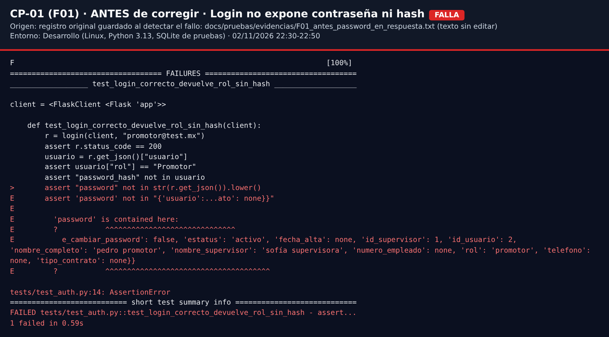

*CP-01 antes: salida original del fallo F01* — `docs/evidencias/CP-01_antes.png`<br>📄 **Origen:** Imagen generada a partir de un registro de texto original (no es captura de pantalla)

- **Causa:** La prueba buscaba la palabra "password" en toda la respuesta. Al agregar la bandera booleana `debe_cambiar_password` (cambio obligatorio de contraseña temporal) la palabra aparecía en el nombre del campo, aunque no había ninguna contraseña ni hash.
- **Archivo corregido:** `backend/tests/test_auth.py`
- **Fragmento antes:**

```
assert "password" not in str(r.get_json()).lower()
```
- **Fragmento después:**

```
assert "password" not in usuario
# ...
texto = r.get_data(as_text=True)
assert PASSWORD not in texto
# además se comprueba que el hash (completo o parcial) no aparece
```
- **Por qué ahora pasa:** Ahora se comprueba lo que exige el requisito (que la contraseña y su hash no viajen en la respuesta) y no el nombre de un campo booleano.

**Después de corregir** · el mismo caso, repetido en SQL Server

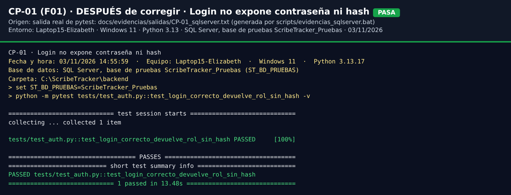

*CP-01 después: misma prueba en SQL Server* — `docs/evidencias/CP-01_despues.png`<br>📄 **Origen:** Imagen generada a partir de la salida de texto de pytest en SQL Server (no es captura de pantalla)


### CP-02 · Contraseña temporal obliga a cambiarla

| Campo | Detalle |
|---|---|
| Prueba | `backend/tests/test_usuarios.py::test_U10_contrasena_temporal_obliga_cambio` (U10 · La contraseña temporal obliga a cambiarla) |
| Requisito funcional | RF-03 (3.6) entrega de acceso; RNF-16 seguridad |
| Tipo de resultado | Fallo **F02** · **Defecto real del sistema** (error 500 al responder a un usuario con contraseña temporal). |
| Precondiciones | usuario recién creado con contraseña temporal |
| Datos de entrada | login con la temporal, consulta su inicio, cambia la contraseña y vuelve a consultar |
| Procedimiento | `set ST_BD_PRUEBAS=ScribeTracker_Pruebas` y `python -m pytest tests/test_usuarios.py::test_U10_contrasena_temporal_obliga_cambio -v` en `backend` |
| Resultado esperado | antes del cambio HTTP 403 (codigo cambiar_password); después HTTP 200 |
| Resultado obtenido | SQL Server (03/11/2026 14:56:19): **1 passed in 12.26s**<br>Ejecución conjunta en SQL Server (1 passed): HTTP 200 · Contraseña actualizada correctamente.<br>Detalle original (ejecución con SQLite): HTTP 200 · Contraseña actualizada correctamente. |
| Estado | Exitosa después de corregir (antes: fallida) |
| Entorno | Laptop15-Elizabeth · Windows 11 · Python 3.13 · **SQL Server**, base de pruebas `ScribeTracker_Pruebas`; el fallo original ocurrió en Entorno de desarrollo (Linux · Python 3.13 · **SQLite** de pruebas) |

**Código de la prueba**

```python
def test_U10_contrasena_temporal_obliga_cambio(app, esc, obs):
    """U10 · La contraseña temporal obliga a cambiarla
    RF: RF-03 (3.6) entrega de acceso; RNF-16 seguridad
    Tipo: válido / restricción
    Pre: usuario recién creado con contraseña temporal
    Entrada: login con la temporal, consulta su inicio, cambia la contraseña y vuelve a consultar
    Esperado: antes del cambio HTTP 403 (codigo cambiar_password); después HTTP 200
    """
    admin = cliente(app, "admin@test.mx")
    temporal = admin.post("/api/usuarios", json={**NUEVO, "id_supervisor": esc.ids.s1}).get_json()["acceso"]["password_temporal"]
    c = app.test_client()
    assert c.post("/api/auth/login", json={"correo": "ana@test.mx", "password": temporal}).status_code == 200
    assert c.get("/api/inicio/promotor").get_json()["codigo"] == "cambiar_password"
    r = obs(c.post("/api/auth/cambiar-password", json={"password_actual": temporal, "password_nueva": "NuevaClave2026"}))
    assert r.status_code == 200
    assert c.get("/api/inicio/promotor").status_code == 200
```

**Antes de corregir (F02)** · registro original del fallo

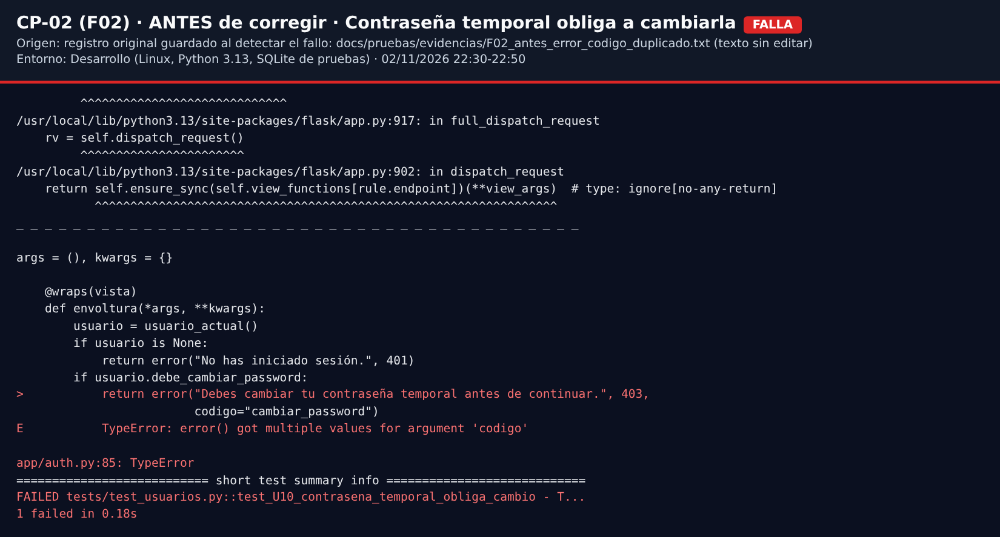

*CP-02 antes: salida original del fallo F02* — `docs/evidencias/CP-02_antes.png`<br>📄 **Origen:** Imagen generada a partir de un registro de texto original (no es captura de pantalla)

- **Causa:** `error(mensaje, codigo, **extra)` recibía el código HTTP como segundo parámetro llamado `codigo` y también el dato extra `codigo="cambiar_password"`: Python lanzaba `TypeError: got multiple values for argument 'codigo'`.
- **Archivo corregido:** `backend/app/auth.py`
- **Fragmento antes:**

```
def error(mensaje, codigo=400, **extra):
    ...
return error("Debes cambiar tu contraseña temporal antes de continuar.", 403,
             codigo="cambiar_password")
```
- **Fragmento después:**

```
def error(mensaje: str, http: int = 400, **extra):
    return jsonify(error=mensaje, **extra), http
```
- **Por qué ahora pasa:** El código HTTP ya no se llama igual que el dato extra, así que la respuesta 403 con `codigo: cambiar_password` se construye sin error y la prueba recibe lo esperado.

**Después de corregir** · el mismo caso, repetido en SQL Server

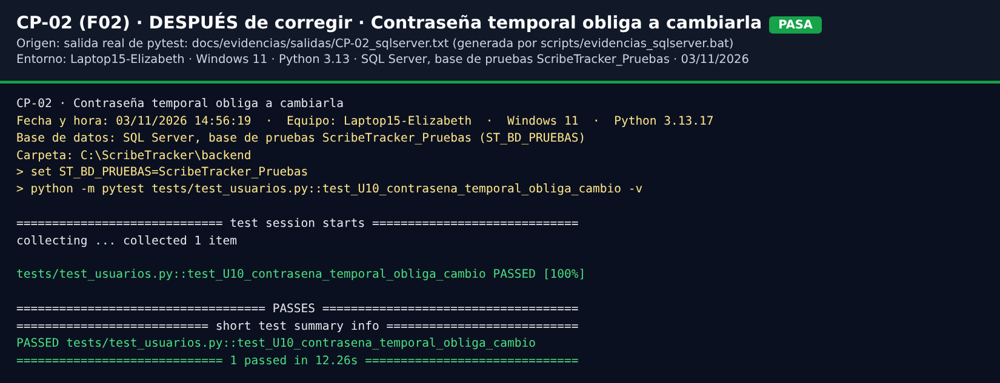

*CP-02 después: misma prueba en SQL Server* — `docs/evidencias/CP-02_despues.png`<br>📄 **Origen:** Imagen generada a partir de la salida de texto de pytest en SQL Server (no es captura de pantalla)


### CP-03 · Flujo completo de jornada con dos tiendas

| Campo | Detalle |
|---|---|
| Prueba | `backend/tests/test_jornada.py::test_J07_flujo_completo` (J07 · Flujo completo de la jornada con dos tiendas) |
| Requisito funcional | RF-01, RF-03, RF-04, RF-05, RF-06, RF-07 |
| Tipo de resultado | Fallo **F03** · Error en los datos de la prueba. El sistema aplicó correctamente la regla. |
| Precondiciones | P1 con Walmart y Soriana asignadas |
| Datos de entrada | iniciar, check-in, 4 fotos, check-out en cada tienda y finalizar sin forzar |
| Procedimiento | `set ST_BD_PRUEBAS=ScribeTracker_Pruebas` y `python -m pytest tests/test_jornada.py::test_J07_flujo_completo -v` en `backend` |
| Resultado esperado | jornada Finalizada sin cierre forzado; historial con 2 tiendas visitadas y 8 fotos |
| Resultado obtenido | SQL Server (03/11/2026 14:56:37): **1 passed in 16.88s**<br>Ejecución conjunta en SQL Server (1 passed): HTTP 200 · Jornada finalizada. El seguimiento de ubicación se detuvo.<br>Detalle original (ejecución con SQLite): HTTP 200 · Jornada finalizada. El seguimiento de ubicación se detuvo. |
| Estado | Exitosa después de corregir (antes: fallida) |
| Entorno | Laptop15-Elizabeth · Windows 11 · Python 3.13 · **SQL Server**, base de pruebas `ScribeTracker_Pruebas`; el fallo original ocurrió en Entorno de desarrollo (Linux · Python 3.13 · **SQLite** de pruebas) |

**Código de la prueba**

```python
def test_J07_flujo_completo(app, esc, obs):
    """J07 · Flujo completo de la jornada con dos tiendas
    RF: RF-01, RF-03, RF-04, RF-05, RF-06, RF-07
    Tipo: válido (integración)
    Pre: P1 con Walmart y Soriana asignadas
    Entrada: iniciar, check-in, 4 fotos, check-out en cada tienda y finalizar sin forzar
    Esperado: jornada Finalizada sin cierre forzado; historial con 2 tiendas visitadas y 8 fotos
    """
    c = _p1(app)
    _iniciar(c, esc)
    # Corrección F03: el check-in de la primera tienda estaba a las 08:00,
    # antes del inicio de jornada (08:05), y el servidor lo rechazó con
    # razón. Ahora la primera visita empieza a las 08:10.
    for idx, h in ((0, 8), (1, 11)):
        a_las(h, 10)
        idv = _checkin(c, esc, idx=idx, metros=5).get_json()["visita"]["id_visita"]
        _cuatro_fotos(c, esc, idv, idx=idx)
        a_las(h + 1, 40)
        assert c.post("/api/promotor/visitas/checkout", json={"id_visita": idv, **punto(esc.coords[idx])}).status_code == 200
    a_las(17, 0)
    r = obs(c.post("/api/promotor/jornada/finalizar", json=punto(esc.coords[1])))
    assert r.status_code == 200 and r.get_json()["jornada"]["cierre_forzado"] is False
    h = c.get("/api/promotor/historial?fecha=2026-11-04").get_json()["resumen"]
    assert h["tiendas_visitadas"] == 2 and h["fotos"] == 8 and h["minutos_en_tienda"] == 180
```

**Antes de corregir (F03)** · registro original del fallo

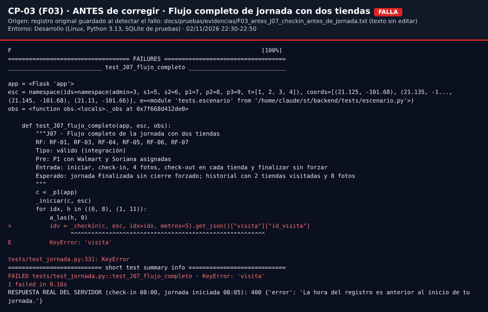

*CP-03 antes: salida original del fallo F03* — `docs/evidencias/CP-03_antes.png`<br>📄 **Origen:** Imagen generada a partir de un registro de texto original (no es captura de pantalla)

- **Causa:** La prueba registraba el primer check-in a las 08:00, antes del inicio de jornada (08:05). El servidor lo rechazó con 400 "La hora del registro es anterior al inicio de tu jornada", que es el comportamiento correcto.
- **Archivo corregido:** `backend/tests/test_jornada.py`
- **Fragmento antes:**

```
for idx, h in ((0, 8), (1, 11)):
    a_las(h, 0)
```
- **Fragmento después:**

```
for idx, h in ((0, 8), (1, 11)):
    a_las(h, 10)
```
- **Por qué ahora pasa:** Con horas coherentes (check-in 08:10, después del inicio) el flujo completo llega hasta el cierre sin forzar.

**Después de corregir** · el mismo caso, repetido en SQL Server

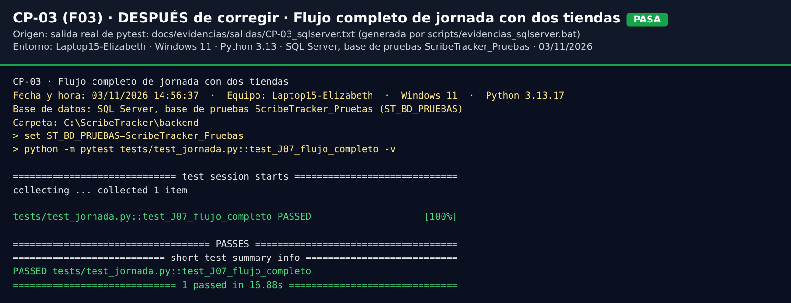

*CP-03 después: misma prueba en SQL Server* — `docs/evidencias/CP-03_despues.png`<br>📄 **Origen:** Imagen generada a partir de la salida de texto de pytest en SQL Server (no es captura de pantalla)


### CP-04 · Mapa y alcance del supervisor

| Campo | Detalle |
|---|---|
| Prueba | `backend/tests/test_supervision_reportes.py::test_S01_mapa_y_alcance_supervisor` (S01 · Mapa con última ubicación y estados separados, limitado al ámbito) |
| Requisito funcional | RF-10 Mapa en tiempo real; RF-02; estados de cuenta, jornada, visita y conexión |
| Tipo de resultado | Fallo **F04** · Error en el diseño de la prueba. |
| Precondiciones | P1 en tienda (visita abierta); P2 sin jornada; P3 pertenece a S2 |
| Datos de entrada | S1 consulta /api/supervision/mapa; admin consulta el mismo |
| Procedimiento | `set ST_BD_PRUEBAS=ScribeTracker_Pruebas` y `python -m pytest tests/test_supervision_reportes.py::test_S01_mapa_y_alcance_supervisor -v` en `backend` |
| Resultado esperado | S1 ve P1 y P2 (no P3), P1 "En tienda" con ubicación reciente; admin ve a los 3 |
| Resultado obtenido | SQL Server (03/11/2026 14:57:00): **1 passed in 14.98s**<br>Ejecución conjunta en SQL Server (1 passed): HTTP 200 · <br>Detalle original (ejecución con SQLite): HTTP 200 ·  |
| Estado | Exitosa después de corregir (antes: fallida) |
| Entorno | Laptop15-Elizabeth · Windows 11 · Python 3.13 · **SQL Server**, base de pruebas `ScribeTracker_Pruebas`; el fallo original ocurrió en Entorno de desarrollo (Linux · Python 3.13 · **SQLite** de pruebas) |

**Código de la prueba**

```python
def test_S01_mapa_y_alcance_supervisor(app, esc, obs):
    """S01 · Mapa con última ubicación y estados separados, limitado al ámbito
    RF: RF-10 Mapa en tiempo real; RF-02; estados de cuenta, jornada, visita y conexión
    Tipo: válido / alcance
    Pre: P1 en tienda (visita abierta); P2 sin jornada; P3 pertenece a S2
    Entrada: S1 consulta /api/supervision/mapa; admin consulta el mismo
    Esperado: S1 ve P1 y P2 (no P3), P1 "En tienda" con ubicación reciente; admin ve a los 3
    """
    _jornada_con_visita(app, esc, cerrar=False)
    r = obs(cliente(app, "s1@test.mx").get("/api/supervision/mapa"))
    ps = {p["numero_empleado"]: p for p in r.get_json()["promotores"]}
    assert set(ps) == {"P1", "P2"}
    p1 = ps["P1"]
    assert (p1["estado_cuenta"], p1["estado_jornada"], p1["estado_visita"], p1["estado_conexion"]) == \
           ("Activo", "En jornada", "En tienda", "Reciente")
    assert p1["ultima_ubicacion"]["fecha_hora"].startswith("2026-11-04T08:05")
    assert ps["P2"]["estado_jornada"] == "Sin jornada"
    admin = cliente(app, "admin@test.mx").get("/api/supervision/mapa").get_json()
    # Corrección F04: los datos base de la etapa 1 incluyen a "Pedro
    # Promotor" (activo, sin número de empleado); el administrador también
    # lo ve. Se verifica que vea a todos los promotores activos.
    assert {p["nombre_completo"] for p in admin["promotores"]} == {
        "Marco Promotor", "Julieta Promotora", "Pablo Promotor", "Pedro Promotor"}
```

**Antes de corregir (F04)** · registro original del fallo

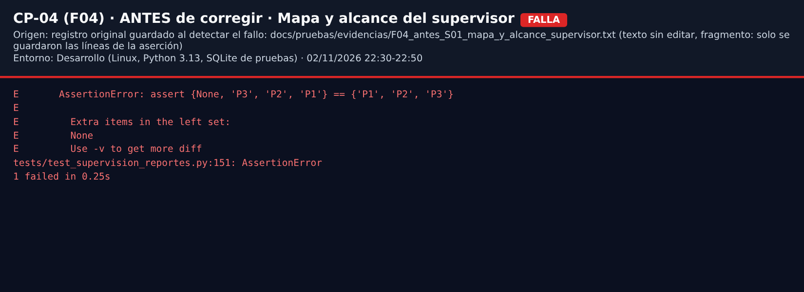

*CP-04 antes: salida original del fallo F04* — `docs/evidencias/CP-04_antes.png`<br>📄 **Origen:** Imagen generada a partir de un registro de texto original (no es captura de pantalla)

- **Causa:** Se esperaban 3 promotores para el administrador, pero la base de la etapa 1 incluye a "Pedro Promotor" (activo, sin número de empleado). El sistema devolvía correctamente 4.
- **Archivo corregido:** `backend/tests/test_supervision_reportes.py`
- **Fragmento antes:**

```
(no se conservó el fragmento; el registro original muestra la comparación con {'P1', 'P2', 'P3'})
```
- **Fragmento después:**

```
assert {p["nombre_completo"] for p in admin["promotores"]} == { ...los 4 promotores activos... }
```
- **Por qué ahora pasa:** La prueba compara ahora los nombres de todos los promotores activos que existen en el escenario.

**Después de corregir** · el mismo caso, repetido en SQL Server

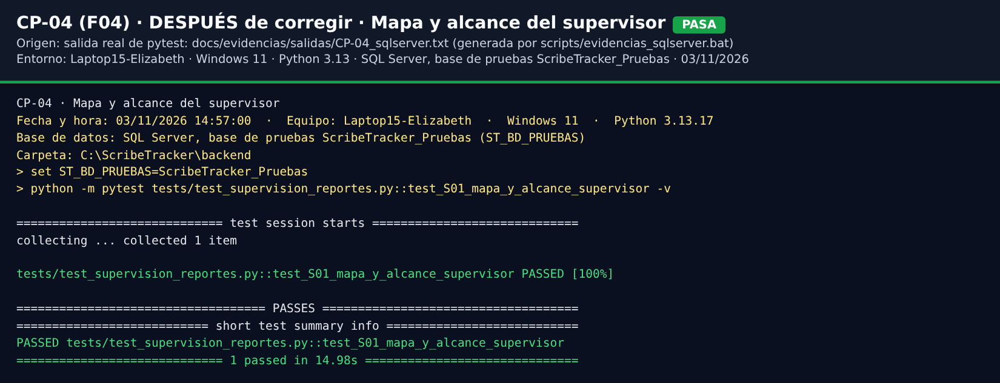

*CP-04 después: misma prueba en SQL Server* — `docs/evidencias/CP-04_despues.png`<br>📄 **Origen:** Imagen generada a partir de la salida de texto de pytest en SQL Server (no es captura de pantalla)


### CP-05 · Ubicación reciente y desactualizada

| Campo | Detalle |
|---|---|
| Prueba | `backend/tests/test_supervision_reportes.py::test_S02_ubicacion_desactualizada` (S02 · Diferenciar ubicación reciente de desactualizada) |
| Requisito funcional | RF-10; excepción del modelo de diseño (promotor sin señal se muestra como desconectado) |
| Tipo de resultado | Fallo **F05** · Error en el diseño de la prueba. |
| Precondiciones | P1 inició a las 08:05 y no envía ubicaciones; parámetro ubicacion_reciente_min = 20 |
| Datos de entrada | S1 consulta el mapa a las 08:20 y a las 08:40 |
| Procedimiento | `set ST_BD_PRUEBAS=ScribeTracker_Pruebas` y `python -m pytest tests/test_supervision_reportes.py::test_S02_ubicacion_desactualizada -v` en `backend` |
| Resultado esperado | 08:20 "Reciente"; 08:40 "Desactualizada" y cuenta como desconectado |
| Resultado obtenido | SQL Server (03/11/2026 14:57:21): **1 passed in 13.12s**<br>Ejecución conjunta en SQL Server (1 passed): HTTP 200 · <br>Detalle original (ejecución con SQLite): HTTP 200 ·  |
| Estado | Exitosa después de corregir (antes: fallida) |
| Entorno | Laptop15-Elizabeth · Windows 11 · Python 3.13 · **SQL Server**, base de pruebas `ScribeTracker_Pruebas`; el fallo original ocurrió en Entorno de desarrollo (Linux · Python 3.13 · **SQLite** de pruebas) |

**Código de la prueba**

```python
def test_S02_ubicacion_desactualizada(app, esc, obs):
    """S02 · Diferenciar ubicación reciente de desactualizada
    RF: RF-10; excepción del modelo de diseño (promotor sin señal se muestra como desconectado)
    Tipo: válido
    Pre: P1 inició a las 08:05 y no envía ubicaciones; parámetro ubicacion_reciente_min = 20
    Entrada: S1 consulta el mapa a las 08:20 y a las 08:40
    Esperado: 08:20 "Reciente"; 08:40 "Desactualizada" y cuenta como desconectado
    """
    c = cliente(app, "p1@test.mx")
    c.post("/api/promotor/jornada/iniciar", json=punto(esc.coords[0]))
    s1 = cliente(app, "s1@test.mx")
    a_las(8, 20)
    # Corrección F05: la lista viene ordenada por nombre (Julieta antes que
    # Marco); se busca a P1 por su número en lugar de tomar la posición 0.
    p1 = [p for p in s1.get("/api/supervision/mapa").get_json()["promotores"] if p["numero_empleado"] == "P1"][0]
    assert p1["estado_conexion"] == "Reciente"
    a_las(8, 40)
    r = obs(s1.get("/api/supervision/mapa"))
    p1 = [p for p in r.get_json()["promotores"] if p["numero_empleado"] == "P1"][0]
    assert p1["estado_conexion"] == "Desactualizada" and r.get_json()["resumen"]["Desconectados"] == 1
```

**Antes de corregir (F05)** · registro original del fallo

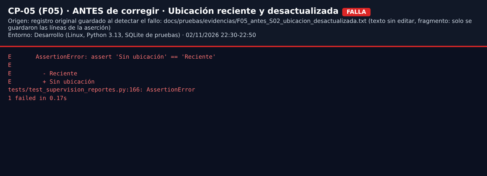

*CP-05 antes: salida original del fallo F05* — `docs/evidencias/CP-05_antes.png`<br>📄 **Origen:** Imagen generada a partir de un registro de texto original (no es captura de pantalla)

- **Causa:** La prueba tomaba el primer promotor de la lista suponiendo que era P1, pero la lista se ordena por nombre.
- **Archivo corregido:** `backend/tests/test_supervision_reportes.py`
- **Fragmento antes:**

```
(no se conservó el fragmento; la prueba tomaba el primer elemento de la lista)
```
- **Fragmento después:**

```
p1 = [p for p in ...["promotores"] if p["numero_empleado"] == "P1"][0]
assert p1["estado_conexion"] == "Reciente"
```
- **Por qué ahora pasa:** El promotor se busca por su número de empleado, sin depender del orden.

**Después de corregir** · el mismo caso, repetido en SQL Server

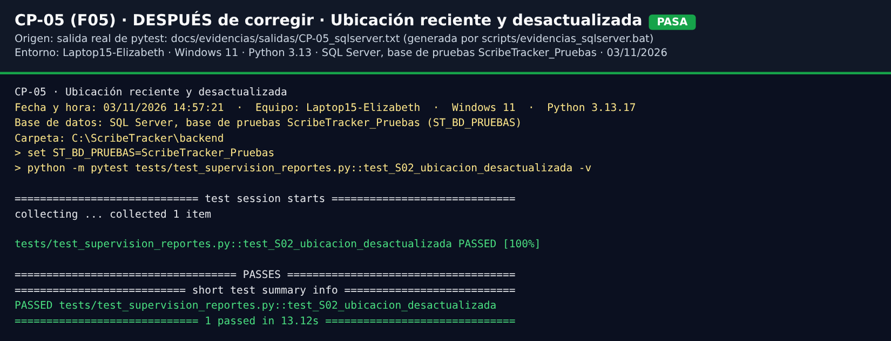

*CP-05 después: misma prueba en SQL Server* — `docs/evidencias/CP-05_despues.png`<br>📄 **Origen:** Imagen generada a partir de la salida de texto de pytest en SQL Server (no es captura de pantalla)


### CP-06 · Exportar reporte de exhibición a PDF

| Campo | Detalle |
|---|---|
| Prueba | `backend/tests/test_supervision_reportes.py::test_REP02_pdf_y_permisos` (REP02 · Exportar reporte de exhibición a PDF con evidencias y permisos) |
| Requisito funcional | RF-16 Exportar reportes (PDF); entrevista P26 (imágenes de anaquel, precios y promociones) |
| Tipo de resultado | Fallo **F06** · **Defecto real del sistema** (error 500 al exportar el PDF si una foto estaba dañada). |
| Precondiciones | P1 con visita cerrada y 4 fotos (imágenes de prueba no decodificables) |
| Datos de entrada | S1 genera reporte Semanal de Exhibición y descarga el PDF; S2 intenta descargarlo; S1 pide reporte de P3 |
| Procedimiento | `set ST_BD_PRUEBAS=ScribeTracker_Pruebas` y `python -m pytest tests/test_supervision_reportes.py::test_REP02_pdf_y_permisos -v` en `backend` |
| Resultado esperado | PDF válido (%PDF); S2 recibe 404; reporte de P3 → 404 |
| Resultado obtenido | SQL Server (03/11/2026 14:57:39): **1 passed, 1 warning in 12.96s**<br>Ejecución conjunta en SQL Server (1 passed): HTTP 201 · Reporte generado. · PDF: HTTP 200, 3345 bytes, tipo application/pdf<br>Detalle original (ejecución con SQLite): HTTP 201 · Reporte generado. · PDF: HTTP 200, 3303 bytes, tipo application/pdf |
| Estado | Exitosa después de corregir (antes: fallida) |
| Entorno | Laptop15-Elizabeth · Windows 11 · Python 3.13 · **SQL Server**, base de pruebas `ScribeTracker_Pruebas`; el fallo original ocurrió en Entorno de desarrollo (Linux · Python 3.13 · **SQLite** de pruebas) |

**Código de la prueba**

```python
def test_REP02_pdf_y_permisos(app, esc, obs):
    """REP02 · Exportar reporte de exhibición a PDF con evidencias y permisos
    RF: RF-16 Exportar reportes (PDF); entrevista P26 (imágenes de anaquel, precios y promociones)
    Tipo: válido / no autorizado
    Pre: P1 con visita cerrada y 4 fotos (imágenes de prueba no decodificables)
    Entrada: S1 genera reporte Semanal de Exhibición y descarga el PDF; S2 intenta descargarlo; S1 pide reporte de P3
    Esperado: PDF válido (%PDF); S2 recibe 404; reporte de P3 → 404
    """
    _jornada_con_visita(app, esc)
    s1 = cliente(app, "s1@test.mx")
    r = s1.post("/api/reportes", json={"tipo": "Semanal", "contenido": "Exhibición", "fecha": "2026-11-04"})
    assert r.status_code == 201 and r.get_json()["metricas"]["desde"] == "2026-11-02"
    idr = r.get_json()["reporte"]["id_reporte"]
    pdf = s1.get(f"/api/reportes/{idr}/pdf")
    obs(r, extra=f"PDF: HTTP {pdf.status_code}, {len(pdf.data)} bytes, tipo {pdf.mimetype}")
    assert pdf.status_code == 200 and pdf.data[:4] == b"%PDF" and pdf.mimetype == "application/pdf"
    assert cliente(app, "s2@test.mx").get(f"/api/reportes/{idr}/pdf").status_code == 404
    assert s1.post("/api/reportes", json={"tipo": "Diario", "fecha": "2026-11-04",
                                          "id_promotor": esc.ids.p3}).status_code == 404
```

**Antes de corregir (F06)** · registro original del fallo

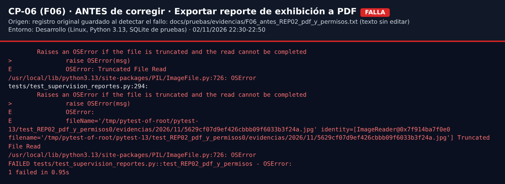

*CP-06 antes: salida original del fallo F06* — `docs/evidencias/CP-06_antes.png`<br>📄 **Origen:** Imagen generada a partir de un registro de texto original (no es captura de pantalla)

- **Causa:** reportlab abre las imágenes al construir el documento; una sola foto truncada lanzaba `OSError: Truncated File Read` y el PDF completo fallaba.
- **Archivo corregido:** `backend/app/servicios/reportes.py`
- **Fragmento antes:**

```
Image(ruta, width=ancho, height=alto, kind="proportional")   # sin verificar el archivo
```
- **Fragmento después:**

```
def _imagen_segura(ruta, Image, ancho, alto):
    if not ruta or not os.path.isfile(ruta):
        return None
    try:
        from PIL import Image as PILImage
        with PILImage.open(ruta) as im:
            im.load()
        return Image(ruta, width=ancho, height=alto, kind="proportional")
    except Exception:
        return None
```
- **Por qué ahora pasa:** Cada imagen se valida con Pillow antes de incluirla; la dañada se omite y el resto del PDF se genera.

**Después de corregir** · el mismo caso, repetido en SQL Server

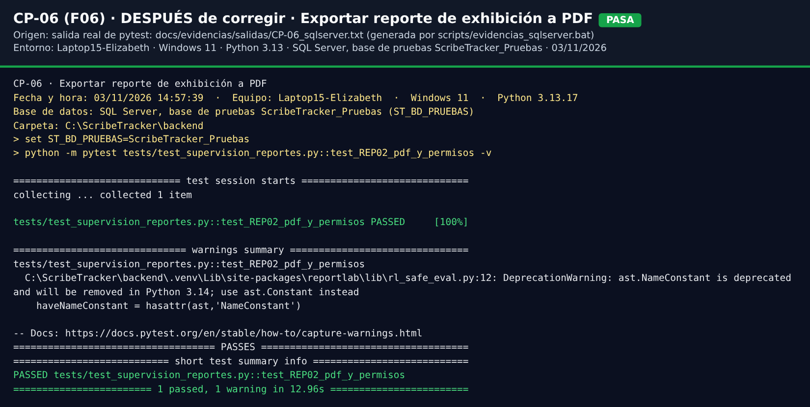

*CP-06 después: misma prueba en SQL Server* — `docs/evidencias/CP-06_despues.png`<br>📄 **Origen:** Imagen generada a partir de la salida de texto de pytest en SQL Server (no es captura de pantalla)


### CP-07 · Sincronización de eventos sin conexión (Angular)

| Campo | Detalle |
|---|---|
| Prueba | E2E-OFF01 (manual en el navegador, registrada en texto) |
| Requisito funcional | RNF-08 / RNF-09 Funcionamiento y almacenamiento sin conexión; RF-03 Check-in; RF-05 Evidencias |
| Tipo de resultado | Fallo **F07** · **Defecto real del sistema** (la cola sin conexión dejaba de reintentar). |
| Precondiciones | promotor.prueba con jornada abierta; sesión iniciada en el navegador de la laptop |
| Datos de entrada | Sin red simulada: check-in en Soriana San Juan Bosco y foto "Anaquel antes"; luego se restaura la red |
| Procedimiento | DevTools → Network → Offline; CHECK-IN y foto; volver a Online; esperar 6 s y revisar la interfaz, `/api/promotor/hoy` e IndexedDB |
| Resultado esperado | Los 2 eventos se envían solos al volver la señal; el servidor los valida y guarda con origen "Sin conexión" y su hora de captura; 0 pendientes |
| Resultado obtenido (antes) | "2 pendiente(s) de sincronizar"; la visita de Soriana no llegó al servidor (null); 1 intento por evento, sin reintentos |
| Resultado obtenido (después) | 0 pendientes; visita de Soriana "Abierta", origen "Sin conexión", foto válida con hora de captura y de recepción; sin duplicados |
| Estado | Exitosa después de corregir (antes: fallida) |
| Entorno | Laptop15-Elizabeth · navegador integrado + Flask + **SQL Server real** `ScribeTracker` (02/11/2026 23:24-23:25). Verificación repetida hoy con el build de producción en desarrollo (SQLite) |

**Código que se probó** (`frontend/src/app/core/cola.service.ts`, método `sincronizar`)

```ts
sincronizar(): Promise<void> {
  if (this.enCurso) return this.enCurso;
  const ejecucion = (async () => { ... })();
  this.enCurso = ejecucion;
  void ejecucion.finally(() => { if (this.enCurso === ejecucion) this.enCurso = null; });
  return ejecucion;
}
```

**Antes de corregir (F07)** · registro original

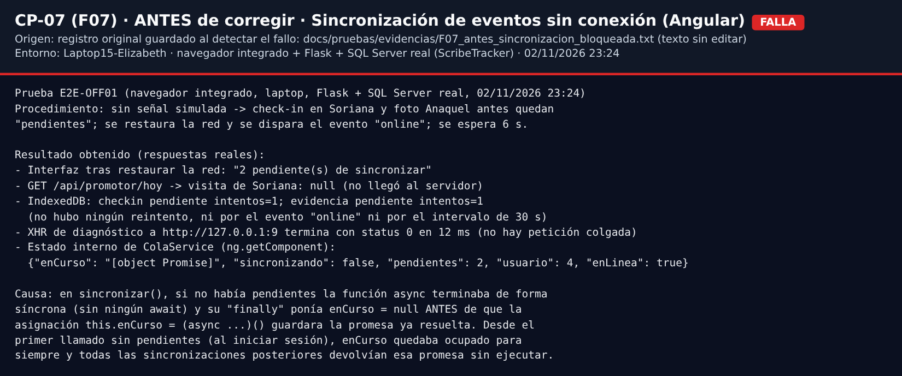

*CP-07 antes: registro original de E2E-OFF01* — `docs/evidencias/CP-07_antes.png`<br>📄 **Origen:** Imagen generada a partir de un registro de texto original (no es captura de pantalla)

- **Causa:** En `sincronizar()`, sin pendientes la función terminaba sin ningún `await` y su `finally` ponía `enCurso = null` antes de que se guardara la promesa. `enCurso` quedaba ocupado para siempre y ninguna sincronización posterior se ejecutaba.
- **Archivo corregido:** `frontend/src/app/core/cola.service.ts`
- **Fragmento antes:**

```ts
async sincronizar() {
  if (this.enCurso) return this.enCurso;
  this.enCurso = (async () => {
    try { ... } finally { this.enCurso = null; }
  })();
  return this.enCurso;
}
```
- **Fragmento después:**

```ts
sincronizar(): Promise<void> {
  if (this.enCurso) return this.enCurso;
  const ejecucion = (async () => { ... })();
  this.enCurso = ejecucion;
  void ejecucion.finally(() => { if (this.enCurso === ejecucion) this.enCurso = null; });
  return ejecucion;
}
```
- **Por qué ahora pasa:** `enCurso` solo se limpia cuando termina la misma ejecución que se guardó, así que cada evento "online" o el intervalo de 30 s vuelven a sincronizar.

**Después de corregir** · mismo caso en la laptop (registro) y repetido hoy (capturas)

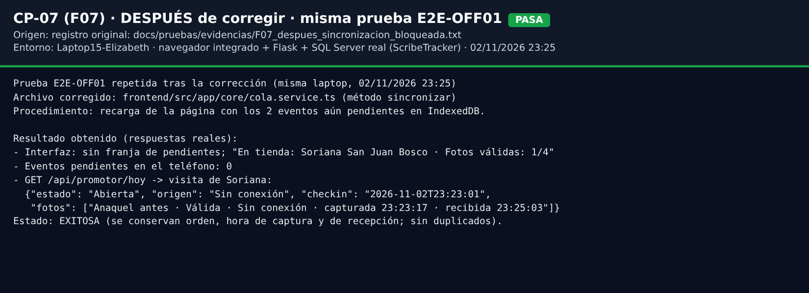

*CP-07 después: registro original en la laptop con SQL Server* — `docs/evidencias/CP-07_despues_registro.png`<br>📄 **Origen:** Imagen generada a partir de un registro de texto original (no es captura de pantalla)

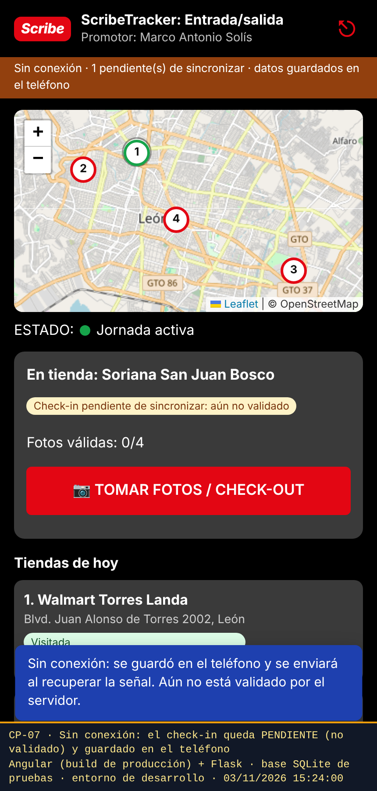

*CP-07 después (repetido hoy): sin señal, check-in pendiente* — `docs/evidencias/CP-07_despues_1_sin_conexion.png`<br>🖥️ **Origen:** Captura de pantalla real (Chromium automatizado) · SQLite de pruebas, desarrollo

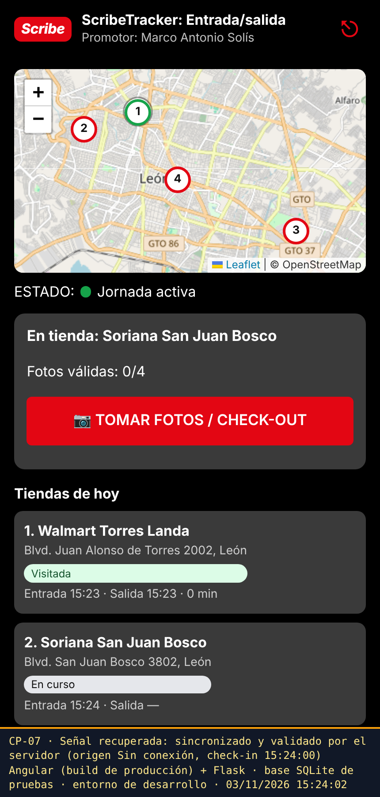

*CP-07 después (repetido hoy): señal recuperada, sincronizado y validado* — `docs/evidencias/CP-07_despues_2_sincronizado.png`<br>🖥️ **Origen:** Captura de pantalla real (Chromium automatizado) · SQLite de pruebas, desarrollo


### CP-08 · Acceso por rol (matriz de permisos)

| Campo | Detalle |
|---|---|
| Prueba | `backend/tests/test_auth.py::test_matriz_de_permisos` (etapa 1, sin docstring; campos tomados del código) |
| Requisito funcional | RF-01 (3.6); RNF-16 Control de acceso por rol (comprobado en el servidor) |
| Tipo de resultado | **Flujo válido y rechazos esperados** (válido e inválido (9 combinaciones)) |
| Precondiciones | Un usuario Activo por rol: Promotor, Supervisor y Administrador |
| Datos de entrada | Cada rol inicia sesión y pide la pantalla inicial de cada uno de los 3 roles (/api/inicio/<rol>) |
| Procedimiento | `set ST_BD_PRUEBAS=ScribeTracker_Pruebas` y `python -m pytest tests/test_auth.py::test_matriz_de_permisos -v` en `backend` |
| Resultado esperado | HTTP 200 solo en la pantalla de su propio rol; HTTP 403 en las otras 2 (6 de 9 combinaciones son rechazos esperados) |
| Resultado obtenido | SQL Server (03/11/2026 14:57:57): **9 passed in 67.89s (0:01:07)**<br>Ejecución conjunta en SQL Server (9 passed): (la prueba no registra detalle HTTP; solo aserciones) |
| Estado | Exitosa |
| Entorno | Laptop15-Elizabeth · Windows 11 · Python 3.13 · **SQL Server**, base de pruebas `ScribeTracker_Pruebas` |

**Código de la prueba**

```python
@pytest.mark.parametrize("rol_usuario", list(ACCESOS))
@pytest.mark.parametrize("rol_ruta", list(RUTAS))
def test_matriz_de_permisos(client, rol_usuario, rol_ruta):
    login(client, ACCESOS[rol_usuario])
    esperado = 200 if rol_usuario == rol_ruta else 403
    assert client.get(RUTAS[rol_ruta]).status_code == esperado
```

**Evidencia**

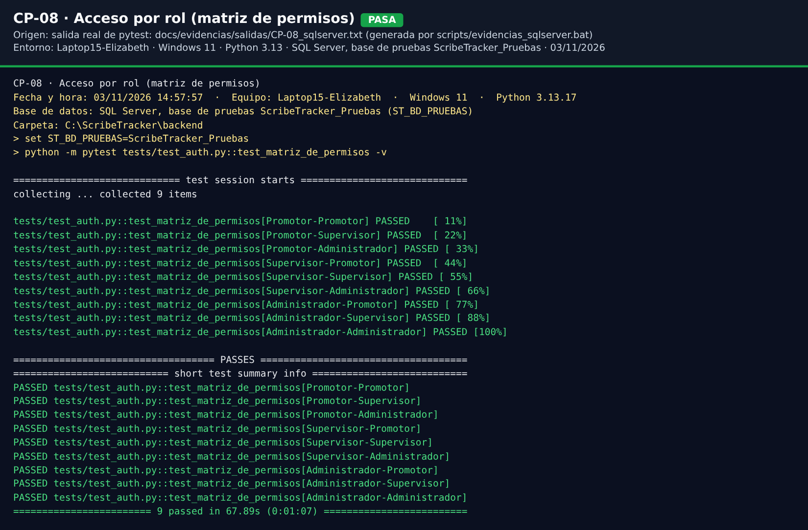

*CP-08: salida real en SQL Server* — `docs/evidencias/CP-08_resultado.png`<br>📄 **Origen:** Imagen generada a partir de la salida de texto de pytest en SQL Server (no es captura de pantalla)


### CP-09 · Rechazo de cuenta inactiva

| Campo | Detalle |
|---|---|
| Prueba | `backend/tests/test_auth.py::test_usuario_inactivo_no_entra` (etapa 1, sin docstring; campos tomados del código) |
| Requisito funcional | RF-01 (3.6) Inicio de sesión: estatus Activo; RF-06 Baja lógica |
| Tipo de resultado | **Rechazo esperado**: la prueba pasa porque el servidor rechaza la acción inválida (inválido) |
| Precondiciones | Usuario inactivo@test.mx con estatus Inactivo y contraseña correcta |
| Datos de entrada | POST /api/auth/login con la contraseña correcta |
| Procedimiento | `set ST_BD_PRUEBAS=ScribeTracker_Pruebas` y `python -m pytest tests/test_auth.py::test_usuario_inactivo_no_entra -v` en `backend` |
| Resultado esperado | HTTP 403 con mensaje de cuenta inactiva; no se crea sesión (/api/auth/me responde 401) |
| Resultado obtenido | SQL Server (03/11/2026 14:59:10): **1 passed in 10.62s**<br>Ejecución conjunta en SQL Server (1 passed): (la prueba no registra detalle HTTP; solo aserciones) |
| Estado | Exitosa |
| Entorno | Laptop15-Elizabeth · Windows 11 · Python 3.13 · **SQL Server**, base de pruebas `ScribeTracker_Pruebas` |

**Código de la prueba**

```python
def test_usuario_inactivo_no_entra(client):
    r = login(client, "inactivo@test.mx")
    assert r.status_code == 403
    assert "inactiva" in r.get_json()["error"]
    assert client.get("/api/auth/me").status_code == 401
```

**Evidencia**

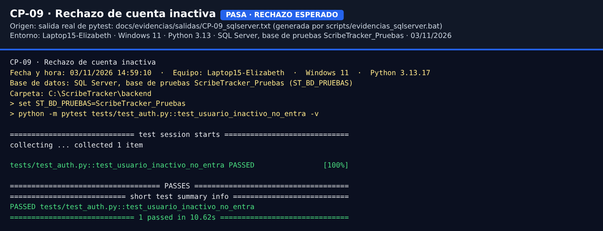

*CP-09: salida real en SQL Server* — `docs/evidencias/CP-09_resultado.png`<br>📄 **Origen:** Imagen generada a partir de la salida de texto de pytest en SQL Server (no es captura de pantalla)

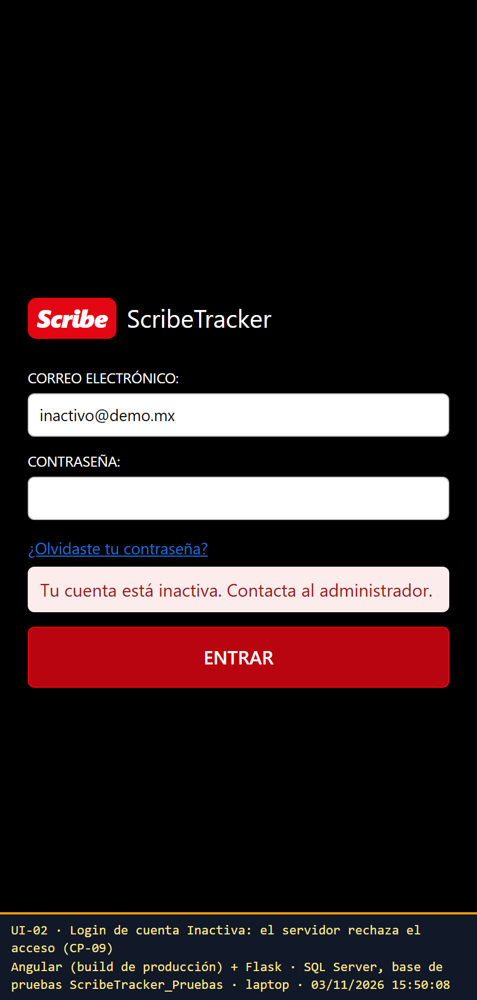

*UI-02 · Login de cuenta Inactiva: el servidor rechaza el acceso (CP-09) (interfaz con SQL Server)* — `docs/evidencias/sqlserver/UI-02_cuenta_inactiva.png`<br>🖥️ **Origen:** Captura de pantalla real (Chromium automatizado) · SQL Server ScribeTracker_Pruebas, laptop

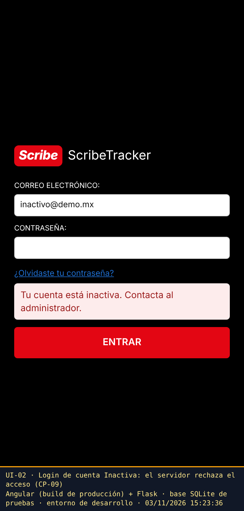

*UI-02 · Login de cuenta Inactiva: el servidor rechaza el acceso (CP-09) (interfaz, SQLite de desarrollo, original)* — `docs/evidencias/UI-02_cuenta_inactiva.png`<br>🖥️ **Origen:** Captura de pantalla real (Chromium automatizado) · SQLite de pruebas, desarrollo


### CP-10 · Petición manipulada: solo el administrador registra usuarios

| Campo | Detalle |
|---|---|
| Prueba | `backend/tests/test_usuarios.py::test_U05_solo_admin_gestiona` (U05 · Supervisor y promotor no pueden registrar usuarios) |
| Requisito funcional | RF-03 (3.6); RNF-16 control de acceso por rol |
| Tipo de resultado | **Rechazo esperado**: la prueba pasa porque el servidor rechaza la acción inválida (no autorizado) |
| Precondiciones | sesiones de Supervisor S1 y Promotor P1 |
| Datos de entrada | POST /api/usuarios con datos válidos (petición manipulada) |
| Procedimiento | `set ST_BD_PRUEBAS=ScribeTracker_Pruebas` y `python -m pytest tests/test_usuarios.py::test_U05_solo_admin_gestiona -v` en `backend` |
| Resultado esperado | HTTP 403 en ambos casos |
| Resultado obtenido | SQL Server (03/11/2026 14:59:27): **1 passed in 11.02s**<br>Ejecución conjunta en SQL Server (1 passed): HTTP 403 · No tienes permiso para esta sección.<br>Detalle original (ejecución con SQLite): HTTP 403 · No tienes permiso para esta sección. |
| Estado | Exitosa |
| Entorno | Laptop15-Elizabeth · Windows 11 · Python 3.13 · **SQL Server**, base de pruebas `ScribeTracker_Pruebas` |

**Código de la prueba**

```python
def test_U05_solo_admin_gestiona(app, esc, obs):
    """U05 · Supervisor y promotor no pueden registrar usuarios
    RF: RF-03 (3.6); RNF-16 control de acceso por rol
    Tipo: no autorizado
    Pre: sesiones de Supervisor S1 y Promotor P1
    Entrada: POST /api/usuarios con datos válidos (petición manipulada)
    Esperado: HTTP 403 en ambos casos
    """
    for correo in ("s1@test.mx", "p1@test.mx"):
        r = obs(cliente(app, correo).post("/api/usuarios", json={**NUEVO, "id_supervisor": esc.ids.s1}))
        assert r.status_code == 403
```

**Evidencia**

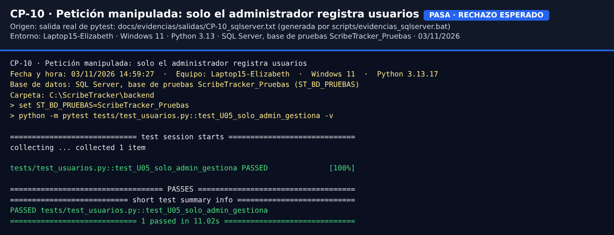

*CP-10: salida real en SQL Server* — `docs/evidencias/CP-10_resultado.png`<br>📄 **Origen:** Imagen generada a partir de la salida de texto de pytest en SQL Server (no es captura de pantalla)

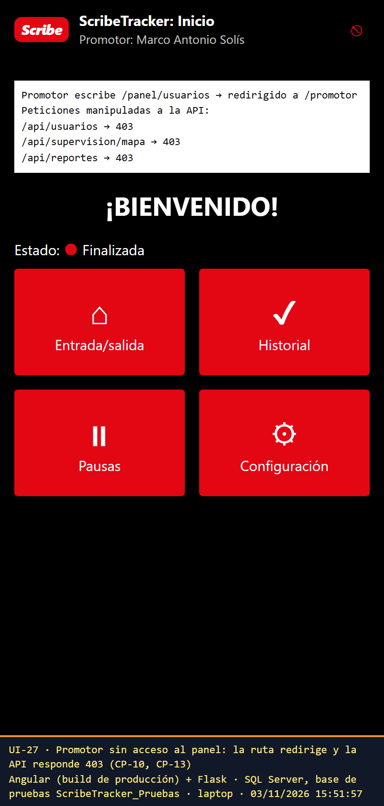

*UI-27 · Promotor sin acceso al panel: la ruta redirige y la API responde 403 (CP-10, CP-13) (interfaz con SQL Server)* — `docs/evidencias/sqlserver/UI-27_permisos_promotor.png`<br>🖥️ **Origen:** Captura de pantalla real (Chromium automatizado) · SQL Server ScribeTracker_Pruebas, laptop

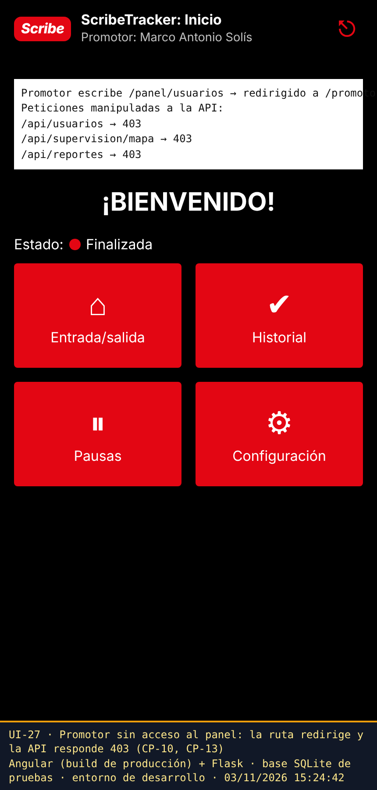

*UI-27 · Promotor sin acceso al panel: la ruta redirige y la API responde 403 (CP-10, CP-13) (interfaz, SQLite de desarrollo, original)* — `docs/evidencias/UI-27_permisos_promotor.png`<br>🖥️ **Origen:** Captura de pantalla real (Chromium automatizado) · SQLite de pruebas, desarrollo


### CP-11 · Campos obligatorios en el alta de usuarios

| Campo | Detalle |
|---|---|
| Prueba | `backend/tests/test_usuarios.py::test_U02_campos_obligatorios` (U02 · Alta rechazada por campos obligatorios vacíos) |
| Requisito funcional | RF-03 (3.6); RF-23 Mensajes de error |
| Tipo de resultado | **Rechazo esperado**: la prueba pasa porque el servidor rechaza la acción inválida (inválido) |
| Precondiciones | sesión de Administrador |
| Datos de entrada | formulario vacío |
| Procedimiento | `set ST_BD_PRUEBAS=ScribeTracker_Pruebas` y `python -m pytest tests/test_usuarios.py::test_U02_campos_obligatorios -v` en `backend` |
| Resultado esperado | HTTP 400 con mensaje por campo (nombre, correo, teléfono, número de empleado, rol) |
| Resultado obtenido | SQL Server (03/11/2026 14:59:43): **1 passed in 11.20s**<br>Ejecución conjunta en SQL Server (1 passed): HTTP 400 · Revisa los campos marcados. · {'campos': {'correo_electronico': 'Escribe un correo electrónico válido.', 'nombre_completo': 'El nombre completo es obligatorio.', 'numero_empleado': 'El número de empleado es obligatorio (letras, números o guiones).', 'rol': 'Selecciona un rol válido.', 'telefono': 'El teléfono es obligatorio (10 a 15 dígitos).'}}<br>Detalle original (ejecución con SQLite): HTTP 400 · Revisa los campos marcados. · {'campos': {'correo_electronico': 'Escribe un correo electrónico válido.', 'nombre_completo': 'El nombre completo es obligatorio.', 'numero_empleado': 'El número de empleado es obligatorio (letras, números o guiones).', 'rol': 'Selecciona un rol válido.', 'telefono': 'El teléfono es obligatorio (10 a 15 dígitos).'}} |
| Estado | Exitosa |
| Entorno | Laptop15-Elizabeth · Windows 11 · Python 3.13 · **SQL Server**, base de pruebas `ScribeTracker_Pruebas` |

**Código de la prueba**

```python
def test_U02_campos_obligatorios(app, esc, obs):
    """U02 · Alta rechazada por campos obligatorios vacíos
    RF: RF-03 (3.6); RF-23 Mensajes de error
    Tipo: inválido
    Pre: sesión de Administrador
    Entrada: formulario vacío
    Esperado: HTTP 400 con mensaje por campo (nombre, correo, teléfono, número de empleado, rol)
    """
    c = cliente(app, "admin@test.mx")
    r = obs(c.post("/api/usuarios", json={}))
    assert r.status_code == 400
    assert set(r.get_json()["campos"]) >= {"nombre_completo", "correo_electronico", "telefono", "numero_empleado", "rol"}
```

**Evidencia**

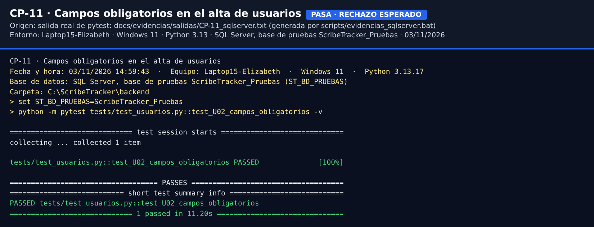

*CP-11: salida real en SQL Server* — `docs/evidencias/CP-11_resultado.png`<br>📄 **Origen:** Imagen generada a partir de la salida de texto de pytest en SQL Server (no es captura de pantalla)

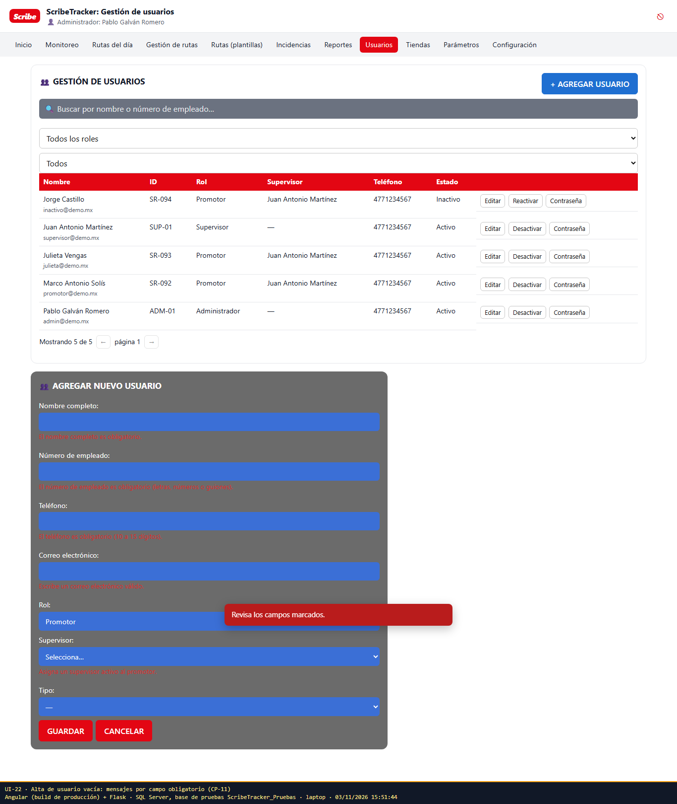

*UI-22 · Alta de usuario vacía: mensajes por campo obligatorio (CP-11) (interfaz con SQL Server)* — `docs/evidencias/sqlserver/UI-22_alta_campos_obligatorios.png`<br>🖥️ **Origen:** Captura de pantalla real (Chromium automatizado) · SQL Server ScribeTracker_Pruebas, laptop


*UI-22 · Alta de usuario vacía: mensajes por campo obligatorio (CP-11) (interfaz, SQLite de desarrollo, original)* — `docs/evidencias/UI-22_alta_campos_obligatorios.png`<br>🖥️ **Origen:** Captura de pantalla real (Chromium automatizado) · SQLite de pruebas, desarrollo


### CP-12 · Correo y número de empleado duplicados

| Campo | Detalle |
|---|---|
| Prueba | `backend/tests/test_usuarios.py::test_U03_duplicados` (U03 · Correo y número de empleado duplicados) |
| Requisito funcional | RF-03 (3.6) número de empleado único; correo UNIQUE (diccionario) |
| Tipo de resultado | **Rechazo esperado**: la prueba pasa porque el servidor rechaza la acción inválida (inválido) |
| Precondiciones | existe p1@test.mx con número P1 |
| Datos de entrada | nuevo usuario con correo p1@test.mx y número P1 |
| Procedimiento | `set ST_BD_PRUEBAS=ScribeTracker_Pruebas` y `python -m pytest tests/test_usuarios.py::test_U03_duplicados -v` en `backend` |
| Resultado esperado | HTTP 400 indicando ambos duplicados; no se crea registro |
| Resultado obtenido | SQL Server (03/11/2026 15:00:01): **1 passed in 11.58s**<br>Ejecución conjunta en SQL Server (1 passed): HTTP 400 · Revisa los campos marcados. · {'campos': {'correo_electronico': 'Ya existe un usuario con ese correo.', 'numero_empleado': 'Ya existe un usuario con ese número de empleado.'}}<br>Detalle original (ejecución con SQLite): HTTP 400 · Revisa los campos marcados. · {'campos': {'correo_electronico': 'Ya existe un usuario con ese correo.', 'numero_empleado': 'Ya existe un usuario con ese número de empleado.'}} |
| Estado | Exitosa |
| Entorno | Laptop15-Elizabeth · Windows 11 · Python 3.13 · **SQL Server**, base de pruebas `ScribeTracker_Pruebas` |

**Código de la prueba**

```python
def test_U03_duplicados(app, esc, obs):
    """U03 · Correo y número de empleado duplicados
    RF: RF-03 (3.6) número de empleado único; correo UNIQUE (diccionario)
    Tipo: inválido
    Pre: existe p1@test.mx con número P1
    Entrada: nuevo usuario con correo p1@test.mx y número P1
    Esperado: HTTP 400 indicando ambos duplicados; no se crea registro
    """
    c = cliente(app, "admin@test.mx")
    r = obs(c.post("/api/usuarios", json={**NUEVO, "correo_electronico": "P1@test.mx", "numero_empleado": "p1",
                                          "id_supervisor": esc.ids.s1}))
    assert r.status_code == 400
    assert "correo_electronico" in r.get_json()["campos"] and "numero_empleado" in r.get_json()["campos"]
```

**Evidencia**

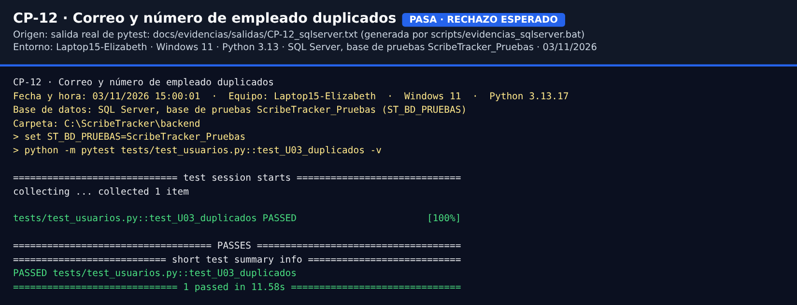

*CP-12: salida real en SQL Server* — `docs/evidencias/CP-12_resultado.png`<br>📄 **Origen:** Imagen generada a partir de la salida de texto de pytest en SQL Server (no es captura de pantalla)

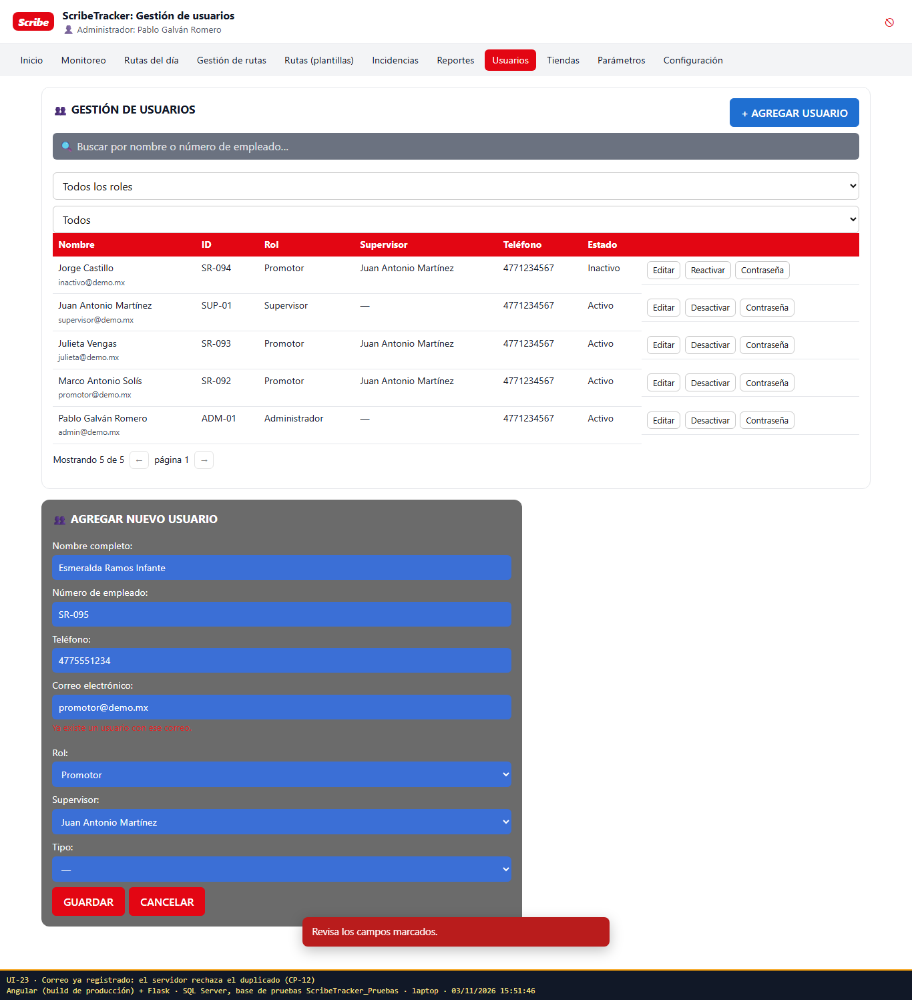

*UI-23 · Correo ya registrado: el servidor rechaza el duplicado (CP-12) (interfaz con SQL Server)* — `docs/evidencias/sqlserver/UI-23_alta_correo_duplicado.png`<br>🖥️ **Origen:** Captura de pantalla real (Chromium automatizado) · SQL Server ScribeTracker_Pruebas, laptop

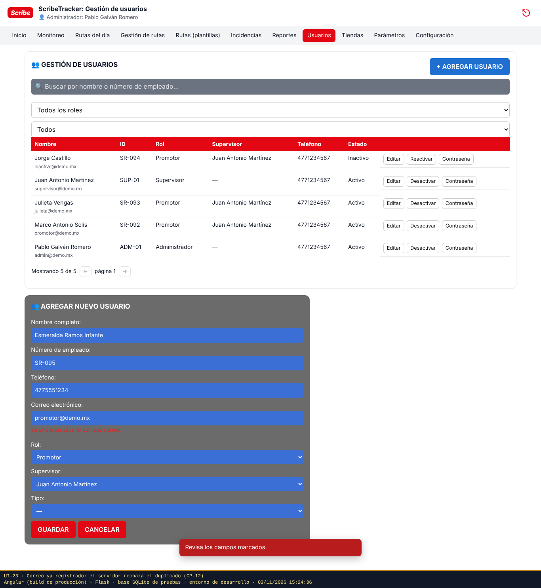

*UI-23 · Correo ya registrado: el servidor rechaza el duplicado (CP-12) (interfaz, SQLite de desarrollo, original)* — `docs/evidencias/UI-23_alta_correo_duplicado.png`<br>🖥️ **Origen:** Captura de pantalla real (Chromium automatizado) · SQLite de pruebas, desarrollo


### CP-13 · Promotor sin acceso a registros ajenos

| Campo | Detalle |
|---|---|
| Prueba | `backend/tests/test_jornada.py::test_A01_promotor_no_accede_a_registros_ajenos` (A01 · Promotor sin acceso a registros ajenos) |
| Requisito funcional | RNF-16 Seguridad de la información |
| Tipo de resultado | **Rechazo esperado**: la prueba pasa porque el servidor rechaza la acción inválida (no autorizado (petición manipulada)) |
| Precondiciones | P1 con visita y foto; P3 es otro promotor |
| Datos de entrada | P3 consulta la visita de P1, su foto, usa una asignación de P1 y llama a la supervisión |
| Procedimiento | `set ST_BD_PRUEBAS=ScribeTracker_Pruebas` y `python -m pytest tests/test_jornada.py::test_A01_promotor_no_accede_a_registros_ajenos -v` en `backend` |
| Resultado esperado | 404 en visita, foto y asignación; 403 en endpoints de supervisión |
| Resultado obtenido | SQL Server (03/11/2026 15:00:17): **1 passed in 13.83s**<br>Ejecución conjunta en SQL Server (1 passed): HTTP 404 · Evidencia no encontrada.<br>Detalle original (ejecución con SQLite): HTTP 404 · Evidencia no encontrada. |
| Estado | Exitosa |
| Entorno | Laptop15-Elizabeth · Windows 11 · Python 3.13 · **SQL Server**, base de pruebas `ScribeTracker_Pruebas` |

**Código de la prueba**

```python
def test_A01_promotor_no_accede_a_registros_ajenos(app, esc, obs):
    """A01 · Promotor sin acceso a registros ajenos
    RF: RNF-16 Seguridad de la información
    Tipo: no autorizado (petición manipulada)
    Pre: P1 con visita y foto; P3 es otro promotor
    Entrada: P3 consulta la visita de P1, su foto, usa una asignación de P1 y llama a la supervisión
    Esperado: 404 en visita, foto y asignación; 403 en endpoints de supervisión
    """
    c1 = _p1(app)
    _iniciar(c1, esc)
    asign = _asignaciones(c1)[1]["id_asignacion"]
    idv = _checkin(c1, esc).get_json()["visita"]["id_visita"]
    url = subir_foto(c1, idv, "Precios", punto(esc.coords[0])).get_json()["evidencia"]["url"]
    c3 = cliente(app, "p3@test.mx")
    assert c3.get(f"/api/promotor/visitas/{idv}").status_code == 404
    r = obs(c3.get(url))
    assert r.status_code == 404
    c3.post("/api/promotor/jornada/iniciar", json=punto(esc.coords[2]))
    assert c3.post("/api/promotor/visitas/checkin", json={"id_asignacion": asign, **punto(esc.coords[1])}).status_code == 404
    assert c3.get("/api/supervision/mapa").status_code == 403
```

**Evidencia**

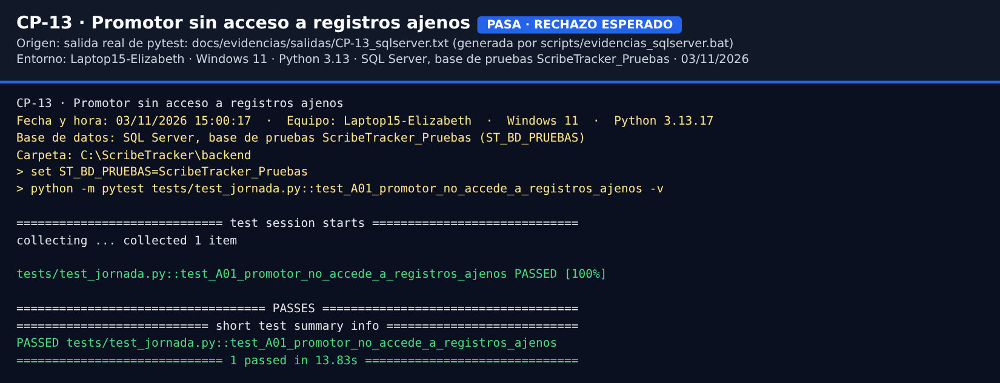

*CP-13: salida real en SQL Server* — `docs/evidencias/CP-13_resultado.png`<br>📄 **Origen:** Imagen generada a partir de la salida de texto de pytest en SQL Server (no es captura de pantalla)


*UI-27 · Promotor sin acceso al panel: la ruta redirige y la API responde 403 (CP-10, CP-13) (interfaz con SQL Server)* — `docs/evidencias/sqlserver/UI-27_permisos_promotor.png`<br>🖥️ **Origen:** Captura de pantalla real (Chromium automatizado) · SQL Server ScribeTracker_Pruebas, laptop


*UI-27 · Promotor sin acceso al panel: la ruta redirige y la API responde 403 (CP-10, CP-13) (interfaz, SQLite de desarrollo, original)* — `docs/evidencias/UI-27_permisos_promotor.png`<br>🖥️ **Origen:** Captura de pantalla real (Chromium automatizado) · SQLite de pruebas, desarrollo


### CP-14 · Supervisor limitado a su ámbito

| Campo | Detalle |
|---|---|
| Prueba | `backend/tests/test_tiendas_rutas.py::test_R03_supervisor_fuera_de_alcance` (R03 · Supervisor no puede asignar ni consultar promotores ajenos) |
| Requisito funcional | RF-09; RNF-16 (supervisor limitado a su ámbito) |
| Tipo de resultado | **Rechazo esperado**: la prueba pasa porque el servidor rechaza la acción inválida (no autorizado (petición manipulada)) |
| Precondiciones | P3 pertenece a S2 |
| Datos de entrada | S1 envía PUT /api/asignaciones/dia y GET /api/asignaciones para P3 |
| Procedimiento | `set ST_BD_PRUEBAS=ScribeTracker_Pruebas` y `python -m pytest tests/test_tiendas_rutas.py::test_R03_supervisor_fuera_de_alcance -v` en `backend` |
| Resultado esperado | HTTP 404 en ambos; no se crean asignaciones |
| Resultado obtenido | SQL Server (03/11/2026 15:00:37): **1 passed in 11.08s**<br>Ejecución conjunta en SQL Server (1 passed): HTTP 404 · Promotor no encontrado o fuera de tu alcance.<br>Detalle original (ejecución con SQLite): HTTP 404 · Promotor no encontrado o fuera de tu alcance. |
| Estado | Exitosa |
| Entorno | Laptop15-Elizabeth · Windows 11 · Python 3.13 · **SQL Server**, base de pruebas `ScribeTracker_Pruebas` |

**Código de la prueba**

```python
def test_R03_supervisor_fuera_de_alcance(app, esc, obs):
    """R03 · Supervisor no puede asignar ni consultar promotores ajenos
    RF: RF-09; RNF-16 (supervisor limitado a su ámbito)
    Tipo: no autorizado (petición manipulada)
    Pre: P3 pertenece a S2
    Entrada: S1 envía PUT /api/asignaciones/dia y GET /api/asignaciones para P3
    Esperado: HTTP 404 en ambos; no se crean asignaciones
    """
    c = cliente(app, "s1@test.mx")
    r = obs(c.put("/api/asignaciones/dia", json={"id_promotor": esc.ids.p3,
                                                 "fecha": (HOY + timedelta(days=1)).isoformat(), "tiendas": [esc.ids.t[0]]}))
    assert r.status_code == 404
    assert c.get(f"/api/asignaciones?id_promotor={esc.ids.p3}&fecha={HOY}").status_code == 404
```

**Evidencia**

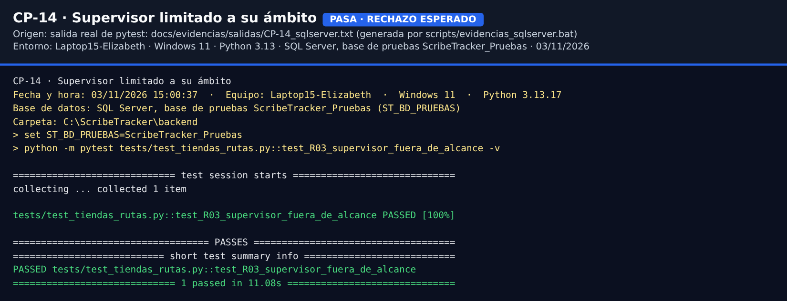

*CP-14: salida real en SQL Server* — `docs/evidencias/CP-14_resultado.png`<br>📄 **Origen:** Imagen generada a partir de la salida de texto de pytest en SQL Server (no es captura de pantalla)


### CP-15 · Inicio de jornada en la primera tienda

| Campo | Detalle |
|---|---|
| Prueba | `backend/tests/test_jornada.py::test_J01_inicio_en_primera_tienda` (J01 · Iniciar jornada dentro de la geocerca de la primera tienda) |
| Requisito funcional | RF-01 Inicio de jornada; reglas C1 y C2 |
| Tipo de resultado | **Flujo válido** (válido) |
| Precondiciones | P1 con Walmart (orden 1) y Soriana (orden 2) asignadas hoy; 08:05 |
| Datos de entrada | ubicación a 10 m de Walmart Torres Landa |
| Procedimiento | `set ST_BD_PRUEBAS=ScribeTracker_Pruebas` y `python -m pytest tests/test_jornada.py::test_J01_inicio_en_primera_tienda -v` en `backend` |
| Resultado esperado | HTTP 201; jornada Abierta; rastreo activo; primer punto de ubicación registrado |
| Resultado obtenido | SQL Server (03/11/2026 15:00:54): **1 passed in 12.35s**<br>Ejecución conjunta en SQL Server (1 passed): HTTP 201 · Jornada iniciada. El seguimiento de ubicación está activo.<br>Detalle original (ejecución con SQLite): HTTP 201 · Jornada iniciada. El seguimiento de ubicación está activo. |
| Estado | Exitosa |
| Entorno | Laptop15-Elizabeth · Windows 11 · Python 3.13 · **SQL Server**, base de pruebas `ScribeTracker_Pruebas` |

**Código de la prueba**

```python
def test_J01_inicio_en_primera_tienda(app, esc, obs):
    """J01 · Iniciar jornada dentro de la geocerca de la primera tienda
    RF: RF-01 Inicio de jornada; reglas C1 y C2
    Tipo: válido
    Pre: P1 con Walmart (orden 1) y Soriana (orden 2) asignadas hoy; 08:05
    Entrada: ubicación a 10 m de Walmart Torres Landa
    Esperado: HTTP 201; jornada Abierta; rastreo activo; primer punto de ubicación registrado
    """
    c = _p1(app)
    r = obs(_iniciar(c, esc))
    assert r.status_code == 201 and r.get_json()["jornada"]["estado"] == "Abierta"
    hoy = c.get("/api/promotor/hoy").get_json()
    assert hoy["rastreo_activo"] is True and hoy["estado"]["estado_jornada"] == "En jornada"
    with app.app_context():
        assert db.session.execute(db.select(db.func.count()).select_from(Ubicacion)).scalar_one() == 1
```

**Evidencia**

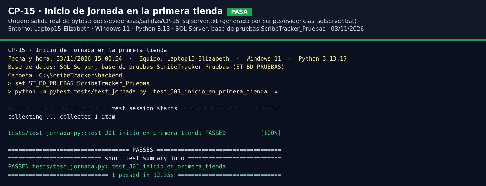

*CP-15: salida real en SQL Server* — `docs/evidencias/CP-15_resultado.png`<br>📄 **Origen:** Imagen generada a partir de la salida de texto de pytest en SQL Server (no es captura de pantalla)

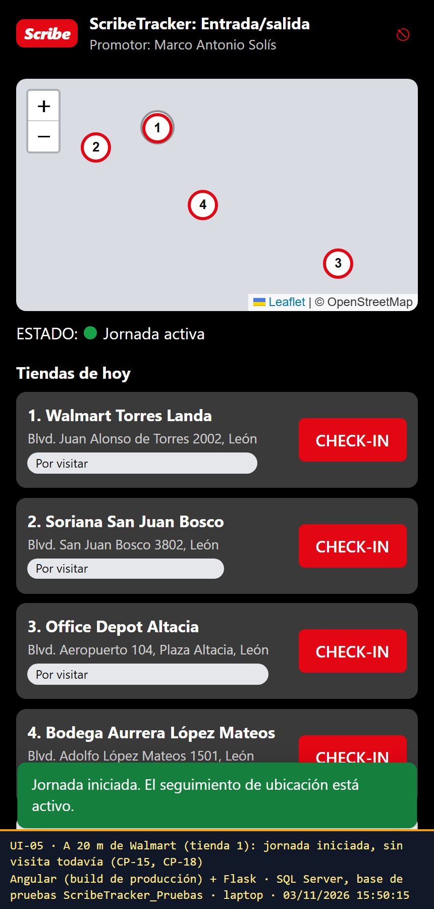

*UI-05 · A 20 m de Walmart (tienda 1): jornada iniciada, sin visita todavía (CP-15, CP-18) (interfaz con SQL Server)* — `docs/evidencias/sqlserver/UI-05_jornada_iniciada.png`<br>🖥️ **Origen:** Captura de pantalla real (Chromium automatizado) · SQL Server ScribeTracker_Pruebas, laptop

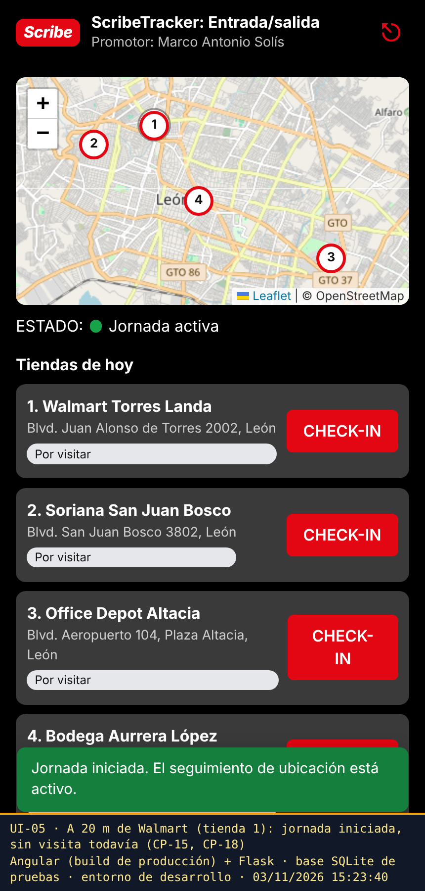

*UI-05 · A 20 m de Walmart (tienda 1): jornada iniciada, sin visita todavía (CP-15, CP-18) (interfaz, SQLite de desarrollo, original)* — `docs/evidencias/UI-05_jornada_iniciada.png`<br>🖥️ **Origen:** Captura de pantalla real (Chromium automatizado) · SQLite de pruebas, desarrollo


### CP-16 · Rechazo de inicio fuera de la primera tienda

| Campo | Detalle |
|---|---|
| Prueba | `backend/tests/test_jornada.py::test_J02_inicio_fuera_de_primera_tienda` (J02 · Iniciar jornada fuera de la geocerca o en otra tienda asignada) |
| Requisito funcional | RF-01; regla C2 |
| Tipo de resultado | **Rechazo esperado**: la prueba pasa porque el servidor rechaza la acción inválida (inválido) |
| Precondiciones | P1 sin jornada |
| Datos de entrada | (a) a 120 m de Walmart; (b) dentro de Soriana, que es la tienda 2 |
| Procedimiento | `set ST_BD_PRUEBAS=ScribeTracker_Pruebas` y `python -m pytest tests/test_jornada.py::test_J02_inicio_fuera_de_primera_tienda -v` en `backend` |
| Resultado esperado | HTTP 409 en ambos casos con la distancia; no se crea jornada |
| Resultado obtenido | SQL Server (03/11/2026 15:01:12): **1 passed in 11.84s**<br>Ejecución conjunta en SQL Server (1 passed): HTTP 409 · Para iniciar tu jornada debes estar en tu primera tienda: Walmart Torres Landa. Estás a 119 m y el radio permitido es de 50 m. · {'distancia_m': 119.9}<br>Detalle original (ejecución con SQLite): HTTP 409 · Para iniciar tu jornada debes estar en tu primera tienda: Walmart Torres Landa. Estás a 119 m y el radio permitido es de 50 m. · {'distancia_m': 119.9} |
| Estado | Exitosa |
| Entorno | Laptop15-Elizabeth · Windows 11 · Python 3.13 · **SQL Server**, base de pruebas `ScribeTracker_Pruebas` |

**Código de la prueba**

```python
def test_J02_inicio_fuera_de_primera_tienda(app, esc, obs):
    """J02 · Iniciar jornada fuera de la geocerca o en otra tienda asignada
    RF: RF-01; regla C2
    Tipo: inválido
    Pre: P1 sin jornada
    Entrada: (a) a 120 m de Walmart; (b) dentro de Soriana, que es la tienda 2
    Esperado: HTTP 409 en ambos casos con la distancia; no se crea jornada
    """
    c = _p1(app)
    r = obs(_iniciar(c, esc, metros=120))
    assert r.status_code == 409 and r.get_json()["distancia_m"] > 50
    assert c.post("/api/promotor/jornada/iniciar", json=punto(esc.coords[1], 5)).status_code == 409
    with app.app_context():
        assert db.session.execute(db.select(db.func.count()).select_from(Jornada)).scalar_one() == 0
```

**Evidencia**

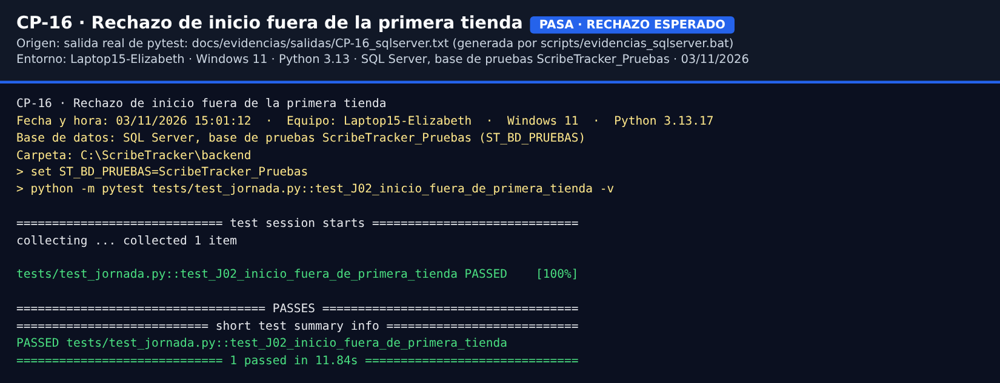

*CP-16: salida real en SQL Server* — `docs/evidencias/CP-16_resultado.png`<br>📄 **Origen:** Imagen generada a partir de la salida de texto de pytest en SQL Server (no es captura de pantalla)

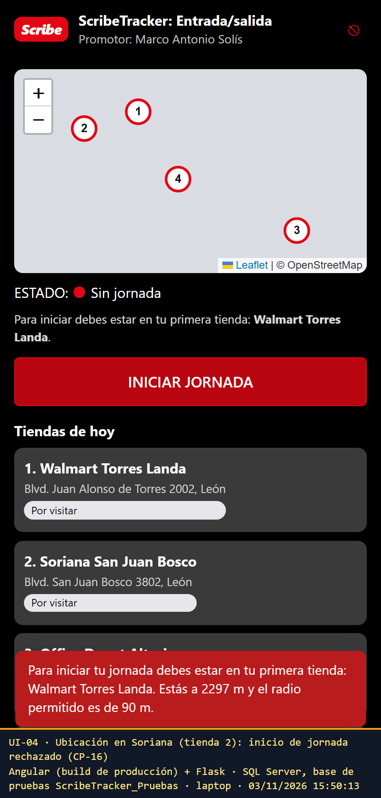

*UI-04 · Ubicación en Soriana (tienda 2): inicio de jornada rechazado (CP-16) (interfaz con SQL Server)* — `docs/evidencias/sqlserver/UI-04_inicio_fuera_primera_tienda.png`<br>🖥️ **Origen:** Captura de pantalla real (Chromium automatizado) · SQL Server ScribeTracker_Pruebas, laptop

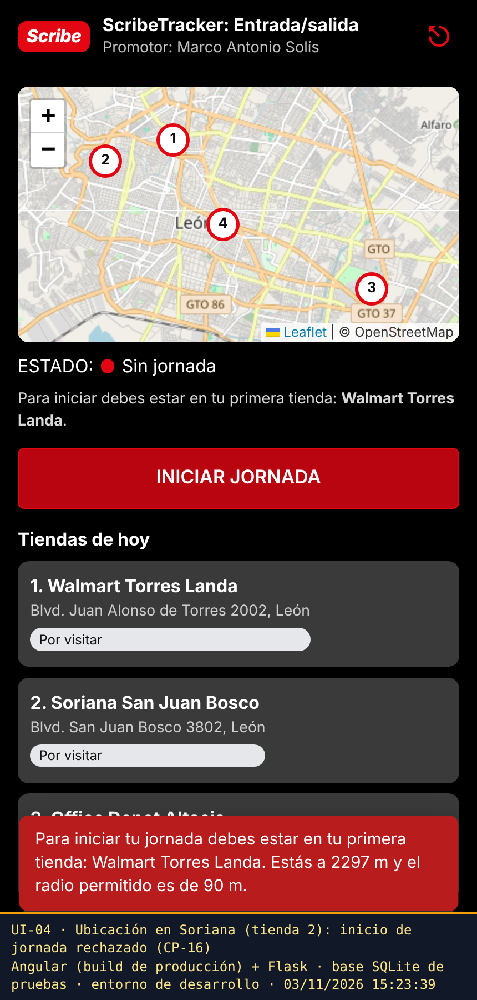

*UI-04 · Ubicación en Soriana (tienda 2): inicio de jornada rechazado (CP-16) (interfaz, SQLite de desarrollo, original)* — `docs/evidencias/UI-04_inicio_fuera_primera_tienda.png`<br>🖥️ **Origen:** Captura de pantalla real (Chromium automatizado) · SQLite de pruebas, desarrollo


### CP-17 · Una sola jornada por fecha

| Campo | Detalle |
|---|---|
| Prueba | `backend/tests/test_jornada.py::test_J03_jornada_unica_por_fecha` (J03 · Una sola jornada por fecha operativa) |
| Requisito funcional | RF-01; regla C1 |
| Tipo de resultado | **Rechazo esperado**: la prueba pasa porque el servidor rechaza la acción inválida (inválido (duplicado)) |
| Precondiciones | P1 ya inició y finalizó su jornada hoy (cierre forzado con motivo) |
| Datos de entrada | segundo intento de iniciar jornada el mismo día |
| Procedimiento | `set ST_BD_PRUEBAS=ScribeTracker_Pruebas` y `python -m pytest tests/test_jornada.py::test_J03_jornada_unica_por_fecha -v` en `backend` |
| Resultado esperado | HTTP 409 "Ya registraste una jornada para este día" |
| Resultado obtenido | SQL Server (03/11/2026 15:01:30): **1 passed in 14.68s**<br>Ejecución conjunta en SQL Server (1 passed): HTTP 409 · Ya registraste una jornada para este día. Solo se permite una jornada por fecha.<br>Detalle original (ejecución con SQLite): HTTP 409 · Ya registraste una jornada para este día. Solo se permite una jornada por fecha. |
| Estado | Exitosa |
| Entorno | Laptop15-Elizabeth · Windows 11 · Python 3.13 · **SQL Server**, base de pruebas `ScribeTracker_Pruebas` |

**Código de la prueba**

```python
def test_J03_jornada_unica_por_fecha(app, esc, obs):
    """J03 · Una sola jornada por fecha operativa
    RF: RF-01; regla C1
    Tipo: inválido (duplicado)
    Pre: P1 ya inició y finalizó su jornada hoy (cierre forzado con motivo)
    Entrada: segundo intento de iniciar jornada el mismo día
    Esperado: HTTP 409 "Ya registraste una jornada para este día"
    """
    c = _p1(app)
    _iniciar(c, esc)
    c.post("/api/promotor/jornada/finalizar", json={**punto(esc.coords[0]), "forzar": True,
                                                   "motivo": "Prueba de jornada única"})
    r = obs(_iniciar(c, esc))
    assert r.status_code == 409 and "una jornada" in r.get_json()["error"]
```

**Evidencia**

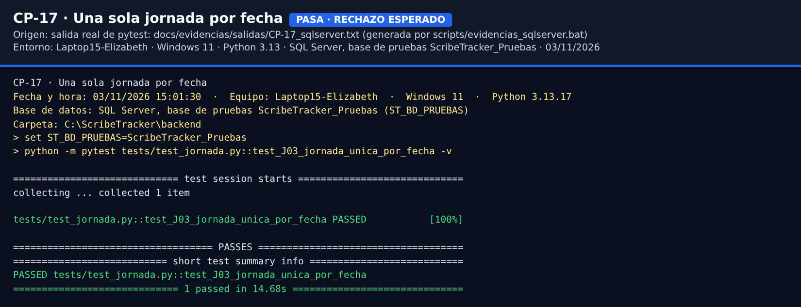

*CP-17: salida real en SQL Server* — `docs/evidencias/CP-17_resultado.png`<br>📄 **Origen:** Imagen generada a partir de la salida de texto de pytest en SQL Server (no es captura de pantalla)


### CP-18 · Check-in separado del inicio de jornada

| Campo | Detalle |
|---|---|
| Prueba | `backend/tests/test_jornada.py::test_V01_checkin_independiente_del_inicio` (V01 · Check-in separado del inicio de jornada) |
| Requisito funcional | RF-03 Check-in; reglas C3 y C4 |
| Tipo de resultado | **Flujo válido** (válido) |
| Precondiciones | P1 con jornada iniciada a las 08:05 y sin visitas |
| Datos de entrada | 08:10 check-in en Walmart a 15 m |
| Procedimiento | `set ST_BD_PRUEBAS=ScribeTracker_Pruebas` y `python -m pytest tests/test_jornada.py::test_V01_checkin_independiente_del_inicio -v` en `backend` |
| Resultado esperado | iniciar jornada no crea visita; el check-in crea visita Abierta con su propia hora y ubicación |
| Resultado obtenido | SQL Server (03/11/2026 15:01:50): **1 passed in 12.76s**<br>Ejecución conjunta en SQL Server (1 passed): HTTP 201 · Check-in registrado correctamente en Walmart Torres Landa.<br>Detalle original (ejecución con SQLite): HTTP 201 · Check-in registrado correctamente en Walmart Torres Landa. |
| Estado | Exitosa |
| Entorno | Laptop15-Elizabeth · Windows 11 · Python 3.13 · **SQL Server**, base de pruebas `ScribeTracker_Pruebas` |

**Código de la prueba**

```python
def test_V01_checkin_independiente_del_inicio(app, esc, obs):
    """V01 · Check-in separado del inicio de jornada
    RF: RF-03 Check-in; reglas C3 y C4
    Tipo: válido
    Pre: P1 con jornada iniciada a las 08:05 y sin visitas
    Entrada: 08:10 check-in en Walmart a 15 m
    Esperado: iniciar jornada no crea visita; el check-in crea visita Abierta con su propia hora y ubicación
    """
    c = _p1(app)
    _iniciar(c, esc)
    with app.app_context():
        assert db.session.execute(db.select(db.func.count()).select_from(Visita)).scalar_one() == 0
    a_las(8, 10)
    r = obs(_checkin(c, esc, metros=15))
    v = r.get_json()["visita"]
    assert r.status_code == 201 and v["estado"] == "Abierta"
    assert v["checkin"].endswith("08:10:00") and 14 < v["distancia_checkin_m"] < 16
```

**Evidencia**

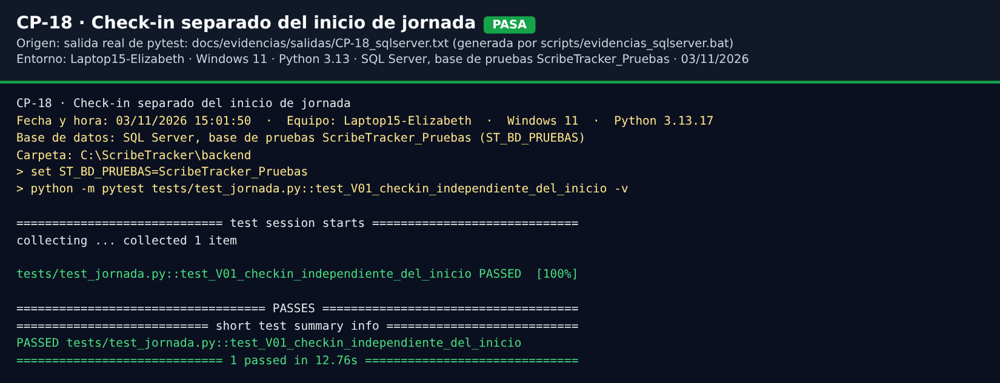

*CP-18: salida real en SQL Server* — `docs/evidencias/CP-18_resultado.png`<br>📄 **Origen:** Imagen generada a partir de la salida de texto de pytest en SQL Server (no es captura de pantalla)

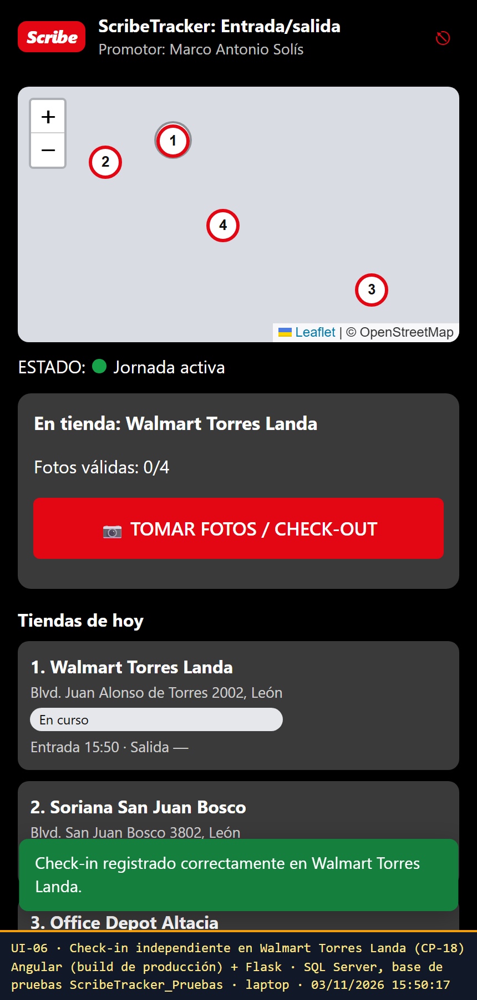

*UI-06 · Check-in independiente en Walmart Torres Landa (CP-18) (interfaz con SQL Server)* — `docs/evidencias/sqlserver/UI-06_checkin.png`<br>🖥️ **Origen:** Captura de pantalla real (Chromium automatizado) · SQL Server ScribeTracker_Pruebas, laptop

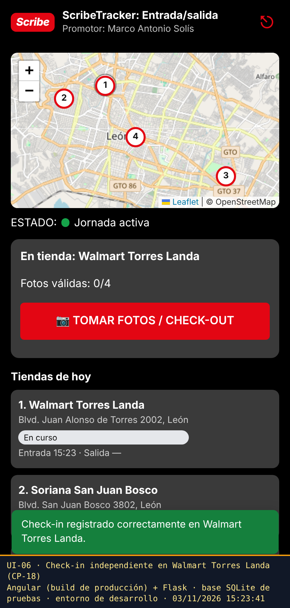

*UI-06 · Check-in independiente en Walmart Torres Landa (CP-18) (interfaz, SQLite de desarrollo, original)* — `docs/evidencias/UI-06_checkin.png`<br>🖥️ **Origen:** Captura de pantalla real (Chromium automatizado) · SQLite de pruebas, desarrollo


### CP-19 · Dos visitas abiertas y visita duplicada

| Campo | Detalle |
|---|---|
| Prueba | `backend/tests/test_jornada.py::test_V03_dos_visitas_abiertas` (V03 · Impedir dos visitas abiertas simultáneas y visita duplicada) |
| Requisito funcional | RF-03; regla C9 |
| Tipo de resultado | **Rechazo esperado**: la prueba pasa porque el servidor rechaza la acción inválida (inválido (estado incompatible)) |
| Precondiciones | P1 con visita abierta en Walmart |
| Datos de entrada | check-in en Soriana (dentro de su geocerca) y repetir check-in en Walmart |
| Procedimiento | `set ST_BD_PRUEBAS=ScribeTracker_Pruebas` y `python -m pytest tests/test_jornada.py::test_V03_dos_visitas_abiertas -v` en `backend` |
| Resultado esperado | HTTP 409 en ambos; solo existe una visita |
| Resultado obtenido | SQL Server (03/11/2026 15:02:09): **1 passed in 13.21s**<br>Ejecución conjunta en SQL Server (1 passed): HTTP 409 · Ya tienes una visita abierta en Walmart. Registra su check-out antes de entrar a otra tienda.<br>Detalle original (ejecución con SQLite): HTTP 409 · Ya tienes una visita abierta en Walmart. Registra su check-out antes de entrar a otra tienda. |
| Estado | Exitosa |
| Entorno | Laptop15-Elizabeth · Windows 11 · Python 3.13 · **SQL Server**, base de pruebas `ScribeTracker_Pruebas` |

**Código de la prueba**

```python
def test_V03_dos_visitas_abiertas(app, esc, obs):
    """V03 · Impedir dos visitas abiertas simultáneas y visita duplicada
    RF: RF-03; regla C9
    Tipo: inválido (estado incompatible)
    Pre: P1 con visita abierta en Walmart
    Entrada: check-in en Soriana (dentro de su geocerca) y repetir check-in en Walmart
    Esperado: HTTP 409 en ambos; solo existe una visita
    """
    c = _p1(app)
    _iniciar(c, esc)
    _checkin(c, esc)
    r = obs(_checkin(c, esc, idx=1, metros=5))
    assert r.status_code == 409 and "visita abierta" in r.get_json()["error"]
    assert _checkin(c, esc).status_code == 409
    with app.app_context():
        assert db.session.execute(db.select(db.func.count()).select_from(Visita)).scalar_one() == 1
```

**Evidencia**

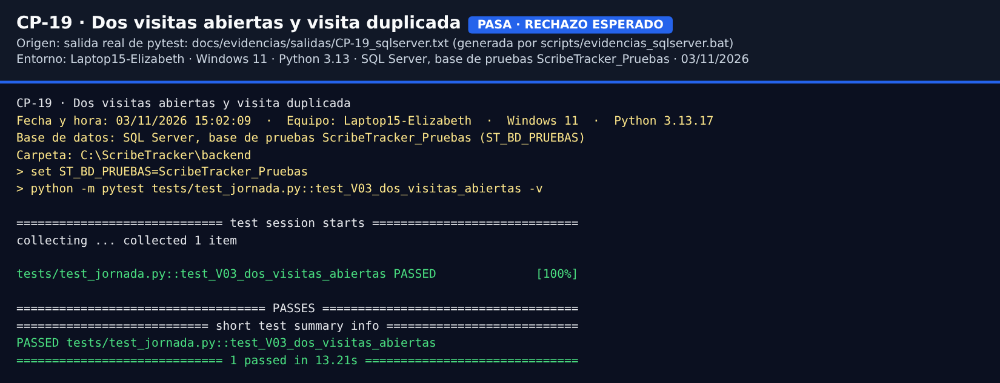

*CP-19: salida real en SQL Server* — `docs/evidencias/CP-19_resultado.png`<br>📄 **Origen:** Imagen generada a partir de la salida de texto de pytest en SQL Server (no es captura de pantalla)


### CP-20 · Foto fuera de geocerca no cuenta

| Campo | Detalle |
|---|---|
| Prueba | `backend/tests/test_jornada.py::test_E02_foto_fuera_de_geocerca_no_cuenta` (E02 · Fotografía fuera de la geocerca se guarda pero no cuenta) |
| Requisito funcional | RF-12 Validación automática; regla D (fuera de geocerca no completa la visita) |
| Tipo de resultado | **Rechazo esperado**: la prueba pasa porque el servidor rechaza la acción inválida (inválido (genera alerta)) |
| Precondiciones | visita abierta en Walmart |
| Datos de entrada | foto "Precios" tomada a 300 m |
| Procedimiento | `set ST_BD_PRUEBAS=ScribeTracker_Pruebas` y `python -m pytest tests/test_jornada.py::test_E02_foto_fuera_de_geocerca_no_cuenta -v` en `backend` |
| Resultado esperado | HTTP 422; estatus "Fuera de geocerca"; incidencia crítica; la categoría Precios sigue faltando |
| Resultado obtenido | SQL Server (03/11/2026 15:02:27): **1 passed in 12.95s**<br>Ejecución conjunta en SQL Server (1 passed): HTTP 422 · La foto se guardó pero NO cuenta para la visita: Tomada a 299 m de la tienda (radio 50 m).<br>Detalle original (ejecución con SQLite): HTTP 422 · La foto se guardó pero NO cuenta para la visita: Tomada a 299 m de la tienda (radio 50 m). |
| Estado | Exitosa |
| Entorno | Laptop15-Elizabeth · Windows 11 · Python 3.13 · **SQL Server**, base de pruebas `ScribeTracker_Pruebas` |

**Código de la prueba**

```python
def test_E02_foto_fuera_de_geocerca_no_cuenta(app, esc, obs):
    """E02 · Fotografía fuera de la geocerca se guarda pero no cuenta
    RF: RF-12 Validación automática; regla D (fuera de geocerca no completa la visita)
    Tipo: inválido (genera alerta)
    Pre: visita abierta en Walmart
    Entrada: foto "Precios" tomada a 300 m
    Esperado: HTTP 422; estatus "Fuera de geocerca"; incidencia crítica; la categoría Precios sigue faltando
    """
    c = _p1(app)
    _iniciar(c, esc)
    idv = _checkin(c, esc).get_json()["visita"]["id_visita"]
    r = obs(subir_foto(c, idv, "Precios", punto(esc.coords[0], 300)))
    assert r.status_code == 422 and r.get_json()["evidencia"]["estatus_validacion"] == "Fuera de geocerca"
    assert "Precios" in r.get_json()["visita"]["categorias_faltantes"]
    with app.app_context():
        inc = db.session.execute(db.select(Incidencia).where(Incidencia.tipo == "Foto fuera de geocerca")).scalar_one()
        assert inc.es_critica
```

**Evidencia**

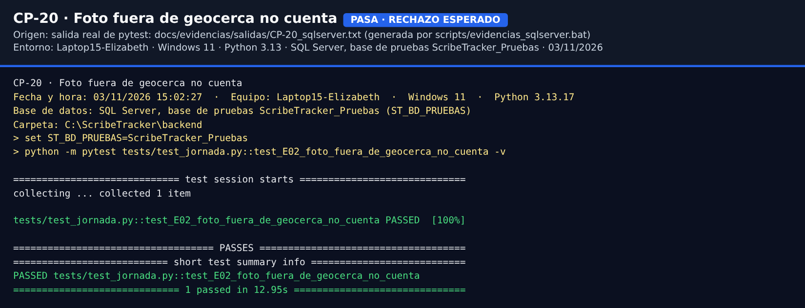

*CP-20: salida real en SQL Server* — `docs/evidencias/CP-20_resultado.png`<br>📄 **Origen:** Imagen generada a partir de la salida de texto de pytest en SQL Server (no es captura de pantalla)

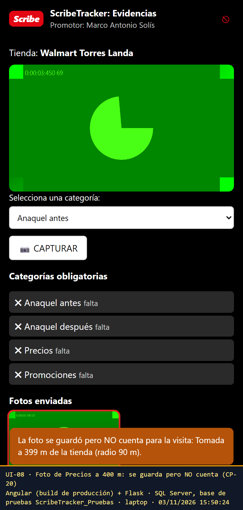

*UI-08 · Foto de Precios a 400 m: se guarda pero NO cuenta (CP-20) (interfaz con SQL Server)* — `docs/evidencias/sqlserver/UI-08_foto_fuera_geocerca.png`<br>🖥️ **Origen:** Captura de pantalla real (Chromium automatizado) · SQL Server ScribeTracker_Pruebas, laptop

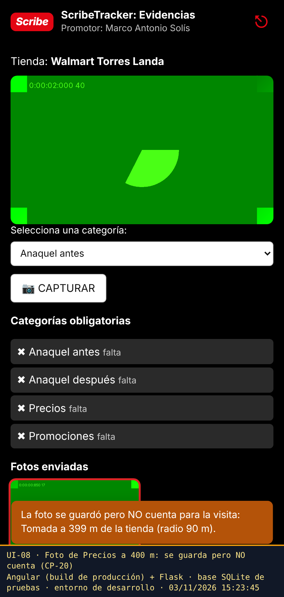

*UI-08 · Foto de Precios a 400 m: se guarda pero NO cuenta (CP-20) (interfaz, SQLite de desarrollo, original)* — `docs/evidencias/UI-08_foto_fuera_geocerca.png`<br>🖥️ **Origen:** Captura de pantalla real (Chromium automatizado) · SQLite de pruebas, desarrollo

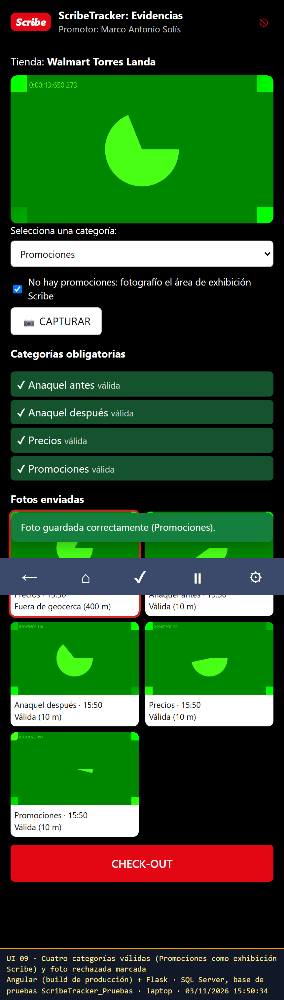

*UI-09 · Cuatro categorías válidas (Promociones como exhibición Scribe) y foto rechazada marcada (interfaz con SQL Server)* — `docs/evidencias/sqlserver/UI-09_cuatro_categorias.png`<br>🖥️ **Origen:** Captura de pantalla real (Chromium automatizado) · SQL Server ScribeTracker_Pruebas, laptop

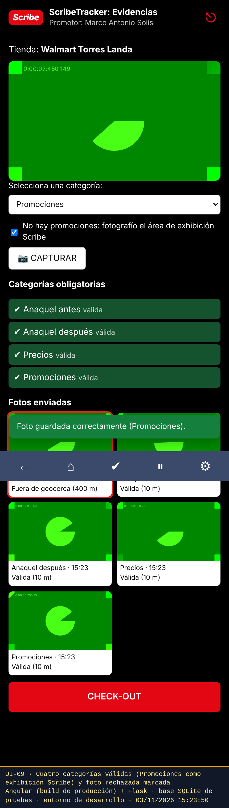

*UI-09 · Cuatro categorías válidas (Promociones como exhibición Scribe) y foto rechazada marcada (interfaz, SQLite de desarrollo, original)* — `docs/evidencias/UI-09_cuatro_categorias.png`<br>🖥️ **Origen:** Captura de pantalla real (Chromium automatizado) · SQLite de pruebas, desarrollo


### CP-21 · Check-out bloqueado por categorías faltantes

| Campo | Detalle |
|---|---|
| Prueba | `backend/tests/test_jornada.py::test_V04_checkout_bloqueado_por_categorias` (V04 · Check-out bloqueado si falta alguna categoría válida) |
| Requisito funcional | RF-04 Check-out; regla D (servidor comprueba las 4 categorías y comunica faltantes) |
| Tipo de resultado | **Rechazo esperado**: la prueba pasa porque el servidor rechaza la acción inválida (inválido) |
| Precondiciones | visita abierta con Anaquel antes y Anaquel después válidas, Precios fuera de geocerca |
| Datos de entrada | check-out dentro de la geocerca |
| Procedimiento | `set ST_BD_PRUEBAS=ScribeTracker_Pruebas` y `python -m pytest tests/test_jornada.py::test_V04_checkout_bloqueado_por_categorias -v` en `backend` |
| Resultado esperado | HTTP 409 con faltantes = [Precios, Promociones]; visita sigue Abierta |
| Resultado obtenido | SQL Server (03/11/2026 15:02:45): **1 passed in 13.39s**<br>Ejecución conjunta en SQL Server (1 passed): HTTP 409 · Faltan fotografías válidas para cerrar la visita: Precios, Promociones. · {'faltantes': ['Precios', 'Promociones']}<br>Detalle original (ejecución con SQLite): HTTP 409 · Faltan fotografías válidas para cerrar la visita: Precios, Promociones. · {'faltantes': ['Precios', 'Promociones']} |
| Estado | Exitosa |
| Entorno | Laptop15-Elizabeth · Windows 11 · Python 3.13 · **SQL Server**, base de pruebas `ScribeTracker_Pruebas` |

**Código de la prueba**

```python
def test_V04_checkout_bloqueado_por_categorias(app, esc, obs):
    """V04 · Check-out bloqueado si falta alguna categoría válida
    RF: RF-04 Check-out; regla D (servidor comprueba las 4 categorías y comunica faltantes)
    Tipo: inválido
    Pre: visita abierta con Anaquel antes y Anaquel después válidas, Precios fuera de geocerca
    Entrada: check-out dentro de la geocerca
    Esperado: HTTP 409 con faltantes = [Precios, Promociones]; visita sigue Abierta
    """
    c = _p1(app)
    _iniciar(c, esc)
    idv = _checkin(c, esc).get_json()["visita"]["id_visita"]
    subir_foto(c, idv, "Anaquel antes", punto(esc.coords[0], 5))
    subir_foto(c, idv, "Anaquel después", punto(esc.coords[0], 5))
    subir_foto(c, idv, "Precios", punto(esc.coords[0], 400))
    r = obs(c.post("/api/promotor/visitas/checkout", json={"id_visita": idv, **punto(esc.coords[0], 5)}))
    assert r.status_code == 409 and r.get_json()["faltantes"] == ["Precios", "Promociones"]
```

**Evidencia**

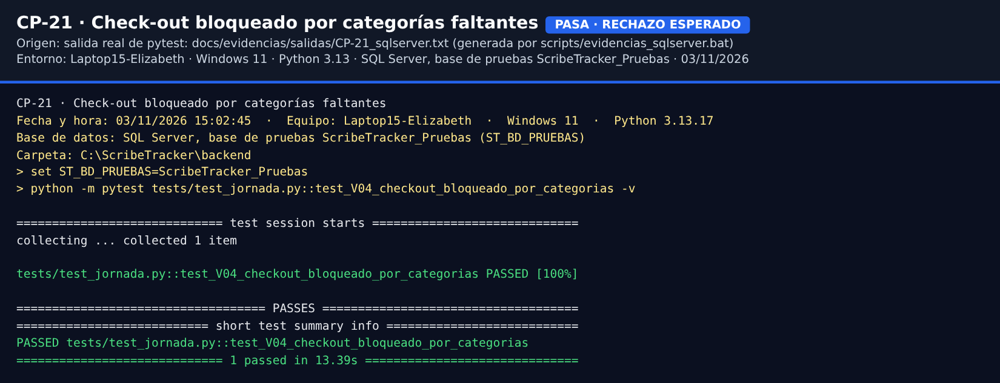

*CP-21: salida real en SQL Server* — `docs/evidencias/CP-21_resultado.png`<br>📄 **Origen:** Imagen generada a partir de la salida de texto de pytest en SQL Server (no es captura de pantalla)

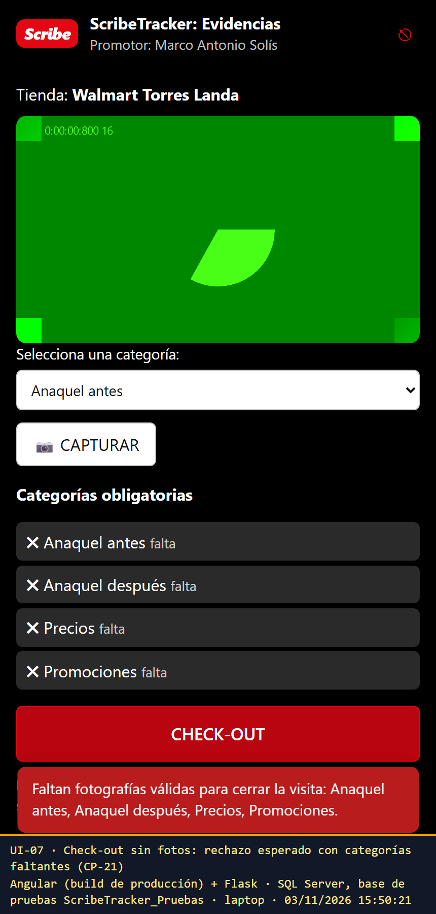

*UI-07 · Check-out sin fotos: rechazo esperado con categorías faltantes (CP-21) (interfaz con SQL Server)* — `docs/evidencias/sqlserver/UI-07_checkout_sin_fotos.png`<br>🖥️ **Origen:** Captura de pantalla real (Chromium automatizado) · SQL Server ScribeTracker_Pruebas, laptop

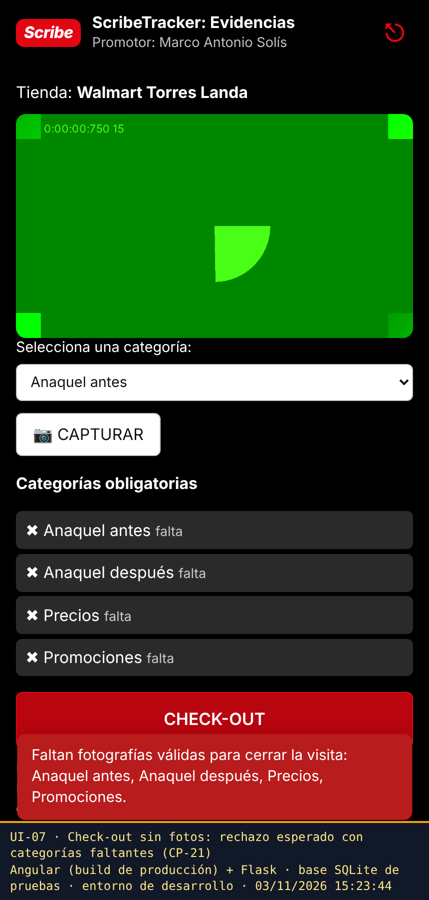

*UI-07 · Check-out sin fotos: rechazo esperado con categorías faltantes (CP-21) (interfaz, SQLite de desarrollo, original)* — `docs/evidencias/UI-07_checkout_sin_fotos.png`<br>🖥️ **Origen:** Captura de pantalla real (Chromium automatizado) · SQLite de pruebas, desarrollo


### CP-22 · Check-out válido sin cerrar la jornada

| Campo | Detalle |
|---|---|
| Prueba | `backend/tests/test_jornada.py::test_V05_checkout_valido_no_cierra_jornada` (V05 · Check-out válido cierra la visita y mantiene la jornada abierta) |
| Requisito funcional | RF-04; reglas C5, C6 y C7 |
| Tipo de resultado | **Flujo válido** (válido) |
| Precondiciones | visita abierta con las 4 categorías válidas (Promociones como exhibición sin promoción) |
| Datos de entrada | 09:45 check-out a 30 m (nueva ubicación) |
| Procedimiento | `set ST_BD_PRUEBAS=ScribeTracker_Pruebas` y `python -m pytest tests/test_jornada.py::test_V05_checkout_valido_no_cierra_jornada -v` en `backend` |
| Resultado esperado | HTTP 200; visita Cerrada con hora y coordenadas de salida propias; jornada sigue Abierta; estado En traslado |
| Resultado obtenido | SQL Server (03/11/2026 15:03:04): **1 passed in 13.06s**<br>Ejecución conjunta en SQL Server (1 passed): HTTP 200 · Check-out registrado. Tiempo en tienda: 1 h 40 min. Tu jornada sigue abierta.<br>Detalle original (ejecución con SQLite): HTTP 200 · Check-out registrado. Tiempo en tienda: 1 h 40 min. Tu jornada sigue abierta. |
| Estado | Exitosa |
| Entorno | Laptop15-Elizabeth · Windows 11 · Python 3.13 · **SQL Server**, base de pruebas `ScribeTracker_Pruebas` |

**Código de la prueba**

```python
def test_V05_checkout_valido_no_cierra_jornada(app, esc, obs):
    """V05 · Check-out válido cierra la visita y mantiene la jornada abierta
    RF: RF-04; reglas C5, C6 y C7
    Tipo: válido
    Pre: visita abierta con las 4 categorías válidas (Promociones como exhibición sin promoción)
    Entrada: 09:45 check-out a 30 m (nueva ubicación)
    Esperado: HTTP 200; visita Cerrada con hora y coordenadas de salida propias; jornada sigue Abierta; estado En traslado
    """
    c = _p1(app)
    _iniciar(c, esc)
    idv = _checkin(c, esc).get_json()["visita"]["id_visita"]
    for cat in CATS[:3]:
        subir_foto(c, idv, cat, punto(esc.coords[0], 5))
    assert subir_foto(c, idv, "Promociones", punto(esc.coords[0], 5), sin_promocion=True).status_code == 201
    a_las(9, 45)
    r = obs(c.post("/api/promotor/visitas/checkout", json={"id_visita": idv, **punto(esc.coords[0], 30)}))
    v = r.get_json()["visita"]
    assert r.status_code == 200 and v["estado"] == "Cerrada" and v["checkout"].endswith("09:45:00")
    assert 29 < v["distancia_checkout_m"] < 31
    hoy = c.get("/api/promotor/hoy").get_json()
    assert hoy["jornada"]["estado"] == "Abierta" and hoy["estado"]["estado_visita"] == "En traslado"
```

**Evidencia**

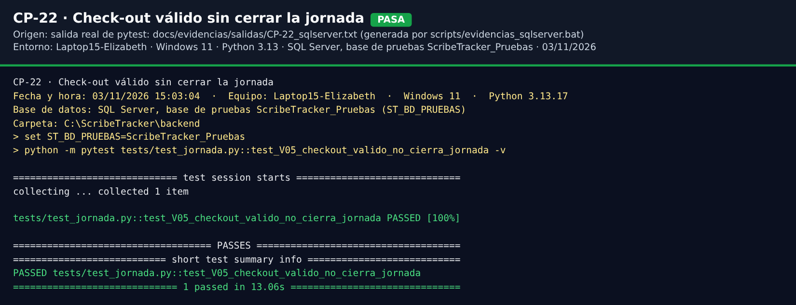

*CP-22: salida real en SQL Server* — `docs/evidencias/CP-22_resultado.png`<br>📄 **Origen:** Imagen generada a partir de la salida de texto de pytest en SQL Server (no es captura de pantalla)


*UI-10 · Check-out válido: la visita se cierra y la jornada sigue abierta (CP-22) (interfaz con SQL Server)* — `docs/evidencias/sqlserver/UI-10_checkout_jornada_abierta.png`<br>🖥️ **Origen:** Captura de pantalla real (Chromium automatizado) · SQL Server ScribeTracker_Pruebas, laptop


*UI-10 · Check-out válido: la visita se cierra y la jornada sigue abierta (CP-22) (interfaz, SQLite de desarrollo, original)* — `docs/evidencias/UI-10_checkout_jornada_abierta.png`<br>🖥️ **Origen:** Captura de pantalla real (Chromium automatizado) · SQLite de pruebas, desarrollo


### CP-23 · Cierre de jornada con visitas pendientes

| Campo | Detalle |
|---|---|
| Prueba | `backend/tests/test_jornada.py::test_J06_finalizar_con_pendientes` (J06 · Cierre de jornada conforme a visitas pendientes) |
| Requisito funcional | RF-01/RF-04; reglas C7, C8 y C9 |
| Tipo de resultado | **Flujo válido** (inválido y válido con motivo) |
| Precondiciones | P1 visitó Walmart; Soriana sigue pendiente |
| Datos de entrada | (a) finalizar con visita abierta; (b) finalizar sin motivo; (c) forzar con motivo |
| Procedimiento | `set ST_BD_PRUEBAS=ScribeTracker_Pruebas` y `python -m pytest tests/test_jornada.py::test_J06_finalizar_con_pendientes -v` en `backend` |
| Resultado esperado | (a) 409 check-out pendiente; (b) 409 con pendientes [Soriana]; (c) 200 Finalizada + incidencia |
| Resultado obtenido | SQL Server (03/11/2026 15:03:23): **1 passed in 16.31s**<br>Ejecución conjunta en SQL Server (1 passed): HTTP 200 · Jornada finalizada. El seguimiento de ubicación se detuvo.<br>Detalle original (ejecución con SQLite): HTTP 200 · Jornada finalizada. El seguimiento de ubicación se detuvo. |
| Estado | Exitosa |
| Entorno | Laptop15-Elizabeth · Windows 11 · Python 3.13 · **SQL Server**, base de pruebas `ScribeTracker_Pruebas` |

**Código de la prueba**

```python
def test_J06_finalizar_con_pendientes(app, esc, obs):
    """J06 · Cierre de jornada conforme a visitas pendientes
    RF: RF-01/RF-04; reglas C7, C8 y C9
    Tipo: inválido y válido con motivo
    Pre: P1 visitó Walmart; Soriana sigue pendiente
    Entrada: (a) finalizar con visita abierta; (b) finalizar sin motivo; (c) forzar con motivo
    Esperado: (a) 409 check-out pendiente; (b) 409 con pendientes [Soriana]; (c) 200 Finalizada + incidencia
    """
    c = _p1(app)
    _iniciar(c, esc)
    idv = _checkin(c, esc).get_json()["visita"]["id_visita"]
    fin = {**punto(esc.coords[0])}
    assert "check-out" in c.post("/api/promotor/jornada/finalizar", json=fin).get_json()["error"]
    _cuatro_fotos(c, esc, idv)
    c.post("/api/promotor/visitas/checkout", json={"id_visita": idv, **punto(esc.coords[0])})
    r = c.post("/api/promotor/jornada/finalizar", json=fin)
    assert r.status_code == 409 and r.get_json()["pendientes"] == ["Soriana San Juan Bosco"]
    r = obs(c.post("/api/promotor/jornada/finalizar", json={**fin, "forzar": True,
                                                           "motivo": "La tienda Soriana cerró por inventario"}))
    assert r.status_code == 200 and r.get_json()["jornada"]["cierre_forzado"] is True
    with app.app_context():
        assert db.session.execute(db.select(Incidencia).where(
            Incidencia.tipo == "Jornada cerrada con tiendas pendientes")).scalar_one()
```

**Evidencia**


*CP-23: salida real en SQL Server* — `docs/evidencias/CP-23_resultado.png`<br>📄 **Origen:** Imagen generada a partir de la salida de texto de pytest en SQL Server (no es captura de pantalla)


*UI-12 · Finalizar con 2 tiendas sin visitar: el servidor exige motivo (CP-23) (interfaz con SQL Server)* — `docs/evidencias/sqlserver/UI-12_finalizar_con_pendientes.png`<br>🖥️ **Origen:** Captura de pantalla real (Chromium automatizado) · SQL Server ScribeTracker_Pruebas, laptop


*UI-12 · Finalizar con 2 tiendas sin visitar: el servidor exige motivo (CP-23) (interfaz, SQLite de desarrollo, original)* — `docs/evidencias/UI-12_finalizar_con_pendientes.png`<br>🖥️ **Origen:** Captura de pantalla real (Chromium automatizado) · SQLite de pruebas, desarrollo


*UI-13 · Jornada finalizada con motivo: seguimiento detenido (CP-23, CP-24) (interfaz con SQL Server)* — `docs/evidencias/sqlserver/UI-13_jornada_finalizada.png`<br>🖥️ **Origen:** Captura de pantalla real (Chromium automatizado) · SQL Server ScribeTracker_Pruebas, laptop


*UI-13 · Jornada finalizada con motivo: seguimiento detenido (CP-23, CP-24) (interfaz, SQLite de desarrollo, original)* — `docs/evidencias/UI-13_jornada_finalizada.png`<br>🖥️ **Origen:** Captura de pantalla real (Chromium automatizado) · SQLite de pruebas, desarrollo


### CP-24 · Seguimiento suspendido en pausa y tras el cierre

| Campo | Detalle |
|---|---|
| Prueba | `backend/tests/test_jornada.py::test_P02_rastreo_suspendido_en_pausa_y_tras_cierre` (P02 · Suspensión del seguimiento durante pausas y después del cierre) |
| Requisito funcional | RF-02, RF-08; Limitación 7 (no rastrea fuera de jornada ni en pausa) |
| Tipo de resultado | **Flujo válido** (inválido (el servidor rechaza puntos)) |
| Precondiciones | jornada abierta |
| Datos de entrada | ubicación normal (09:00); pausa de descanso; ubicación en pausa; fin de pausa; cierre; ubicación tras cierre |
| Procedimiento | `set ST_BD_PRUEBAS=ScribeTracker_Pruebas` y `python -m pytest tests/test_jornada.py::test_P02_rastreo_suspendido_en_pausa_y_tras_cierre -v` en `backend` |
| Resultado esperado | 201, luego 409 "suspendido durante la pausa", y 409 tras finalizar; estado "Rastreo suspendido" |
| Resultado obtenido | SQL Server (03/11/2026 15:03:46): **1 passed in 13.44s**<br>Ejecución conjunta en SQL Server (1 passed): HTTP 409 · El seguimiento está suspendido durante la pausa.<br>Detalle original (ejecución con SQLite): HTTP 409 · El seguimiento está suspendido durante la pausa. |
| Estado | Exitosa |
| Entorno | Laptop15-Elizabeth · Windows 11 · Python 3.13 · **SQL Server**, base de pruebas `ScribeTracker_Pruebas` |

**Código de la prueba**

```python
def test_P02_rastreo_suspendido_en_pausa_y_tras_cierre(app, esc, obs):
    """P02 · Suspensión del seguimiento durante pausas y después del cierre
    RF: RF-02, RF-08; Limitación 7 (no rastrea fuera de jornada ni en pausa)
    Tipo: inválido (el servidor rechaza puntos)
    Pre: jornada abierta
    Entrada: ubicación normal (09:00); pausa de descanso; ubicación en pausa; fin de pausa; cierre; ubicación tras cierre
    Esperado: 201, luego 409 "suspendido durante la pausa", y 409 tras finalizar; estado "Rastreo suspendido"
    """
    c = _p1(app)
    _iniciar(c, esc)
    a_las(9, 0)
    assert c.post("/api/promotor/ubicaciones", json=punto(esc.coords[0], 300)).status_code == 201
    c.post("/api/promotor/pausas/iniciar", json={"tipo": "Descanso"})
    a_las(9, 10)
    r = obs(c.post("/api/promotor/ubicaciones", json=punto(esc.coords[0], 300)))
    assert r.status_code == 409 and r.get_json()["codigo_rastreo"] == "en_pausa"
    hoy = c.get("/api/promotor/hoy").get_json()
    assert hoy["rastreo_activo"] is False and hoy["estado"]["estado_conexion"] == "Rastreo suspendido"
    a_las(9, 15)
    c.post("/api/promotor/pausas/finalizar", json={})
    c.post("/api/promotor/jornada/finalizar", json={**punto(esc.coords[0]), "forzar": True,
                                                   "motivo": "Prueba de rastreo tras el cierre"})
    a_las(9, 30)
    r = c.post("/api/promotor/ubicaciones", json=punto(esc.coords[0], 300))
    assert r.status_code == 409 and r.get_json()["codigo_rastreo"] == "sin_jornada"
```

**Evidencia**


*CP-24: salida real en SQL Server* — `docs/evidencias/CP-24_resultado.png`<br>📄 **Origen:** Imagen generada a partir de la salida de texto de pytest en SQL Server (no es captura de pantalla)


*UI-11 · Pausa de descanso con temporizador: seguimiento detenido (CP-24) (interfaz con SQL Server)* — `docs/evidencias/sqlserver/UI-11_pausa_activa.png`<br>🖥️ **Origen:** Captura de pantalla real (Chromium automatizado) · SQL Server ScribeTracker_Pruebas, laptop


*UI-11 · Pausa de descanso con temporizador: seguimiento detenido (CP-24) (interfaz, SQLite de desarrollo, original)* — `docs/evidencias/UI-11_pausa_activa.png`<br>🖥️ **Origen:** Captura de pantalla real (Chromium automatizado) · SQLite de pruebas, desarrollo


### CP-25 · Reintentos sin duplicados

| Campo | Detalle |
|---|---|
| Prueba | `backend/tests/test_supervision_reportes.py::test_O01_reintento_sin_duplicados` (O01 · Reintentos con el mismo identificador no duplican registros) |
| Requisito funcional | RNF-08/RNF-09 sincronización; regla C9 (sin duplicados) |
| Tipo de resultado | **Flujo válido** (válido (idempotencia)) |
| Precondiciones | P1 con jornada iniciada |
| Datos de entrada | el mismo check-in y la misma foto enviados 3 veces con igual X-Id-Cliente |
| Procedimiento | `set ST_BD_PRUEBAS=ScribeTracker_Pruebas` y `python -m pytest tests/test_supervision_reportes.py::test_O01_reintento_sin_duplicados -v` en `backend` |
| Resultado esperado | misma respuesta (201) marcada "repetido"; 1 visita y 1 evidencia en la base |
| Resultado obtenido | SQL Server (03/11/2026 15:04:05): **1 passed in 13.82s**<br>Ejecución conjunta en SQL Server (1 passed): HTTP 201 · Foto guardada correctamente (Precios).<br>Detalle original (ejecución con SQLite): HTTP 201 · Foto guardada correctamente (Precios). |
| Estado | Exitosa |
| Entorno | Laptop15-Elizabeth · Windows 11 · Python 3.13 · **SQL Server**, base de pruebas `ScribeTracker_Pruebas` |

**Código de la prueba**

```python
def test_O01_reintento_sin_duplicados(app, esc, obs):
    """O01 · Reintentos con el mismo identificador no duplican registros
    RF: RNF-08/RNF-09 sincronización; regla C9 (sin duplicados)
    Tipo: válido (idempotencia)
    Pre: P1 con jornada iniciada
    Entrada: el mismo check-in y la misma foto enviados 3 veces con igual X-Id-Cliente
    Esperado: misma respuesta (201) marcada "repetido"; 1 visita y 1 evidencia en la base
    """
    c = cliente(app, "p1@test.mx")
    c.post("/api/promotor/jornada/iniciar", json=punto(esc.coords[0], 10))
    a = c.get("/api/promotor/hoy").get_json()["asignaciones"][0]
    cab = {"X-Id-Cliente": str(uuid.uuid4())}
    cuerpos = [c.post("/api/promotor/visitas/checkin", json={"id_asignacion": a["id_asignacion"],
                                                             **punto(esc.coords[0], 5)}, headers=cab) for _ in range(3)]
    assert [r.status_code for r in cuerpos] == [201, 201, 201]
    assert cuerpos[2].get_json()["repetido"] is True
    idv = cuerpos[0].get_json()["visita"]["id_visita"]
    cab_f = {"X-Id-Cliente": str(uuid.uuid4())}
    datos = b"\xff\xd8\xff\xe0" + b"x" * 300
    rs = [subir_foto(c, idv, "Precios", punto(esc.coords[0], 5), datos=datos, cabeceras=cab_f) for _ in range(3)]
    obs(rs[-1])
    assert [r.status_code for r in rs] == [201, 201, 201]
    with app.app_context():
        assert db.session.execute(db.select(db.func.count()).select_from(Visita)).scalar_one() == 1
        assert db.session.execute(db.select(db.func.count()).select_from(Evidencia)).scalar_one() == 1
```

**Evidencia**


*CP-25: salida real en SQL Server* — `docs/evidencias/CP-25_resultado.png`<br>📄 **Origen:** Imagen generada a partir de la salida de texto de pytest en SQL Server (no es captura de pantalla)


### CP-26 · Reporte consistente con los registros

| Campo | Detalle |
|---|---|
| Prueba | `backend/tests/test_supervision_reportes.py::test_REP01_reporte_consistente_con_registros` (REP01 · Reporte diario de desempeño consistente con los registros) |
| Requisito funcional | RF-13, RF-15 Reportes de desempeño |
| Tipo de resultado | **Flujo válido** (válido) |
| Precondiciones | P1 con 2 asignadas, 1 visitada (08:10-09:40), 1 foto fuera de geocerca adicional; jornada iniciada 08:05 |
| Datos de entrada | S1 genera reporte Diario de Desempeño para P1 el 4-nov-2026 |
| Procedimiento | `set ST_BD_PRUEBAS=ScribeTracker_Pruebas` y `python -m pytest tests/test_supervision_reportes.py::test_REP01_reporte_consistente_con_registros -v` en `backend` |
| Resultado esperado | asignadas 2, visitadas 1, cumplimiento 50 %, tiempo promedio 90 min, fotos válidas 4 de 5, incidencias 1 crítica |
| Resultado obtenido | SQL Server (03/11/2026 15:04:25): **1 passed in 16.24s**<br>Ejecución conjunta en SQL Server (1 passed): HTTP 201 · Reporte generado.<br>Detalle original (ejecución con SQLite): HTTP 201 · Reporte generado. |
| Estado | Exitosa |
| Entorno | Laptop15-Elizabeth · Windows 11 · Python 3.13 · **SQL Server**, base de pruebas `ScribeTracker_Pruebas` |

**Código de la prueba**

```python
def test_REP01_reporte_consistente_con_registros(app, esc, obs):
    """REP01 · Reporte diario de desempeño consistente con los registros
    RF: RF-13, RF-15 Reportes de desempeño
    Tipo: válido
    Pre: P1 con 2 asignadas, 1 visitada (08:10-09:40), 1 foto fuera de geocerca adicional; jornada iniciada 08:05
    Entrada: S1 genera reporte Diario de Desempeño para P1 el 4-nov-2026
    Esperado: asignadas 2, visitadas 1, cumplimiento 50 %, tiempo promedio 90 min, fotos válidas 4 de 5, incidencias 1 crítica
    """
    c, idv = _jornada_con_visita(app, esc, cerrar=False)
    subir_foto(c, idv, "Precios", punto(esc.coords[0], 500))
    a_las(9, 40)
    c.post("/api/promotor/visitas/checkout", json={"id_visita": idv, **punto(esc.coords[0], 5)})
    r = obs(cliente(app, "s1@test.mx").post("/api/reportes", json={"tipo": "Diario", "contenido": "Desempeño",
                                                                    "fecha": "2026-11-04", "id_promotor": esc.ids.p1}))
    assert r.status_code == 201
    m = r.get_json()["metricas"]["promotores"][0]
    assert (m["tiendas_asignadas"], m["tiendas_visitadas"], m["cumplimiento_pct"]) == (2, 1, 50.0)
    assert m["tiempo_promedio_tienda_min"] == 90 and (m["fotos_validas"], m["fotos_total"]) == (4, 5)
    with app.app_context():
        assert m["incidencias_total"] == db.session.execute(db.select(db.func.count()).select_from(Incidencia).where(
            Incidencia.id_promotor == esc.ids.p1)).scalar_one() == 1
```

**Evidencia**


*CP-26: salida real en SQL Server* — `docs/evidencias/CP-26_resultado.png`<br>📄 **Origen:** Imagen generada a partir de la salida de texto de pytest en SQL Server (no es captura de pantalla)


*UI-18 · Reporte diario de exhibición generado con datos reales (CP-26) (interfaz con SQL Server)* — `docs/evidencias/sqlserver/UI-18_reporte.png`<br>🖥️ **Origen:** Captura de pantalla real (Chromium automatizado) · SQL Server ScribeTracker_Pruebas, laptop


*UI-18 · Reporte diario de exhibición generado con datos reales (CP-26) (interfaz, SQLite de desarrollo, original)* — `docs/evidencias/UI-18_reporte.png`<br>🖥️ **Origen:** Captura de pantalla real (Chromium automatizado) · SQLite de pruebas, desarrollo


*UI-19 · PDF descargado (interfaz con SQL Server)* — `docs/evidencias/sqlserver/UI-19_reporte_pdf_p1.png`<br>📑 **Origen:** Primera página del PDF exportado, convertida a imagen


*UI-19 · PDF descargado (interfaz, SQLite de desarrollo, original)* — `docs/evidencias/UI-19_reporte_p1.png`<br>📑 **Origen:** Primera página del PDF exportado, convertida a imagen


### CP-27 · Coordenadas obligatorias de tienda

| Campo | Detalle |
|---|---|
| Prueba | `backend/tests/test_tiendas_rutas.py::test_T02_coordenadas_obligatorias` (T02 · Tienda sin coordenadas y con radio fuera de rango) |
| Requisito funcional | RF-19; excepción del modelo de diseño ("Las coordenadas GPS son obligatorias...") |
| Tipo de resultado | **Rechazo esperado**: la prueba pasa porque el servidor rechaza la acción inválida (inválido) |
| Precondiciones | sesión de Administrador |
| Datos de entrada | latitud vacía, longitud 500, radio 5 m |
| Procedimiento | `set ST_BD_PRUEBAS=ScribeTracker_Pruebas` y `python -m pytest tests/test_tiendas_rutas.py::test_T02_coordenadas_obligatorias -v` en `backend` |
| Resultado esperado | HTTP 400 con mensaje en latitud, longitud y radio |
| Resultado obtenido | SQL Server (03/11/2026 15:04:47): **1 passed in 12.80s**<br>Ejecución conjunta en SQL Server (1 passed): HTTP 400 · Revisa los campos marcados. · {'campos': {'latitud': 'Las coordenadas GPS son obligatorias para el cálculo de la geocerca.', 'longitud': 'Debe estar entre -180 y 180.', 'radio_geocerca_m': 'El radio debe ser un número entre 10 y 1000 metros.'}}<br>Detalle original (ejecución con SQLite): HTTP 400 · Revisa los campos marcados. · {'campos': {'latitud': 'Las coordenadas GPS son obligatorias para el cálculo de la geocerca.', 'longitud': 'Debe estar entre -180 y 180.', 'radio_geocerca_m': 'El radio debe ser un número entre 10 y 1000 metros.'}} |
| Estado | Exitosa |
| Entorno | Laptop15-Elizabeth · Windows 11 · Python 3.13 · **SQL Server**, base de pruebas `ScribeTracker_Pruebas` |

**Código de la prueba**

```python
def test_T02_coordenadas_obligatorias(app, esc, obs):
    """T02 · Tienda sin coordenadas y con radio fuera de rango
    RF: RF-19; excepción del modelo de diseño ("Las coordenadas GPS son obligatorias...")
    Tipo: inválido
    Pre: sesión de Administrador
    Entrada: latitud vacía, longitud 500, radio 5 m
    Esperado: HTTP 400 con mensaje en latitud, longitud y radio
    """
    r = obs(cliente(app, "admin@test.mx").post("/api/tiendas", json={**TIENDA, "latitud": "", "longitud": "500",
                                                                      "radio_geocerca_m": 5}))
    assert r.status_code == 400
    campos = r.get_json()["campos"]
    assert "obligatorias" in campos["latitud"] and "longitud" in campos and "radio_geocerca_m" in campos
```

**Evidencia**


*CP-27: salida real en SQL Server* — `docs/evidencias/CP-27_resultado.png`<br>📄 **Origen:** Imagen generada a partir de la salida de texto de pytest en SQL Server (no es captura de pantalla)


*UI-25 · Alta de tienda sin coordenadas: rechazo esperado (CP-27) (interfaz con SQL Server)* — `docs/evidencias/sqlserver/UI-25_tienda_sin_coordenadas.png`<br>🖥️ **Origen:** Captura de pantalla real (Chromium automatizado) · SQL Server ScribeTracker_Pruebas, laptop


*UI-25 · Alta de tienda sin coordenadas: rechazo esperado (CP-27) (interfaz, SQLite de desarrollo, original)* — `docs/evidencias/UI-25_tienda_sin_coordenadas.png`<br>🖥️ **Origen:** Captura de pantalla real (Chromium automatizado) · SQLite de pruebas, desarrollo


### CP-28 · Pantalla actualizada al terminar la sincronización (Angular)

Fallo nuevo encontrado el 03/11/2026 al preparar las capturas de CP-07: la sincronización funcionaba (el servidor tenía la visita), pero la pantalla seguía mostrando el estado anterior. Se guardó la evidencia antes de corregir y se repitió el mismo caso después.

| Campo | Detalle |
|---|---|
| Prueba | `scripts/evidencias/reproducir_sincronizacion.py` (Playwright, automatizada) |
| Requisito funcional | RNF-08 / RNF-09 Sin conexión (estados "pendiente" y "confirmado" separados); RF-03 Check-in |
| Tipo de resultado | Fallo **F08** · **Defecto real del sistema** (la pantalla mostraba un estado distinto al del servidor después de sincronizar). |
| Precondiciones | Promotor demo con 4 tiendas; jornada iniciada y visita a Walmart completa (4 fotos) y cerrada |
| Datos de entrada | Ubicación a 10 m de Soriana San Juan Bosco (21.1395, -101.7104); red desactivada; CHECK-IN; red restaurada |
| Procedimiento | `python scripts/evidencias/reproducir_sincronizacion.py <url> <carpeta> antes/despues/sqlserver <entorno>`; a los 5 s de recuperar la señal compara la pantalla con `/api/promotor/hoy` |
| Resultado esperado | 5 s después de recuperar la señal, Soriana aparece "En curso", sin botón CHECK-IN, igual que en el servidor |
| Resultado obtenido (antes) | Pantalla: "2. Soriana San Juan Bosco / Blvd. San Juan Bosco 3802, León / Por visitar / CHECK-IN"; botón CHECK-IN visible: True; franja: "0 pendiente(s) de sincronizar · datos guardados en el teléfono". Servidor: visita Abierta, origen Sin conexión |
| Resultado obtenido (después) | Pantalla: "2. Soriana San Juan Bosco / Blvd. San Juan Bosco 3802, León / En curso / Entrada 15:19 · Salida —"; botón CHECK-IN visible: False; visita en curso: "En tienda: Soriana San Juan Bosco /  / Fotos válidas: 0/4 /  / 📷 TOMAR FOTOS / CHECK-OUT". Servidor: visita Abierta, origen Sin conexión |
| Estado | Exitosa después de corregir (antes: fallida) |
| Entorno | Angular (build de producción compilado en la laptop) + Flask + SQLite de pruebas, entorno de desarrollo. Antes: build anterior; después: build de las 15:17 con la corrección |

**Código de la prueba** (fragmento de `reproducir_sincronizacion.py`)

```python
ctx.set_geolocation({"latitude": SORIANA[0] + 10 * M, "longitude": SORIANA[1], "accuracy": 12})
ctx.set_offline(True)
page.locator("button", has_text="CHECK-IN").first.click()
page.wait_for_selector(".franja")
ctx.set_offline(False)
page.evaluate("window.dispatchEvent(new Event('online'))")
time.sleep(5)
pantalla = {...}   # estado de Soriana y botón CHECK-IN en la pantalla
servidor = page.evaluate("fetch('/api/promotor/hoy')...asignaciones[1].visita")
```

**Antes de corregir (F08)**


*CP-28 antes: la pantalla dice Por visitar y CHECK-IN mientras el servidor ya tiene la visita abierta* — `docs/evidencias/CP-28_antes.png`<br>🖥️ **Origen:** Captura de pantalla real (Chromium automatizado) · SQLite de pruebas, desarrollo

- **Causa:** Al terminar la sincronización, la cola quitaba los eventos pendientes, pero la pantalla del promotor no volvía a leer `/api/promotor/hoy` hasta el refresco automático de 60 s. Durante ese tiempo Soriana aparecía "Por visitar" con el botón CHECK-IN, aunque el servidor ya tenía la visita abierta, y la franja decía "0 pendiente(s) · datos guardados en el teléfono". Un segundo CHECK-IN habría sido rechazado y confundía al promotor.
- **Archivos corregidos:** `frontend/src/app/core/cola.service.ts y frontend/src/app/promotor/promotor.service.ts`
- **Fragmento antes:**

```ts
// cola.service.ts: al terminar sincronizar() no se avisaba a nadie
} finally {
  this.sincronizando.set(false);
}
// promotor-shell.ts: la pantalla solo se recargaba al entrar y cada 60 s
this.refresco = setInterval(() => void this.ps.cargar(), 60_000);
```
- **Fragmento después:**

```ts
// cola.service.ts
alSincronizar(oyente: () => void) { this.oyentes.push(oyente); }
...
} finally {
  this.sincronizando.set(false);
}
for (const oyente of this.oyentes) oyente();

// promotor.service.ts
constructor() {
  this.cola.alSincronizar(() => { if (this.cola.enLinea()) void this.cargar(); });
}
```
- **Por qué ahora pasa:** Al terminar cada sincronización con red, la pantalla vuelve a pedir el estado al servidor; 5 s después de recuperar la señal ya muestra la visita "En curso" y oculta el botón CHECK-IN.

**Después de corregir** · el mismo caso


*CP-28 después: la pantalla coincide con el servidor (En curso, sin CHECK-IN)* — `docs/evidencias/CP-28_despues.png`<br>📄 **Origen:** Imagen generada a partir de la salida de texto de pytest en SQL Server (no es captura de pantalla)

**Mismo caso repetido con SQL Server** (laptop, `ScribeTracker_Pruebas`, build con la corrección)

| Campo | Detalle |
|---|---|
| Resultado obtenido | Pantalla: "2. Soriana San Juan Bosco / Blvd. San Juan Bosco 3802, León / En curso / Entrada 15:52 · Salida —"; botón CHECK-IN visible: False; franja: "(sin franja)". Servidor (SQL Server): {'estado': 'Abierta', 'origen': 'Sin conexión', 'checkin': '2026-11-03T15:52:39'} · hora 2026-11-03T15:52:48 |
| Estado | Exitosa: la pantalla coincide con el servidor |


*CP-28 con SQL Server: la pantalla coincide con el servidor* — `docs/evidencias/CP-28_sqlserver.png`<br>🖥️ **Origen:** Captura de pantalla real (Chromium automatizado) · SQL Server ScribeTracker_Pruebas, laptop


## 5. Pruebas desde Angular en la laptop con SQL Server real (E2E)

Registradas en `docs/pruebas/pruebas_e2e.json` (02/11/2026, navegador integrado + Flask + base `ScribeTracker`). No hay capturas de estas ejecuciones porque ese navegador no guarda imágenes; las pantallas equivalentes están en el anexo.

| ID | Nombre | RF | Esperado | Obtenido | Estado |
|---|---|---|---|---|---|
| E2E-01 | Inicio de jornada fuera de la primera tienda | RF-01; regla C2 | Rechazo con distancia y radio | Aviso: "Para iniciar tu jornada debes estar en tu primera tienda: Walmart Torres Landa. Estás a 2297 m y el radio permitido es de 90 m." | exitosa |
| E2E-02 | Inicio de jornada en la primera tienda | RF-01; reglas C1-C2 | Jornada iniciada y rastreo activo | Aviso "Jornada iniciada. El seguimiento de ubicación está activo."; estado "Jornada activa"; aparecen los botones CHECK-IN | exitosa |
| E2E-03 | Check-in y check-out bloqueado sin fotos | RF-03, RF-04; regla D | Check-in registrado; check-out rechazado con categorías faltantes | "Check-in registrado correctamente en Walmart Torres Landa." y "Faltan fotografías válidas para cerrar la visita: Anaquel antes, Anaquel después, Precios, Promociones." | exitosa |
| E2E-04 | Fotos con cámara integrada y geocerca | RF-05, RF-06, RF-12 | La foto lejana se guarda sin contar; las 4 categorías quedan válidas | "La foto se guardó pero NO cuenta para la visita: Tomada a 399 m de la tienda (radio 90 m)."; lista ✔ en las 4 categorías; galería: Precios Fuera de geocerca (400 m) y 4 Válidas (11 m) | exitosa |
| E2E-05 | Check-out sin cerrar la jornada | RF-04; reglas C5-C7 | Visita cerrada, jornada abierta | "Check-out registrado. Tiempo en tienda: 0 h 1 min. Tu jornada sigue abierta."; Walmart "Visitada", Soriana "Por visitar" con CHECK-IN; estado "Jornada activa" | exitosa |
| E2E-06 | Pausa de descanso detiene el seguimiento | RF-02, RF-08 | Pausa iniciada, rastreo suspendido y punto rechazado | "Pausa de descanso iniciada (20 min). El seguimiento de ubicación está detenido."; servidor: estado_jornada "En pausa", estado_conexion "Rastreo suspendido", rastreo_activo false; ubicación 409 "El seguimiento está suspendido durante la pausa."; "Pausa finalizada. Rastreo reactivado." | exitosa |
| E2E-07 | Sincronización sin conexión | RNF-08, RNF-09 | Eventos marcados como pendientes (no validados) y enviados al volver la red | Primera ejecución: pendientes correctos pero NO se sincronizaron (defecto F07). Tras la corrección: 0 pendientes; visita Soriana con origen "Sin conexión"; foto capturada 23:23:17, recibida 23:25:03 | fallida → corregida → exitosa |
| E2E-08 | Monitoreo del supervisor | RF-10, RF-11 | Estados separados, última ubicación y alertas críticas | Resumen: En tienda 1; tabla: Activo · En jornada · En tienda Soriana San Juan Bosco · Reciente · 23:21 · visitas 1/4 · pausas 1; alerta crítica "Foto fuera de geocerca" | exitosa |
| E2E-09 | Reporte de exhibición en PDF | RF-13, RF-15, RF-16 | Métricas iguales a los registros y PDF con fotos | 201 "Reporte generado."; asignadas 4, visitadas 1, fotos 5 válidas de 6, 1 fuera de geocerca, 2 incidencias; PDF 67,655 bytes (%PDF-1.4) con 5 imágenes | exitosa |

## 6. Anexo A: recorrido de la interfaz con SQL Server (laptop)

Capturas tomadas en la laptop con la aplicación compilada (Angular), Flask y SQL Server, base de pruebas `ScribeTracker_Pruebas` (sembrada con datos de demostración; nunca la base real). Ubicación y cámara simuladas por Chromium. La contraseña temporal de UI-24 se tapó a propósito antes de capturar. En UI-05 las teselas del mapa (OpenStreetMap) no terminaron de cargar al momento de capturar; los marcadores, el estado y la lista sí son los reales.

#### UI-01 · Pantalla de inicio de sesión (SQL Server)


*UI-01 con SQL Server* — `docs/evidencias/sqlserver/UI-01_login.png`<br>🖥️ **Origen:** Captura de pantalla real (Chromium automatizado) · SQL Server ScribeTracker_Pruebas, laptop

#### UI-02 · Login de cuenta Inactiva: el servidor rechaza el acceso (CP-09) (SQL Server)


*UI-02 con SQL Server* — `docs/evidencias/sqlserver/UI-02_cuenta_inactiva.png`<br>🖥️ **Origen:** Captura de pantalla real (Chromium automatizado) · SQL Server ScribeTracker_Pruebas, laptop

#### UI-03 · Inicio del promotor (rol Promotor) (SQL Server)


*UI-03 con SQL Server* — `docs/evidencias/sqlserver/UI-03_inicio_promotor.png`<br>🖥️ **Origen:** Captura de pantalla real (Chromium automatizado) · SQL Server ScribeTracker_Pruebas, laptop

#### UI-04 · Ubicación en Soriana (tienda 2): inicio de jornada rechazado (CP-16) (SQL Server)


*UI-04 con SQL Server* — `docs/evidencias/sqlserver/UI-04_inicio_fuera_primera_tienda.png`<br>🖥️ **Origen:** Captura de pantalla real (Chromium automatizado) · SQL Server ScribeTracker_Pruebas, laptop

#### UI-05 · A 20 m de Walmart (tienda 1): jornada iniciada, sin visita todavía (CP-15, CP-18) (SQL Server)


*UI-05 con SQL Server* — `docs/evidencias/sqlserver/UI-05_jornada_iniciada.png`<br>🖥️ **Origen:** Captura de pantalla real (Chromium automatizado) · SQL Server ScribeTracker_Pruebas, laptop

#### UI-06 · Check-in independiente en Walmart Torres Landa (CP-18) (SQL Server)


*UI-06 con SQL Server* — `docs/evidencias/sqlserver/UI-06_checkin.png`<br>🖥️ **Origen:** Captura de pantalla real (Chromium automatizado) · SQL Server ScribeTracker_Pruebas, laptop

#### UI-07 · Check-out sin fotos: rechazo esperado con categorías faltantes (CP-21) (SQL Server)


*UI-07 con SQL Server* — `docs/evidencias/sqlserver/UI-07_checkout_sin_fotos.png`<br>🖥️ **Origen:** Captura de pantalla real (Chromium automatizado) · SQL Server ScribeTracker_Pruebas, laptop

#### UI-08 · Foto de Precios a 400 m: se guarda pero NO cuenta (CP-20) (SQL Server)


*UI-08 con SQL Server* — `docs/evidencias/sqlserver/UI-08_foto_fuera_geocerca.png`<br>🖥️ **Origen:** Captura de pantalla real (Chromium automatizado) · SQL Server ScribeTracker_Pruebas, laptop

#### UI-09 · Cuatro categorías válidas (Promociones como exhibición Scribe) y foto rechazada marcada (SQL Server)


*UI-09 con SQL Server* — `docs/evidencias/sqlserver/UI-09_cuatro_categorias.png`<br>🖥️ **Origen:** Captura de pantalla real (Chromium automatizado) · SQL Server ScribeTracker_Pruebas, laptop

#### UI-10 · Check-out válido: la visita se cierra y la jornada sigue abierta (CP-22) (SQL Server)


*UI-10 con SQL Server* — `docs/evidencias/sqlserver/UI-10_checkout_jornada_abierta.png`<br>🖥️ **Origen:** Captura de pantalla real (Chromium automatizado) · SQL Server ScribeTracker_Pruebas, laptop

#### UI-11 · Pausa de descanso con temporizador: seguimiento detenido (CP-24) (SQL Server)


*UI-11 con SQL Server* — `docs/evidencias/sqlserver/UI-11_pausa_activa.png`<br>🖥️ **Origen:** Captura de pantalla real (Chromium automatizado) · SQL Server ScribeTracker_Pruebas, laptop

#### UI-12 · Finalizar con 2 tiendas sin visitar: el servidor exige motivo (CP-23) (SQL Server)


*UI-12 con SQL Server* — `docs/evidencias/sqlserver/UI-12_finalizar_con_pendientes.png`<br>🖥️ **Origen:** Captura de pantalla real (Chromium automatizado) · SQL Server ScribeTracker_Pruebas, laptop

#### UI-13 · Jornada finalizada con motivo: seguimiento detenido (CP-23, CP-24) (SQL Server)


*UI-13 con SQL Server* — `docs/evidencias/sqlserver/UI-13_jornada_finalizada.png`<br>🖥️ **Origen:** Captura de pantalla real (Chromium automatizado) · SQL Server ScribeTracker_Pruebas, laptop

#### UI-14 · Historial propio del día: tiendas, horarios, pausas y fotos (SQL Server)


*UI-14 con SQL Server* — `docs/evidencias/sqlserver/UI-14_historial.png`<br>🖥️ **Origen:** Captura de pantalla real (Chromium automatizado) · SQL Server ScribeTracker_Pruebas, laptop

#### UI-15 · Supervisor: estados separados, última ubicación y alertas críticas internas (SQL Server)


*UI-15 con SQL Server* — `docs/evidencias/sqlserver/UI-15_supervisor_mapa.png`<br>🖥️ **Origen:** Captura de pantalla real (Chromium automatizado) · SQL Server ScribeTracker_Pruebas, laptop

#### UI-16 · Rutas del día: recorrido, visitas, incidencias y evidencias con su validación (SQL Server)


*UI-16 con SQL Server* — `docs/evidencias/sqlserver/UI-16_supervisor_seguimiento.png`<br>🖥️ **Origen:** Captura de pantalla real (Chromium automatizado) · SQL Server ScribeTracker_Pruebas, laptop

#### UI-17 · Historial de incidencias con seguimiento manual (SQL Server)


*UI-17 con SQL Server* — `docs/evidencias/sqlserver/UI-17_incidencias.png`<br>🖥️ **Origen:** Captura de pantalla real (Chromium automatizado) · SQL Server ScribeTracker_Pruebas, laptop

#### UI-18 · Reporte diario de exhibición generado con datos reales (CP-26) (SQL Server)


*UI-18 con SQL Server* — `docs/evidencias/sqlserver/UI-18_reporte.png`<br>🖥️ **Origen:** Captura de pantalla real (Chromium automatizado) · SQL Server ScribeTracker_Pruebas, laptop

#### UI-20 · Gestión de rutas: asignación manual por fecha y orden (advertencia por cantidad) (SQL Server)


*UI-20 con SQL Server* — `docs/evidencias/sqlserver/UI-20_asignacion.png`<br>🖥️ **Origen:** Captura de pantalla real (Chromium automatizado) · SQL Server ScribeTracker_Pruebas, laptop

#### UI-21 · Administrador: resumen general, alertas y últimas actividades (SQL Server)


*UI-21 con SQL Server* — `docs/evidencias/sqlserver/UI-21_admin_inicio.png`<br>🖥️ **Origen:** Captura de pantalla real (Chromium automatizado) · SQL Server ScribeTracker_Pruebas, laptop

#### UI-22 · Alta de usuario vacía: mensajes por campo obligatorio (CP-11) (SQL Server)


*UI-22 con SQL Server* — `docs/evidencias/sqlserver/UI-22_alta_campos_obligatorios.png`<br>🖥️ **Origen:** Captura de pantalla real (Chromium automatizado) · SQL Server ScribeTracker_Pruebas, laptop

#### UI-23 · Correo ya registrado: el servidor rechaza el duplicado (CP-12) (SQL Server)


*UI-23 con SQL Server* — `docs/evidencias/sqlserver/UI-23_alta_correo_duplicado.png`<br>🖥️ **Origen:** Captura de pantalla real (Chromium automatizado) · SQL Server ScribeTracker_Pruebas, laptop

#### UI-24 · Usuario creado: la contraseña temporal se muestra una sola vez (aquí oculta a propósito) (SQL Server)


*UI-24 con SQL Server* — `docs/evidencias/sqlserver/UI-24_alta_usuario.png`<br>🖥️ **Origen:** Captura de pantalla real (Chromium automatizado) · SQL Server ScribeTracker_Pruebas, laptop

#### UI-25 · Alta de tienda sin coordenadas: rechazo esperado (CP-27) (SQL Server)


*UI-25 con SQL Server* — `docs/evidencias/sqlserver/UI-25_tienda_sin_coordenadas.png`<br>🖥️ **Origen:** Captura de pantalla real (Chromium automatizado) · SQL Server ScribeTracker_Pruebas, laptop

#### UI-26 · Parámetros globales (tolerancias 20 y 30 min separadas) (SQL Server)


*UI-26 con SQL Server* — `docs/evidencias/sqlserver/UI-26_parametros.png`<br>🖥️ **Origen:** Captura de pantalla real (Chromium automatizado) · SQL Server ScribeTracker_Pruebas, laptop

#### UI-27 · Promotor sin acceso al panel: la ruta redirige y la API responde 403 (CP-10, CP-13) (SQL Server)


*UI-27 con SQL Server* — `docs/evidencias/sqlserver/UI-27_permisos_promotor.png`<br>🖥️ **Origen:** Captura de pantalla real (Chromium automatizado) · SQL Server ScribeTracker_Pruebas, laptop


*UI-19 con SQL Server · primera página del PDF (docs/evidencias/sqlserver/UI-19_reporte.pdf)* — `docs/evidencias/sqlserver/UI-19_reporte_pdf_p1.png`<br>📑 **Origen:** Primera página del PDF exportado, convertida a imagen

#### CP-07_despues_1_sin_conexion (SQL Server)


*CP-07_despues_1_sin_conexion con SQL Server* — `docs/evidencias/sqlserver/CP-07_despues_1_sin_conexion.png`<br>🖥️ **Origen:** Captura de pantalla real (Chromium automatizado) · SQL Server ScribeTracker_Pruebas, laptop

#### CP-07_despues_2_sincronizado (SQL Server)


*CP-07_despues_2_sincronizado con SQL Server* — `docs/evidencias/sqlserver/CP-07_despues_2_sincronizado.png`<br>🖥️ **Origen:** Captura de pantalla real (Chromium automatizado) · SQL Server ScribeTracker_Pruebas, laptop

## 6b. Anexo B: recorrido de la interfaz original (desarrollo, SQLite)

Capturas tomadas con la aplicación compilada (Angular) y Flask sobre SQLite de pruebas. Cada imagen lleva abajo el caso, el entorno y la hora. La contraseña temporal de UI-24 se tapó a propósito antes de capturar.

#### UI-01 · Pantalla de inicio de sesión


*UI-01* — `docs/evidencias/UI-01_login.png`<br>🖥️ **Origen:** Captura de pantalla real (Chromium automatizado) · SQLite de pruebas, desarrollo

#### UI-02 · Login de cuenta Inactiva: el servidor rechaza el acceso (CP-09)


*UI-02* — `docs/evidencias/UI-02_cuenta_inactiva.png`<br>🖥️ **Origen:** Captura de pantalla real (Chromium automatizado) · SQLite de pruebas, desarrollo

#### UI-03 · Inicio del promotor (rol Promotor)


*UI-03* — `docs/evidencias/UI-03_inicio_promotor.png`<br>🖥️ **Origen:** Captura de pantalla real (Chromium automatizado) · SQLite de pruebas, desarrollo

#### UI-04 · Ubicación en Soriana (tienda 2): inicio de jornada rechazado (CP-16)


*UI-04* — `docs/evidencias/UI-04_inicio_fuera_primera_tienda.png`<br>🖥️ **Origen:** Captura de pantalla real (Chromium automatizado) · SQLite de pruebas, desarrollo

#### UI-05 · A 20 m de Walmart (tienda 1): jornada iniciada, sin visita todavía (CP-15, CP-18)


*UI-05* — `docs/evidencias/UI-05_jornada_iniciada.png`<br>🖥️ **Origen:** Captura de pantalla real (Chromium automatizado) · SQLite de pruebas, desarrollo

#### UI-06 · Check-in independiente en Walmart Torres Landa (CP-18)


*UI-06* — `docs/evidencias/UI-06_checkin.png`<br>🖥️ **Origen:** Captura de pantalla real (Chromium automatizado) · SQLite de pruebas, desarrollo

#### UI-07 · Check-out sin fotos: rechazo esperado con categorías faltantes (CP-21)


*UI-07* — `docs/evidencias/UI-07_checkout_sin_fotos.png`<br>🖥️ **Origen:** Captura de pantalla real (Chromium automatizado) · SQLite de pruebas, desarrollo

#### UI-08 · Foto de Precios a 400 m: se guarda pero NO cuenta (CP-20)


*UI-08* — `docs/evidencias/UI-08_foto_fuera_geocerca.png`<br>🖥️ **Origen:** Captura de pantalla real (Chromium automatizado) · SQLite de pruebas, desarrollo

#### UI-09 · Cuatro categorías válidas (Promociones como exhibición Scribe) y foto rechazada marcada


*UI-09* — `docs/evidencias/UI-09_cuatro_categorias.png`<br>🖥️ **Origen:** Captura de pantalla real (Chromium automatizado) · SQLite de pruebas, desarrollo

#### UI-10 · Check-out válido: la visita se cierra y la jornada sigue abierta (CP-22)


*UI-10* — `docs/evidencias/UI-10_checkout_jornada_abierta.png`<br>🖥️ **Origen:** Captura de pantalla real (Chromium automatizado) · SQLite de pruebas, desarrollo

#### UI-11 · Pausa de descanso con temporizador: seguimiento detenido (CP-24)


*UI-11* — `docs/evidencias/UI-11_pausa_activa.png`<br>🖥️ **Origen:** Captura de pantalla real (Chromium automatizado) · SQLite de pruebas, desarrollo

#### UI-12 · Finalizar con 2 tiendas sin visitar: el servidor exige motivo (CP-23)


*UI-12* — `docs/evidencias/UI-12_finalizar_con_pendientes.png`<br>🖥️ **Origen:** Captura de pantalla real (Chromium automatizado) · SQLite de pruebas, desarrollo

#### UI-13 · Jornada finalizada con motivo: seguimiento detenido (CP-23, CP-24)


*UI-13* — `docs/evidencias/UI-13_jornada_finalizada.png`<br>🖥️ **Origen:** Captura de pantalla real (Chromium automatizado) · SQLite de pruebas, desarrollo

#### UI-14 · Historial propio del día: tiendas, horarios, pausas y fotos


*UI-14* — `docs/evidencias/UI-14_historial.png`<br>🖥️ **Origen:** Captura de pantalla real (Chromium automatizado) · SQLite de pruebas, desarrollo

#### UI-15 · Supervisor: estados separados, última ubicación y alertas críticas internas


*UI-15* — `docs/evidencias/UI-15_supervisor_mapa.png`<br>🖥️ **Origen:** Captura de pantalla real (Chromium automatizado) · SQLite de pruebas, desarrollo

#### UI-16 · Rutas del día: recorrido, visitas, incidencias y evidencias con su validación


*UI-16* — `docs/evidencias/UI-16_supervisor_seguimiento.png`<br>🖥️ **Origen:** Captura de pantalla real (Chromium automatizado) · SQLite de pruebas, desarrollo

#### UI-17 · Historial de incidencias con seguimiento manual


*UI-17* — `docs/evidencias/UI-17_incidencias.png`<br>🖥️ **Origen:** Captura de pantalla real (Chromium automatizado) · SQLite de pruebas, desarrollo

#### UI-18 · Reporte diario de exhibición generado con datos reales (CP-26)


*UI-18* — `docs/evidencias/UI-18_reporte.png`<br>🖥️ **Origen:** Captura de pantalla real (Chromium automatizado) · SQLite de pruebas, desarrollo

#### UI-20 · Gestión de rutas: asignación manual por fecha y orden (advertencia por cantidad)


*UI-20* — `docs/evidencias/UI-20_asignacion.png`<br>🖥️ **Origen:** Captura de pantalla real (Chromium automatizado) · SQLite de pruebas, desarrollo

#### UI-21 · Administrador: resumen general, alertas y últimas actividades


*UI-21* — `docs/evidencias/UI-21_admin_inicio.png`<br>🖥️ **Origen:** Captura de pantalla real (Chromium automatizado) · SQLite de pruebas, desarrollo

#### UI-22 · Alta de usuario vacía: mensajes por campo obligatorio (CP-11)


*UI-22* — `docs/evidencias/UI-22_alta_campos_obligatorios.png`<br>🖥️ **Origen:** Captura de pantalla real (Chromium automatizado) · SQLite de pruebas, desarrollo

#### UI-23 · Correo ya registrado: el servidor rechaza el duplicado (CP-12)


*UI-23* — `docs/evidencias/UI-23_alta_correo_duplicado.png`<br>🖥️ **Origen:** Captura de pantalla real (Chromium automatizado) · SQLite de pruebas, desarrollo

#### UI-24 · Usuario creado: la contraseña temporal se muestra una sola vez (aquí oculta a propósito)


*UI-24* — `docs/evidencias/UI-24_alta_usuario.png`<br>🖥️ **Origen:** Captura de pantalla real (Chromium automatizado) · SQLite de pruebas, desarrollo

#### UI-25 · Alta de tienda sin coordenadas: rechazo esperado (CP-27)


*UI-25* — `docs/evidencias/UI-25_tienda_sin_coordenadas.png`<br>🖥️ **Origen:** Captura de pantalla real (Chromium automatizado) · SQLite de pruebas, desarrollo

#### UI-26 · Parámetros globales (tolerancias 20 y 30 min separadas)


*UI-26* — `docs/evidencias/UI-26_parametros.png`<br>🖥️ **Origen:** Captura de pantalla real (Chromium automatizado) · SQLite de pruebas, desarrollo

#### UI-27 · Promotor sin acceso al panel: la ruta redirige y la API responde 403 (CP-10, CP-13)


*UI-27* — `docs/evidencias/UI-27_permisos_promotor.png`<br>🖥️ **Origen:** Captura de pantalla real (Chromium automatizado) · SQLite de pruebas, desarrollo


*UI-19 · Primera página del PDF exportado (docs/evidencias/UI-19_reporte.pdf)* — `docs/evidencias/UI-19_reporte_p1.png`<br>📑 **Origen:** Primera página del PDF exportado, convertida a imagen

## 7. Las cuatro capturas con SQL Server que estaban pendientes

| Captura | Pantalla | Estado | Archivo |
|---|---|---|---|
| UI-05 | Promotor → Entrada/salida con la jornada iniciada en Walmart Torres Landa | Guardada automáticamente con SQL Server | `docs/evidencias/sqlserver/UI-05_jornada_iniciada.png` |
| UI-07 | Promotor → Evidencias: CHECK-OUT sin fotos (rechazo esperado) | Guardada automáticamente con SQL Server | `docs/evidencias/sqlserver/UI-07_checkout_sin_fotos.png` |
| UI-15 | Supervisor → Módulo de supervisión (mapa, resumen y alertas) | Guardada automáticamente con SQL Server | `docs/evidencias/sqlserver/UI-15_supervisor_mapa.png` |
| UI-18 | Supervisor → Reportes con un reporte generado | Guardada automáticamente con SQL Server | `docs/evidencias/sqlserver/UI-18_reporte.png` |

Para repetirlas a mano en Chrome contra SQL Server: abre `scripts\iniciar.bat`, entra a http://localhost:4200 y captura con `Win + Shift + S`. Guárdalas en `docs\evidencias\sqlserver\` como `MANUAL-UI-xx.png` para distinguirlas de las automáticas.

## 8. Inventario de imágenes y su origen

📄 = imagen generada a partir de un registro de texto (no es captura de pantalla) · 🖥️ = captura de pantalla real · 📑 = página de PDF convertida a imagen.

| Archivo | Origen | Descripción |
|---|---|---|
| `docs/evidencias/CP-01_antes.png` | 📄 Imagen generada a partir de un registro de texto original (no es captura de pantalla) | CP-01 antes: salida original del fallo F01 |
| `docs/evidencias/CP-01_despues.png` | 📄 Imagen generada a partir de la salida de texto de pytest en SQL Server (no es captura de pantalla) | CP-01 después: misma prueba en SQL Server |
| `docs/evidencias/CP-02_antes.png` | 📄 Imagen generada a partir de un registro de texto original (no es captura de pantalla) | CP-02 antes: salida original del fallo F02 |
| `docs/evidencias/CP-02_despues.png` | 📄 Imagen generada a partir de la salida de texto de pytest en SQL Server (no es captura de pantalla) | CP-02 después: misma prueba en SQL Server |
| `docs/evidencias/CP-03_antes.png` | 📄 Imagen generada a partir de un registro de texto original (no es captura de pantalla) | CP-03 antes: salida original del fallo F03 |
| `docs/evidencias/CP-03_despues.png` | 📄 Imagen generada a partir de la salida de texto de pytest en SQL Server (no es captura de pantalla) | CP-03 después: misma prueba en SQL Server |
| `docs/evidencias/CP-04_antes.png` | 📄 Imagen generada a partir de un registro de texto original (no es captura de pantalla) | CP-04 antes: salida original del fallo F04 |
| `docs/evidencias/CP-04_despues.png` | 📄 Imagen generada a partir de la salida de texto de pytest en SQL Server (no es captura de pantalla) | CP-04 después: misma prueba en SQL Server |
| `docs/evidencias/CP-05_antes.png` | 📄 Imagen generada a partir de un registro de texto original (no es captura de pantalla) | CP-05 antes: salida original del fallo F05 |
| `docs/evidencias/CP-05_despues.png` | 📄 Imagen generada a partir de la salida de texto de pytest en SQL Server (no es captura de pantalla) | CP-05 después: misma prueba en SQL Server |
| `docs/evidencias/CP-06_antes.png` | 📄 Imagen generada a partir de un registro de texto original (no es captura de pantalla) | CP-06 antes: salida original del fallo F06 |
| `docs/evidencias/CP-06_despues.png` | 📄 Imagen generada a partir de la salida de texto de pytest en SQL Server (no es captura de pantalla) | CP-06 después: misma prueba en SQL Server |
| `docs/evidencias/CP-07_antes.png` | 📄 Imagen generada a partir de un registro de texto original (no es captura de pantalla) | CP-07 antes: registro original de E2E-OFF01 |
| `docs/evidencias/CP-07_despues_registro.png` | 📄 Imagen generada a partir de un registro de texto original (no es captura de pantalla) | CP-07 después: registro original en la laptop con SQL Server |
| `docs/evidencias/CP-07_despues_1_sin_conexion.png` | 🖥️ Captura de pantalla real (Chromium automatizado) · SQLite de pruebas, desarrollo | CP-07 después (repetido hoy): sin señal, check-in pendiente |
| `docs/evidencias/CP-07_despues_2_sincronizado.png` | 🖥️ Captura de pantalla real (Chromium automatizado) · SQLite de pruebas, desarrollo | CP-07 después (repetido hoy): señal recuperada, sincronizado y validado |
| `docs/evidencias/CP-08_resultado.png` | 📄 Imagen generada a partir de la salida de texto de pytest en SQL Server (no es captura de pantalla) | CP-08: salida real en SQL Server |
| `docs/evidencias/CP-09_resultado.png` | 📄 Imagen generada a partir de la salida de texto de pytest en SQL Server (no es captura de pantalla) | CP-09: salida real en SQL Server |
| `docs/evidencias/sqlserver/UI-02_cuenta_inactiva.png` | 🖥️ Captura de pantalla real (Chromium automatizado) · SQL Server ScribeTracker_Pruebas, laptop | UI-02 · Login de cuenta Inactiva: el servidor rechaza el acceso (CP-09) (interfaz con SQL Server) |
| `docs/evidencias/UI-02_cuenta_inactiva.png` | 🖥️ Captura de pantalla real (Chromium automatizado) · SQLite de pruebas, desarrollo | UI-02 · Login de cuenta Inactiva: el servidor rechaza el acceso (CP-09) (interfaz, SQLite de desarrollo, original) |
| `docs/evidencias/CP-10_resultado.png` | 📄 Imagen generada a partir de la salida de texto de pytest en SQL Server (no es captura de pantalla) | CP-10: salida real en SQL Server |
| `docs/evidencias/sqlserver/UI-27_permisos_promotor.png` | 🖥️ Captura de pantalla real (Chromium automatizado) · SQL Server ScribeTracker_Pruebas, laptop | UI-27 · Promotor sin acceso al panel: la ruta redirige y la API responde 403 (CP-10, CP-13) (interfaz con SQL Server) |
| `docs/evidencias/UI-27_permisos_promotor.png` | 🖥️ Captura de pantalla real (Chromium automatizado) · SQLite de pruebas, desarrollo | UI-27 · Promotor sin acceso al panel: la ruta redirige y la API responde 403 (CP-10, CP-13) (interfaz, SQLite de desarrollo, original) |
| `docs/evidencias/CP-11_resultado.png` | 📄 Imagen generada a partir de la salida de texto de pytest en SQL Server (no es captura de pantalla) | CP-11: salida real en SQL Server |
| `docs/evidencias/sqlserver/UI-22_alta_campos_obligatorios.png` | 🖥️ Captura de pantalla real (Chromium automatizado) · SQL Server ScribeTracker_Pruebas, laptop | UI-22 · Alta de usuario vacía: mensajes por campo obligatorio (CP-11) (interfaz con SQL Server) |
| `docs/evidencias/UI-22_alta_campos_obligatorios.png` | 🖥️ Captura de pantalla real (Chromium automatizado) · SQLite de pruebas, desarrollo | UI-22 · Alta de usuario vacía: mensajes por campo obligatorio (CP-11) (interfaz, SQLite de desarrollo, original) |
| `docs/evidencias/CP-12_resultado.png` | 📄 Imagen generada a partir de la salida de texto de pytest en SQL Server (no es captura de pantalla) | CP-12: salida real en SQL Server |
| `docs/evidencias/sqlserver/UI-23_alta_correo_duplicado.png` | 🖥️ Captura de pantalla real (Chromium automatizado) · SQL Server ScribeTracker_Pruebas, laptop | UI-23 · Correo ya registrado: el servidor rechaza el duplicado (CP-12) (interfaz con SQL Server) |
| `docs/evidencias/UI-23_alta_correo_duplicado.png` | 🖥️ Captura de pantalla real (Chromium automatizado) · SQLite de pruebas, desarrollo | UI-23 · Correo ya registrado: el servidor rechaza el duplicado (CP-12) (interfaz, SQLite de desarrollo, original) |
| `docs/evidencias/CP-13_resultado.png` | 📄 Imagen generada a partir de la salida de texto de pytest en SQL Server (no es captura de pantalla) | CP-13: salida real en SQL Server |
| `docs/evidencias/CP-14_resultado.png` | 📄 Imagen generada a partir de la salida de texto de pytest en SQL Server (no es captura de pantalla) | CP-14: salida real en SQL Server |
| `docs/evidencias/CP-15_resultado.png` | 📄 Imagen generada a partir de la salida de texto de pytest en SQL Server (no es captura de pantalla) | CP-15: salida real en SQL Server |
| `docs/evidencias/sqlserver/UI-05_jornada_iniciada.png` | 🖥️ Captura de pantalla real (Chromium automatizado) · SQL Server ScribeTracker_Pruebas, laptop | UI-05 · A 20 m de Walmart (tienda 1): jornada iniciada, sin visita todavía (CP-15, CP-18) (interfaz con SQL Server) |
| `docs/evidencias/UI-05_jornada_iniciada.png` | 🖥️ Captura de pantalla real (Chromium automatizado) · SQLite de pruebas, desarrollo | UI-05 · A 20 m de Walmart (tienda 1): jornada iniciada, sin visita todavía (CP-15, CP-18) (interfaz, SQLite de desarrollo, original) |
| `docs/evidencias/CP-16_resultado.png` | 📄 Imagen generada a partir de la salida de texto de pytest en SQL Server (no es captura de pantalla) | CP-16: salida real en SQL Server |
| `docs/evidencias/sqlserver/UI-04_inicio_fuera_primera_tienda.png` | 🖥️ Captura de pantalla real (Chromium automatizado) · SQL Server ScribeTracker_Pruebas, laptop | UI-04 · Ubicación en Soriana (tienda 2): inicio de jornada rechazado (CP-16) (interfaz con SQL Server) |
| `docs/evidencias/UI-04_inicio_fuera_primera_tienda.png` | 🖥️ Captura de pantalla real (Chromium automatizado) · SQLite de pruebas, desarrollo | UI-04 · Ubicación en Soriana (tienda 2): inicio de jornada rechazado (CP-16) (interfaz, SQLite de desarrollo, original) |
| `docs/evidencias/CP-17_resultado.png` | 📄 Imagen generada a partir de la salida de texto de pytest en SQL Server (no es captura de pantalla) | CP-17: salida real en SQL Server |
| `docs/evidencias/CP-18_resultado.png` | 📄 Imagen generada a partir de la salida de texto de pytest en SQL Server (no es captura de pantalla) | CP-18: salida real en SQL Server |
| `docs/evidencias/sqlserver/UI-06_checkin.png` | 🖥️ Captura de pantalla real (Chromium automatizado) · SQL Server ScribeTracker_Pruebas, laptop | UI-06 · Check-in independiente en Walmart Torres Landa (CP-18) (interfaz con SQL Server) |
| `docs/evidencias/UI-06_checkin.png` | 🖥️ Captura de pantalla real (Chromium automatizado) · SQLite de pruebas, desarrollo | UI-06 · Check-in independiente en Walmart Torres Landa (CP-18) (interfaz, SQLite de desarrollo, original) |
| `docs/evidencias/CP-19_resultado.png` | 📄 Imagen generada a partir de la salida de texto de pytest en SQL Server (no es captura de pantalla) | CP-19: salida real en SQL Server |
| `docs/evidencias/CP-20_resultado.png` | 📄 Imagen generada a partir de la salida de texto de pytest en SQL Server (no es captura de pantalla) | CP-20: salida real en SQL Server |
| `docs/evidencias/sqlserver/UI-08_foto_fuera_geocerca.png` | 🖥️ Captura de pantalla real (Chromium automatizado) · SQL Server ScribeTracker_Pruebas, laptop | UI-08 · Foto de Precios a 400 m: se guarda pero NO cuenta (CP-20) (interfaz con SQL Server) |
| `docs/evidencias/UI-08_foto_fuera_geocerca.png` | 🖥️ Captura de pantalla real (Chromium automatizado) · SQLite de pruebas, desarrollo | UI-08 · Foto de Precios a 400 m: se guarda pero NO cuenta (CP-20) (interfaz, SQLite de desarrollo, original) |
| `docs/evidencias/sqlserver/UI-09_cuatro_categorias.png` | 🖥️ Captura de pantalla real (Chromium automatizado) · SQL Server ScribeTracker_Pruebas, laptop | UI-09 · Cuatro categorías válidas (Promociones como exhibición Scribe) y foto rechazada marcada (interfaz con SQL Server) |
| `docs/evidencias/UI-09_cuatro_categorias.png` | 🖥️ Captura de pantalla real (Chromium automatizado) · SQLite de pruebas, desarrollo | UI-09 · Cuatro categorías válidas (Promociones como exhibición Scribe) y foto rechazada marcada (interfaz, SQLite de desarrollo, original) |
| `docs/evidencias/CP-21_resultado.png` | 📄 Imagen generada a partir de la salida de texto de pytest en SQL Server (no es captura de pantalla) | CP-21: salida real en SQL Server |
| `docs/evidencias/sqlserver/UI-07_checkout_sin_fotos.png` | 🖥️ Captura de pantalla real (Chromium automatizado) · SQL Server ScribeTracker_Pruebas, laptop | UI-07 · Check-out sin fotos: rechazo esperado con categorías faltantes (CP-21) (interfaz con SQL Server) |
| `docs/evidencias/UI-07_checkout_sin_fotos.png` | 🖥️ Captura de pantalla real (Chromium automatizado) · SQLite de pruebas, desarrollo | UI-07 · Check-out sin fotos: rechazo esperado con categorías faltantes (CP-21) (interfaz, SQLite de desarrollo, original) |
| `docs/evidencias/CP-22_resultado.png` | 📄 Imagen generada a partir de la salida de texto de pytest en SQL Server (no es captura de pantalla) | CP-22: salida real en SQL Server |
| `docs/evidencias/sqlserver/UI-10_checkout_jornada_abierta.png` | 🖥️ Captura de pantalla real (Chromium automatizado) · SQL Server ScribeTracker_Pruebas, laptop | UI-10 · Check-out válido: la visita se cierra y la jornada sigue abierta (CP-22) (interfaz con SQL Server) |
| `docs/evidencias/UI-10_checkout_jornada_abierta.png` | 🖥️ Captura de pantalla real (Chromium automatizado) · SQLite de pruebas, desarrollo | UI-10 · Check-out válido: la visita se cierra y la jornada sigue abierta (CP-22) (interfaz, SQLite de desarrollo, original) |
| `docs/evidencias/CP-23_resultado.png` | 📄 Imagen generada a partir de la salida de texto de pytest en SQL Server (no es captura de pantalla) | CP-23: salida real en SQL Server |
| `docs/evidencias/sqlserver/UI-12_finalizar_con_pendientes.png` | 🖥️ Captura de pantalla real (Chromium automatizado) · SQL Server ScribeTracker_Pruebas, laptop | UI-12 · Finalizar con 2 tiendas sin visitar: el servidor exige motivo (CP-23) (interfaz con SQL Server) |
| `docs/evidencias/UI-12_finalizar_con_pendientes.png` | 🖥️ Captura de pantalla real (Chromium automatizado) · SQLite de pruebas, desarrollo | UI-12 · Finalizar con 2 tiendas sin visitar: el servidor exige motivo (CP-23) (interfaz, SQLite de desarrollo, original) |
| `docs/evidencias/sqlserver/UI-13_jornada_finalizada.png` | 🖥️ Captura de pantalla real (Chromium automatizado) · SQL Server ScribeTracker_Pruebas, laptop | UI-13 · Jornada finalizada con motivo: seguimiento detenido (CP-23, CP-24) (interfaz con SQL Server) |
| `docs/evidencias/UI-13_jornada_finalizada.png` | 🖥️ Captura de pantalla real (Chromium automatizado) · SQLite de pruebas, desarrollo | UI-13 · Jornada finalizada con motivo: seguimiento detenido (CP-23, CP-24) (interfaz, SQLite de desarrollo, original) |
| `docs/evidencias/CP-24_resultado.png` | 📄 Imagen generada a partir de la salida de texto de pytest en SQL Server (no es captura de pantalla) | CP-24: salida real en SQL Server |
| `docs/evidencias/sqlserver/UI-11_pausa_activa.png` | 🖥️ Captura de pantalla real (Chromium automatizado) · SQL Server ScribeTracker_Pruebas, laptop | UI-11 · Pausa de descanso con temporizador: seguimiento detenido (CP-24) (interfaz con SQL Server) |
| `docs/evidencias/UI-11_pausa_activa.png` | 🖥️ Captura de pantalla real (Chromium automatizado) · SQLite de pruebas, desarrollo | UI-11 · Pausa de descanso con temporizador: seguimiento detenido (CP-24) (interfaz, SQLite de desarrollo, original) |
| `docs/evidencias/CP-25_resultado.png` | 📄 Imagen generada a partir de la salida de texto de pytest en SQL Server (no es captura de pantalla) | CP-25: salida real en SQL Server |
| `docs/evidencias/CP-26_resultado.png` | 📄 Imagen generada a partir de la salida de texto de pytest en SQL Server (no es captura de pantalla) | CP-26: salida real en SQL Server |
| `docs/evidencias/sqlserver/UI-18_reporte.png` | 🖥️ Captura de pantalla real (Chromium automatizado) · SQL Server ScribeTracker_Pruebas, laptop | UI-18 · Reporte diario de exhibición generado con datos reales (CP-26) (interfaz con SQL Server) |
| `docs/evidencias/UI-18_reporte.png` | 🖥️ Captura de pantalla real (Chromium automatizado) · SQLite de pruebas, desarrollo | UI-18 · Reporte diario de exhibición generado con datos reales (CP-26) (interfaz, SQLite de desarrollo, original) |
| `docs/evidencias/sqlserver/UI-19_reporte_pdf_p1.png` | 📑 Primera página del PDF exportado, convertida a imagen | UI-19 · PDF descargado (interfaz con SQL Server) |
| `docs/evidencias/UI-19_reporte_p1.png` | 📑 Primera página del PDF exportado, convertida a imagen | UI-19 · PDF descargado (interfaz, SQLite de desarrollo, original) |
| `docs/evidencias/CP-27_resultado.png` | 📄 Imagen generada a partir de la salida de texto de pytest en SQL Server (no es captura de pantalla) | CP-27: salida real en SQL Server |
| `docs/evidencias/sqlserver/UI-25_tienda_sin_coordenadas.png` | 🖥️ Captura de pantalla real (Chromium automatizado) · SQL Server ScribeTracker_Pruebas, laptop | UI-25 · Alta de tienda sin coordenadas: rechazo esperado (CP-27) (interfaz con SQL Server) |
| `docs/evidencias/UI-25_tienda_sin_coordenadas.png` | 🖥️ Captura de pantalla real (Chromium automatizado) · SQLite de pruebas, desarrollo | UI-25 · Alta de tienda sin coordenadas: rechazo esperado (CP-27) (interfaz, SQLite de desarrollo, original) |
| `docs/evidencias/CP-28_antes.png` | 🖥️ Captura de pantalla real (Chromium automatizado) · SQLite de pruebas, desarrollo | CP-28 antes: la pantalla dice Por visitar y CHECK-IN mientras el servidor ya tiene la visita abierta |
| `docs/evidencias/CP-28_despues.png` | 📄 Imagen generada a partir de la salida de texto de pytest en SQL Server (no es captura de pantalla) | CP-28 después: la pantalla coincide con el servidor (En curso, sin CHECK-IN) |
| `docs/evidencias/CP-28_sqlserver.png` | 🖥️ Captura de pantalla real (Chromium automatizado) · SQL Server ScribeTracker_Pruebas, laptop | CP-28 con SQL Server: la pantalla coincide con el servidor |
| `docs/evidencias/sqlserver/UI-01_login.png` | 🖥️ Captura de pantalla real (Chromium automatizado) · SQL Server ScribeTracker_Pruebas, laptop | UI-01 con SQL Server |
| `docs/evidencias/sqlserver/UI-03_inicio_promotor.png` | 🖥️ Captura de pantalla real (Chromium automatizado) · SQL Server ScribeTracker_Pruebas, laptop | UI-03 con SQL Server |
| `docs/evidencias/sqlserver/UI-14_historial.png` | 🖥️ Captura de pantalla real (Chromium automatizado) · SQL Server ScribeTracker_Pruebas, laptop | UI-14 con SQL Server |
| `docs/evidencias/sqlserver/UI-15_supervisor_mapa.png` | 🖥️ Captura de pantalla real (Chromium automatizado) · SQL Server ScribeTracker_Pruebas, laptop | UI-15 con SQL Server |
| `docs/evidencias/sqlserver/UI-16_supervisor_seguimiento.png` | 🖥️ Captura de pantalla real (Chromium automatizado) · SQL Server ScribeTracker_Pruebas, laptop | UI-16 con SQL Server |
| `docs/evidencias/sqlserver/UI-17_incidencias.png` | 🖥️ Captura de pantalla real (Chromium automatizado) · SQL Server ScribeTracker_Pruebas, laptop | UI-17 con SQL Server |
| `docs/evidencias/sqlserver/UI-20_asignacion.png` | 🖥️ Captura de pantalla real (Chromium automatizado) · SQL Server ScribeTracker_Pruebas, laptop | UI-20 con SQL Server |
| `docs/evidencias/sqlserver/UI-21_admin_inicio.png` | 🖥️ Captura de pantalla real (Chromium automatizado) · SQL Server ScribeTracker_Pruebas, laptop | UI-21 con SQL Server |
| `docs/evidencias/sqlserver/UI-24_alta_usuario.png` | 🖥️ Captura de pantalla real (Chromium automatizado) · SQL Server ScribeTracker_Pruebas, laptop | UI-24 con SQL Server |
| `docs/evidencias/sqlserver/UI-26_parametros.png` | 🖥️ Captura de pantalla real (Chromium automatizado) · SQL Server ScribeTracker_Pruebas, laptop | UI-26 con SQL Server |
| `docs/evidencias/sqlserver/CP-07_despues_1_sin_conexion.png` | 🖥️ Captura de pantalla real (Chromium automatizado) · SQL Server ScribeTracker_Pruebas, laptop | CP-07_despues_1_sin_conexion con SQL Server |
| `docs/evidencias/sqlserver/CP-07_despues_2_sincronizado.png` | 🖥️ Captura de pantalla real (Chromium automatizado) · SQL Server ScribeTracker_Pruebas, laptop | CP-07_despues_2_sincronizado con SQL Server |
| `docs/evidencias/UI-01_login.png` | 🖥️ Captura de pantalla real (Chromium automatizado) · SQLite de pruebas, desarrollo | UI-01 |
| `docs/evidencias/UI-03_inicio_promotor.png` | 🖥️ Captura de pantalla real (Chromium automatizado) · SQLite de pruebas, desarrollo | UI-03 |
| `docs/evidencias/UI-14_historial.png` | 🖥️ Captura de pantalla real (Chromium automatizado) · SQLite de pruebas, desarrollo | UI-14 |
| `docs/evidencias/UI-15_supervisor_mapa.png` | 🖥️ Captura de pantalla real (Chromium automatizado) · SQLite de pruebas, desarrollo | UI-15 |
| `docs/evidencias/UI-16_supervisor_seguimiento.png` | 🖥️ Captura de pantalla real (Chromium automatizado) · SQLite de pruebas, desarrollo | UI-16 |
| `docs/evidencias/UI-17_incidencias.png` | 🖥️ Captura de pantalla real (Chromium automatizado) · SQLite de pruebas, desarrollo | UI-17 |
| `docs/evidencias/UI-20_asignacion.png` | 🖥️ Captura de pantalla real (Chromium automatizado) · SQLite de pruebas, desarrollo | UI-20 |
| `docs/evidencias/UI-21_admin_inicio.png` | 🖥️ Captura de pantalla real (Chromium automatizado) · SQLite de pruebas, desarrollo | UI-21 |
| `docs/evidencias/UI-24_alta_usuario.png` | 🖥️ Captura de pantalla real (Chromium automatizado) · SQLite de pruebas, desarrollo | UI-24 |
| `docs/evidencias/UI-26_parametros.png` | 🖥️ Captura de pantalla real (Chromium automatizado) · SQLite de pruebas, desarrollo | UI-26 |

Total: 95 imágenes · 35 generadas a partir de texto · 58 capturas de pantalla · 2 páginas de PDF.

